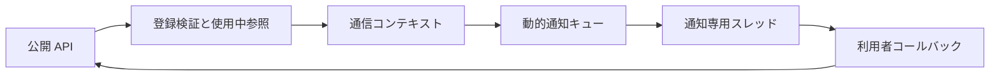
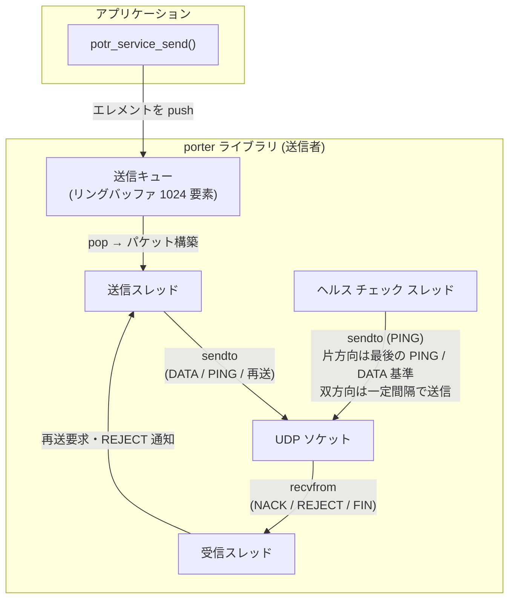
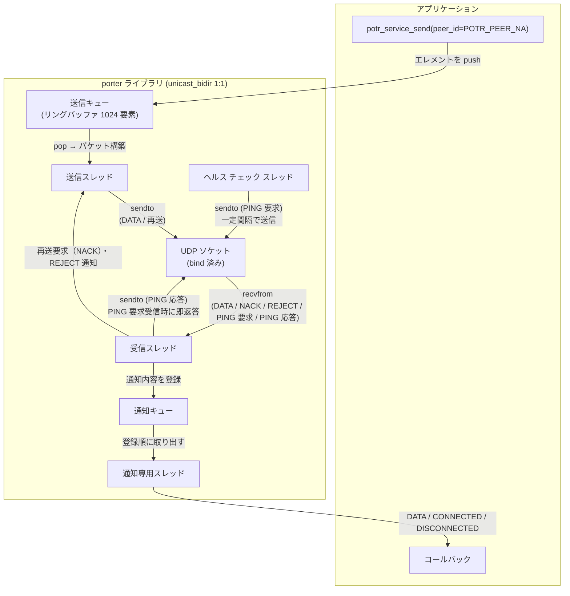
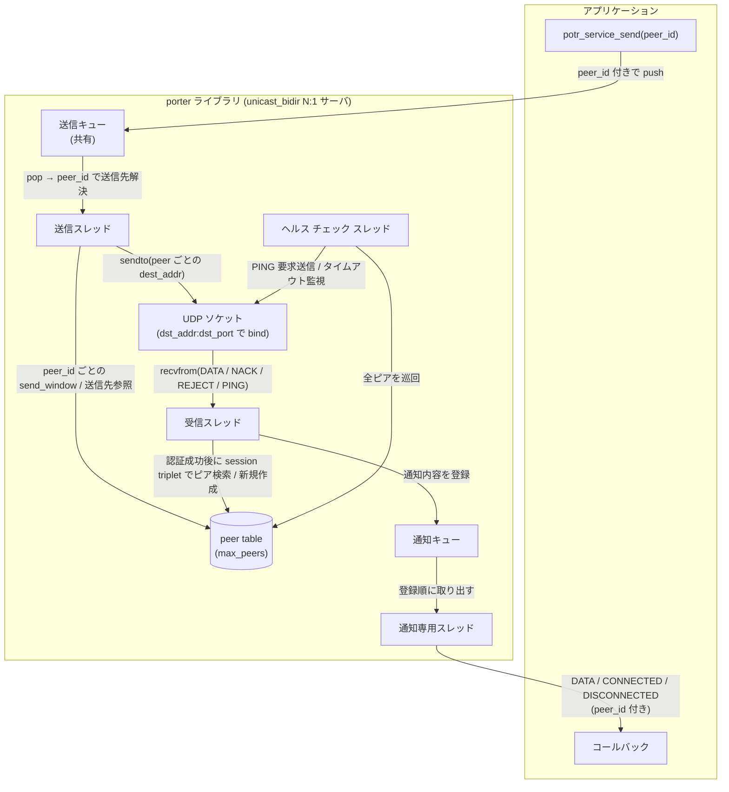
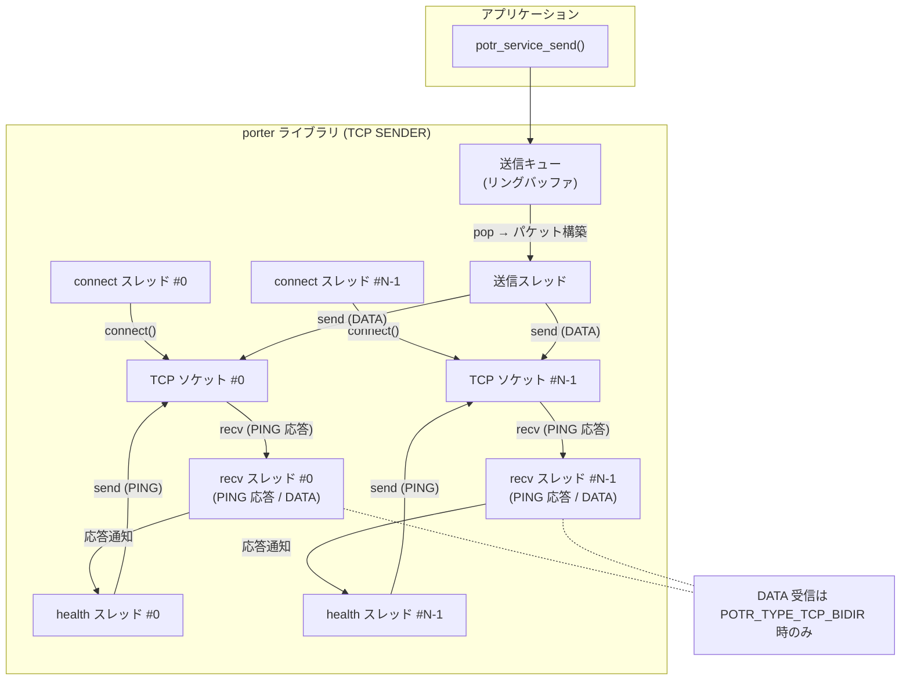
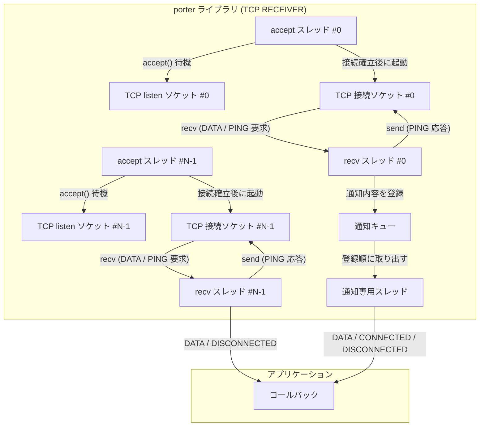
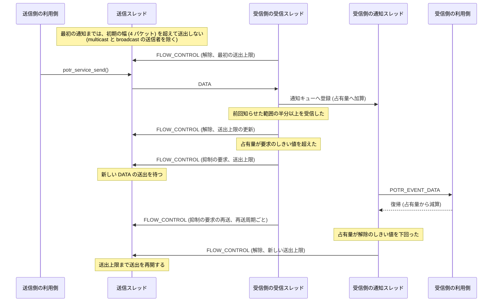
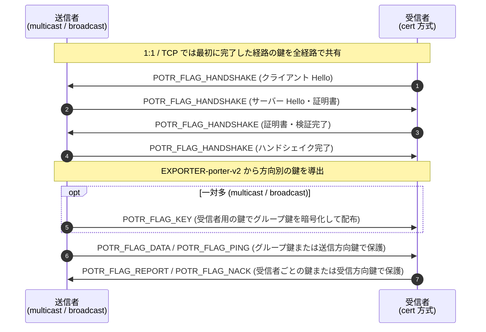

# アーキテクチャー設計

## 概要

porter は、アプリケーションと UDP ソケット層の間に抽象レイヤーを置き、非同期送受信・再送制御・ヘルス チェックを透過的に提供します。  
アプリケーションは `potr_service_open()` または `potr_service_open_from_config()` でサービスを開き、送信側は `potr_service_send(handle, peer_id, ...)` を呼び出すだけで、内部スレッドが送受信・再送・ヘルス チェックをすべて担います。1:1 モードおよび他通信種別では `peer_id` に `POTR_PEER_NA` を指定し、`unicast_bidir` の N:1 モードでは接続中ピアの `peer_id` を指定します。

## ハンドルの寿命と通知の実行

公開ハンドルは、通信コンテキストから分離した軽量な制御情報を指します。  
登録表で検証し、ハンドル単位の受付状態と使用中参照を保護してから通信コンテキストへ到達します。  
登録表の保護は検索と登録に限定し、API 本体や送信待ちの間は保持しません。  
終了済みの制御情報はライブラリ存続中保持し、アドレス再利用による古いハンドルの誤認を防ぎます。

通知先を持つハンドルでは専用通知スレッドを起動します。  
受信・ヘルス チェック・ピア切断の処理は、状態と通知内容を確定してから動的通知キューへ登録します。  
通知スレッドは内部状態のロックを保持せずに利用者のコールバックを実行するため、コールバック内のブロッキング送信中も I/O が進行します。  
通知ノードを再利用し、DATA と PATH 状態はコールバック復帰まで有効な領域に保持します。  
フロー制御が有効な場合 (容量を設定した場合)、通知スレッドは DATA のコールバックからの復帰の直後に占有量を減算し、解除のしきい値を下回ったときは、その場でフロー制御パケット (解除と新しい送出上限) を送出します。容量を設定していない受信側は、占有量を数えず、通知スレッドはフロー制御パケットを送出しません。

正常 close は受付を停止し、受付済み API と送信の完了を待って通信スレッドを停止します。  
通知生成元がなくなった後にキューを確定し、登録済み通知の完了と通知スレッドの終了を待って資源を回収します。

通知領域の確保失敗時は永続する異常理由を設定し、送信キューの空き待ちとチケット待ちを失敗で解除します。  
open 時に予約した異常通知ノードを先行通知の末尾に登録し、追加確保なしで原因を一度通知します。  
close の状態と異常理由は分けて管理し、close 中の失敗も同じ回収手順へ合流させます。



Figure: ハンドルの寿命と非同期通知の実行関係

## 役割モデル

porter は通信の参加者を **送信者 (SENDER)** と **受信者 (RECEIVER)** に区別します。

Table: porter 通信参加者の役割定義

| 役割 | 説明 |
|---|---|
| SENDER | `potr_service_send()` でデータを送出します。ヘルス チェック PING を送信します。 |
| RECEIVER | 到着したパケットをコールバックで上位層へ渡します。NACK で再送を要求します。 |

1:1 (ユニキャスト) 通信では送信者 1 : 受信者 1 の構成となります。  
1:N (マルチキャスト・ブロードキャスト) 通信では送信者 1 : 受信者 N の構成となります。

### unicast_bidir における役割の解釈

`POTR_TYPE_UNICAST_BIDIR` には **1:1 モード** と **N:1 モード** があります。

- 1:1 モードでは、両端が送受信・NACK・ヘルス チェックを独立して行います。`POTR_ROLE_SENDER` / `POTR_ROLE_RECEIVER` は設定上のラベルであり、データ方向そのものを制約しません
- N:1 モードでは、サーバー側は `src_addr` を省略した `POTR_ROLE_RECEIVER` として開かれ、クライアントごとの状態はピア テーブルで管理されます

Table: unicast_bidir のモード別 Role の意味

| モード | Role / 設定の意味 |
|---|---|
| 1:1 | `POTR_ROLE_SENDER` は `src_addr:src_port` で bind し、`dst_addr:dst_port` へ送信する側。`POTR_ROLE_RECEIVER` は `dst_addr:dst_port` で bind し、必要に応じて送信元を学習して返信する側 |
| N:1 | サーバーは `POTR_ROLE_RECEIVER` として `dst_addr:dst_port` で待ち受けます。各クライアントは従来どおり `src_addr` を持つ `unicast_bidir` エンドポイントとして接続します。 |

> UDP は無接続であるため、1:1 モードではどちらの端が先に `potr_service_open_from_config()` / `potr_service_open()` を呼び出しても動作に違いはありません。N:1 モードではサーバーが受信ソケットを先に開いて待ち受ける運用が自然です。

### TCP 通信種別における役割の解釈

`POTR_TYPE_TCP` / `POTR_TYPE_TCP_BIDIR` では Role は **TCP 接続方向のみ** を意味します。

Table: TCP 通信種別における Role の役割とデータ送受信

| Role | TCP の役割 | データ送受信 |
|---|---|---|
| `POTR_ROLE_SENDER` | TCP クライアント (`connect()`) | tcp: 送信のみ / tcp_bidir: 送受信 |
| `POTR_ROLE_RECEIVER` | TCP サーバー (`listen()` → `accept()`) | tcp: 受信のみ / tcp_bidir: 送受信 |

UDP は無接続のため先に開いた方が待機するだけですが、TCP では RECEIVER が先に `potr_service_open_from_config()` / `potr_service_open()` を呼び出して `listen()` に入っている必要があります。

## スレッド構成

### 送信者のスレッド



Figure: 送信者のスレッド構成

Table: 送信者 (SENDER) のスレッド構成と役割

| スレッド | 役割 |
|---|---|
| 送信スレッド | 送信キューからエレメントを取り出し、DATA パケットを構築して全パスへ sendto します。 |
| 受信スレッド | NACK / REJECT / FIN / FIN_ACK などの制御パケットを処理し、再送・close 完了通知・DISCONNECTED 発火を行います。 |
| ヘルス チェック スレッド | 非 TCP は 1 サービス 1 本。片方向 type 1-6 は最後の PING / 有効 DATA 送信時刻を監視して期限到達時だけ PING を送信し、双方向系は一定間隔で PING を送信します。 |

### 受信者のスレッド

受信者が起動するスレッドは **受信スレッド 1 本のみ** です。  
ただし `POTR_TYPE_UNICAST_BIDIR` の RECEIVER は、SENDER と同等のスレッド構成 (送信スレッド・ヘルス チェック スレッドを含む 3 本) を起動します (後述「unicast_bidir のスレッド構成」参照)。

受信スレッドが担う処理:

- DATA パケットの受信・受信ウィンドウへの格納・フラグメント結合・通知キューへの登録
- 欠番検出と NACK 送出 (reorder_timeout_ms > 0 の場合は待機後に送出)
- RAW モードのギャップ検出による `POTR_EVENT_DISCONNECTED` 発火 (reorder_timeout_ms > 0 の場合は待機後に発火)
- FIN / REJECT パケット受信による `POTR_EVENT_DISCONNECTED` 発火
- ヘルス チェック タイムアウト監視による `POTR_EVENT_DISCONNECTED` 発火
- リオーダー バッファー タイムアウト監視 (reorder_timeout_ms > 0 の場合): 欠番待機中に期限超過したら NACK 送出または DISCONNECTED 発火

### unicast_bidir のスレッド構成

#### 1:1 モード

`POTR_TYPE_UNICAST_BIDIR` の 1:1 モードでは、両端が対称な 3 スレッド構成を持ちます。



Figure: unicast_bidir 1:1 のスレッド構成

#### N:1 サーバー モード

N:1 モードではサーバー側に 1 つの共有スレッド群があり、各ピアの状態は `peer_id` ごとにピア テーブルへ分離して保持されます。



Figure: unicast_bidir N:1 サーバーのスレッド構成

Table: N:1 サーバー モードのスレッド構成と役割

| スレッド | 役割 |
|---|---|
| 送信スレッド | 共有送信キューから `peer_id` 付きエレメントを取り出し、対応するピアの送信先へ `sendto` します。`POTR_PEER_ALL` は `potr_service_send()` 呼び出し時点で全ピア分に展開されます。 |
| 受信スレッド | `recvfrom` 後に暗号化必須判定と GCM 認証を行い、成功したパケットだけを session triplet (`session_id` + `session_tv_sec` + `session_tv_nsec`) でピア特定します。未知セッションは DATA / PING のみ新規ピア作成対象とします。 |
| ヘルス チェック スレッド | 非 TCP の共有 1 本が接続中の各ピアを巡回し、`health_interval_ms` に従って PING を送信し、`health_timeout_ms` 超過で個別に切断を検知します。双方向 UDP ではこの定周期 PING が接続確立の前提であり、実効 `health_interval_ms = 0` のままでは `CONNECTED` しません。 |

### TCP / TCP_BIDIR のスレッド構成

TCP では接続確立・再接続を担う **connect スレッド** (RECEIVER 側では **accept スレッド**) が追加されます。  
接続確立後に send / recv / health スレッドを起動し、切断後は停止する「接続ライフサイクル管理」を担います。

#### TCP SENDER のスレッド

path 数 N (最大 `POTR_MAX_PATH = 8`) の例。各 path に独立した connect・recv・health スレッドが起動します。  
送信スレッドは 1 本だけ起動し、全アクティブ path への送信を担います。



Figure: TCP SENDER のスレッド構成 (path 数 = N の例)

Table: TCP SENDER のスレッド構成と役割

| スレッド | 数 | 役割 |
|---|---|---|
| connect スレッド | N | path ごとに起動。`connect()` で接続を確立し、成功したら recv / health スレッドを起動します。切断後は `reconnect_interval_ms` 待機して再試行します。 |
| 送信スレッド | 1 | 全 path 共有。送信キューからエレメントを取り出し、全アクティブ path にループ送信します。各 path の送信前に `potr_internal_tcp_check_writable()` (`cplat_socket_watch_wait_writable()` の無待機確認) で書き込み可能を確認し、バッファー満杯の path は、他 path へ書き込めた場合に限り今回のパケット列を飛ばします (どの path にも書き込めない場合は、空きを待って書き込みます)。キューにある複数の DATA パケットは、path ごとに連結して 1 回の送信で書き込みます ([プロトコル](protocol.md) のパッキングの動作を参照)。 |
| recv スレッド | N | path ごとに起動。PING 応答 (`ack_num > 0`) を受信して対応する health スレッドに通知します。TCP 接続断を検知したら `tcp_active_paths` をデクリメントし、0 になった時点で `POTR_EVENT_DISCONNECTED` を発火します。 |
| health スレッド | N | path ごとに起動。`tcp_health_interval_ms` 周期で PING 要求を送信します。`tcp_health_timeout_ms` 以内に応答を受信しなければその path の接続断と判定して対象世代へ閉じる要求 (`potr_internal_tcp_conn_request_close()`) を発行します。 |

**スレッド数の合計** (SENDER、path 数 N のとき):

Table: TCP SENDER のスレッド種別と合計数

| スレッド種別 | 数 |
|---|---|
| connect スレッド | N |
| 送信スレッド | 1 (全 path 共有) |
| recv スレッド | N |
| health スレッド | N |
| **合計** | **3N + 1** |

#### TCP RECEIVER のスレッド



Figure: TCP RECEIVER のスレッド構成 (path 数 = N の例)

Table: TCP RECEIVER のスレッド構成と役割

| スレッド | 数 | 役割 |
|---|---|---|
| accept スレッド | N | path ごとに起動。`listen()` ソケットで `accept()` を待機し、接続確立後に recv スレッドを起動します。 |
| recv スレッド | N | path ごとに起動。ヘッダー読み取り → ペイロード読み取りの 2 ステップで受信します。`recv_window_mutex` で保護しながら `potr_internal_window_recv_push()` で重複排除します。`ack_num=0` の PING 要求に即応答し、`tcp_health_timeout_ms` 以内に PING 要求を受信しない場合は接続断と判定します。 |

#### TCP_BIDIR のスレッド構成

両端が対称なスレッド構成 (connect スレッド × N + 送信 + 受信 × N + ヘルス チェック × N) を持ちます。

Table: TCP および TCP_BIDIR のスレッド構成比較

| 通信種別 | Role | connect スレッド | 送信スレッド | recv スレッド | health スレッド |
|---|---|---|---|---|---|
| TCP | SENDER | N 本 (connect/再接続) | 1 本 (接続後起動) | N 本 (接続後起動) | N 本 (接続後起動) |
| TCP | RECEIVER | N 本 (accept ループ) | × | N 本 (接続後起動) | × |
| TCP_BIDIR | SENDER | N 本 (connect/再接続) | 1 本 (接続後起動) | N 本 (接続後起動) | N 本 (接続後起動) |
| TCP_BIDIR | RECEIVER | N 本 (accept ループ) | 1 本 (接続後起動) | N 本 (接続後起動) | N 本 (接続後起動) |

#### TCP 接続管理

**CONNECTED / DISCONNECTED イベントの発火条件**

アクティブ path 数 (`tcp_active_paths`) をカウンターで管理します。  
カウンターの更新は `tcp_state_mutex` で保護します。

Table: TCP 接続イベントの発火条件

| イベント | 発火条件 |
|---|---|
| `POTR_EVENT_CONNECTED` | アクティブ path 数が 0 → 1 になった時 (最初の 1 本が接続した瞬間) |
| `POTR_EVENT_DISCONNECTED` | アクティブ path 数が 1 → 0 になった時 (全 path が切断された瞬間) |

2 本目以降の接続確立・切断では上記イベントは発火しません。

**部分切断時のセッション継続**

残存する path が存在する間は `session_id` / `session_tv_*` を保持し続けます。  
再接続した path は既存セッションに合流するため、`POTR_EVENT_CONNECTED` は再発火しません。  
全 path が切断した時点で `session_tv_*` をリセットし、次回の接続は新セッションとして扱います (`POTR_EVENT_CONNECTED` が再発火します)。

RECEIVER 側は、接続時の session triplet(`session_id + session_tv_sec + session_tv_nsec`) が既知のセッションと一致した場合にセッション初期化をスキップして既存コンテキストに合流します。

**送信スレッドのバッファー満杯対策**

単一の送信スレッドが、`tcp_write_all_paths()` から全 path に逐次 `tcp_write_path()` を呼び出すため、特定 path の TCP 送信バッファーが満杯になると他 path への送信も遅延します。  
これを避けるため、各 path への書き込みの前に `potr_internal_tcp_check_writable()` (`cplat_socket_watch_wait_writable()` の無待機確認) で書き込み可能かを確認し、書き込み不可の path は、他 path へ書き込めた場合に限り今回のパケット列を飛ばします (他 path への冗長送信で補完)。どの path にも書き込めない場合は、空きを待って書き込みます。  
path を飛ばし、かつその path の警告を抑制していないときに WARNING ログを 1 回出力し、その path を書き込み可能と判定した回数の累計が `POTR_TCP_BUF_FULL_SUPPRESS_COUNT` (10) に達するまで、同じ path の警告を抑制します (`buf_full_suppress_cnt[POTR_MAX_PATH]`)。書き込み不可の判定は数えません。

## コンポーネント構成

サービスの開始処理は、資源の所有と起動順序を管理する部分と、通信経路を準備する部分に分けています。  
受信処理は、パケットを受け入れる条件の検証を分離し、セッションや受信ウィンドウを更新する前に呼び出します。  
セッション採用と FIN 制御は受信状態の更新として集約します。  
再送と順序整列は受信状態ビュー経由で 1:1 と N:1 が共有します。  
構成済みスロットへのパケット振り分けも共有し、受信ループはソケット I/O とピア解決を担当し、タイムアウト時と TCP の受信状態変化時に監視処理を呼びます。

Table: porter コンポーネントの責務と境界条件一覧

| 実装 | 責務 | 境界で守る条件 |
|---|---|---|
| `api/potr_service_open.c` | 設定検証、コンテキストの確保、スレッド起動、失敗時の資源解放 | 起動完了後にハンドルを呼び出し元へ返却 |
| `api/api_open_paths.c` | 通信方式の選択、送信先設定 | 方式別の準備結果を呼び出し側へ伝達 |
| `api/api_open_paths_udp.c` | UDP 各方式のソケットと経路の準備 | 登録済みソケットは途中失敗時もコンテキストが所有 |
| `api/api_open_paths_tcp.c` | TCP の listen 準備と送信側アドレスの解決 | 送信側の接続ソケットは接続管理が生成 |
| `api/api_open_paths_common.c` | IPv4 の解決・解析と結果コードの変換 | 方式間で同じエラー分類を使用 |
| `thread/potr_connect_thread.c` | TCP 接続・再接続の管理、接続の登録、通知、接続後スレッド管理 | 受信側はセッション確立ロック、受信ロックの順で取得 |
| `thread/thread_connect_prepare.c` | 接続待機、接続元照合、先読み、セッション比較 | 新規接続ソケットは成功時に所有権を返し、比較は共有状態を更新しない |
| `thread/potr_recv_thread.c` | ソケット受信、ピア解決、監視処理の呼び出し | 認証成功後に受信状態を更新する |
| `thread/thread_recv_health.c` | N:1・1:1 の受信期限監視、TCP の PING 起床判断 | 既存の受信スレッドから呼び、N:1 の health 起床はピアのロック解放後に行う |
| `thread/thread_recv_validate.c` | 暗号化要件、GCM 認証、UDP 送信元の照合 | 認証失敗は `POTR_ERR_PROTOCOL`、送信元照合は採用可否を返す |
| `thread/thread_recv_slot.c` | 1:1／N:1 の受信状態参照、フラグメント結合、展開、DATA 配信 | 順序整列済みのエレメントを受け取り、データの所有権は移動しない |
| `thread/thread_recv_session.c` | セッション triplet の採用判定、経路切断、PING 受信状態の更新、送信元学習 | 旧セッションでは受信状態を変更しない |
| `thread/thread_recv_fin.c` | pending FIN の判定、`FIN_ACK` 送受信、FIN による切断 | 判定と発火を分離し、`recv_window_mutex` 保持中は発火しない |
| `thread/thread_recv_window.c` | ウィンドウ投入、NACK 再送要求、REJECT、リオーダー | ループへ個別の状態操作を公開せず、再送と順序整列を入口関数へ集約する |
| `thread/thread_recv_dispatch.c` | 構成済みスロットへの FIN / REJECT / DATA / PING 振り分け | ピア検索と mutex は呼び出し側が担当する |

表のパスは `prod/libsrc/porter/` を起点とします。  
分割した関数の契約は同じディレクトリの私有ヘッダーへ記載し、公開 API やライブラリ内共有 API には追加しません。

```mermaid
flowchart TD
    subgraph api["api"]
        potr_service_open["potr_service_open"]
        api_open_paths["api_open_paths"]
        api_open_paths_udp["api_open_paths_udp"]
        api_open_paths_tcp["api_open_paths_tcp"]
        api_open_paths_common["api_open_paths_common"]
        potr_service_open_from_config["potr_service_open_from_config"]
        potr_service_send["potr_service_send"]
        potr_service_close["potr_service_close"]
    end

    subgraph thread["thread"]
        potr_recv_thread["potr_recv_thread"]
        thread_recv_validate["thread_recv_validate"]
        thread_recv_slot["thread_recv_slot"]
        thread_recv_session["thread_recv_session"]
        thread_recv_fin["thread_recv_fin"]
        thread_recv_window["thread_recv_window"]
        thread_recv_dispatch["thread_recv_dispatch"]
        thread_recv_health["thread_recv_health"]
        potr_send_thread["potr_send_thread"]
        potr_health_thread["potr_health_thread"]
        potr_connect_thread["potr_connect_thread"]
        thread_connect_prepare["thread_connect_prepare"]
    end

    subgraph protocol["protocol"]
        packet["packet<br>(パケット構築・解析)"]
        window["window<br>(スライディングウィンドウ)"]
        seqnum["seqnum<br>(通番管理)"]
        config["config<br>(設定ファイル解析)"]
    end

    subgraph infra["infra"]
        potr_send_queue["potr_send_queue<br>(リングバッファ)"]
        potr_trace["potr_trace<br>(トレーサー取得)"]
    end

    subgraph cplat["cplat"]
        net["net<br>(socket・endpoint・byteorder)"]
        subgraph compress["compress"]
            compress_mod["compress<br>(raw DEFLATE)"]
        end
        subgraph crypto["crypto"]
            crypto_mod["crypto<br>(AES-256-GCM)"]
        end
    end

    CTX[("potr_context<br>(セッション全状態)")]

    potr_service_open -->|"生成・初期化"| CTX
    potr_service_open -->|"経路準備"| api_open_paths
    api_open_paths -->|"UDP 方式別準備"| api_open_paths_udp
    api_open_paths -->|"TCP 準備"| api_open_paths_tcp
    api_open_paths -->|"宛先解析"| api_open_paths_common
    api_open_paths_udp --> api_open_paths_common
    api_open_paths_tcp --> api_open_paths_common
    api_open_paths_udp --> net
    api_open_paths_tcp --> net
    api_open_paths_common --> net
    potr_service_open_from_config -->|"委譲"| potr_service_open
    potr_service_send -->|"エレメント push"| potr_send_queue
    potr_service_close -->|"スレッド停止・解放"| CTX

    potr_send_thread --> packet
    potr_send_thread --> window
    potr_send_thread --> compress_mod
    potr_send_thread --> crypto_mod
    potr_send_thread --> potr_send_queue
    potr_send_thread -->|"送信"| net

    potr_connect_thread -->|"接続・先読み・比較"| thread_connect_prepare
    potr_connect_thread -->|"先読みパケットの解析"| packet
    thread_connect_prepare --> net
    potr_recv_thread --> packet
    potr_recv_thread -->|"受信状態参照・DATA 配信"| thread_recv_slot
    thread_recv_slot --> compress_mod
    potr_recv_thread -->|"認証・送信元照合"| thread_recv_validate
    potr_recv_thread -->|"セッション採用・経路切断"| thread_recv_session
    potr_recv_thread -->|"構成済みスロットへ振り分け"| thread_recv_dispatch
    thread_recv_dispatch -->|"FIN 判定・切断発火"| thread_recv_fin
    thread_recv_dispatch -->|"再送・順序整列"| thread_recv_window
    thread_recv_dispatch -->|"セッション採用・経路学習"| thread_recv_session
    potr_recv_thread -->|"TCP の FIN 判定・切断発火"| thread_recv_fin
    potr_recv_thread -->|"リオーダー期限切れ"| thread_recv_window
    potr_recv_thread -->|"受信期限・TCP 状態変化"| thread_recv_health
    thread_recv_health -->|"切断・パス状態同期"| thread_recv_session
    thread_recv_health -->|"切断時の初期化"| window
    thread_recv_window --> window
    thread_recv_window --> seqnum
    thread_recv_window --> packet
    thread_recv_window -->|"制御パケットの認証タグ生成"| crypto_mod
    thread_recv_window -->|"整列済みデータの配信"| thread_recv_slot
    thread_recv_window -->|"経路学習・経路状態同期"| thread_recv_session
    thread_recv_window -->|"pending FIN 到達"| thread_recv_fin
    thread_recv_fin -->|"経路切断"| thread_recv_session
    thread_recv_validate --> crypto_mod
    potr_recv_thread -->|"受信"| net
    thread_recv_window -->|"NACK / REJECT / 再送"| net
```



Figure: porter コンポーネント構成

## セッション コンテキスト (potr_context)

porter の全状態は `potr_context` 構造体 (`potr_context *` の実体) に集約されます。  
この構造体はアプリケーションには不透明 (opaque) であり、内部実装のみがアクセスします。

Table: potr_context が保持する情報カテゴリ

| カテゴリ | 保持する情報 |
|---|---|
| 設定 | サービス定義 (通信種別・アドレス・ポート・暗号化鍵)、グローバル設定 (ウィンドウ サイズ・ヘルス チェック間隔) |
| ソケット | 最大 4 パス分の UDP ソケット (`cplat_socket` 型) |
| スレッド | 受信・送信・ヘルス チェック スレッド ハンドル |
| ウィンドウ | 送信ウィンドウ・受信ウィンドウ (各パケットのコピーを保持) |
| 送信キュー | ペイロード エレメントのリング バッファー (1024 要素) |
| セッション状態 | 自セッション ID / 相手セッション ID・開始時刻 |
| 接続状態 | `health_alive` (1: 疎通中、0: 未接続または切断) |
| ヘルス チェック | 最終送信時刻・最終受信時刻 (パス別) |
| フラグメント バッファー | フラグメント結合用バッファー (最大 65,535 バイト) |
| 圧縮バッファー | 圧縮・展開作業バッファー (約 65 KB) |
| 暗号バッファー | 暗号化・復号作業バッファー (max_payload + 16 バイト) |
| NACK 重複抑制 | 直近 NACK のリング バッファー (16 要素) |
| リオーダー状態 | `reorder_pending` フラグ・待機通番・タイムアウト期限 (`reorder_timeout_ms > 0` のときのみ使用) |

> **TCP 通信種別について**: `POTR_TYPE_TCP` / `POTR_TYPE_TCP_BIDIR` では以下の追加フィールドを保持します。
>
> | フィールド | 説明 |
> |---|---|
> | `tcp_listen_sock[POTR_MAX_PATH]` | RECEIVER の listen ソケット (path ごと) |
> | `tcp_conn_fd[POTR_MAX_PATH]` | アクティブ接続ソケット (path ごと) |
> | `tcp_active_paths` | アクティブ TCP path 数 (0 = 全切断) |
> | `tcp_send_mutex[POTR_MAX_PATH]` | TCP `send()` の排他制御 (path ごと。送信スレッド・health スレッド・recv スレッドの競合防止) |
> | `recv_window_mutex` | recv_window 保護 (複数 recv スレッドが同一 recv_window に並行アクセスするための排他制御) |
> | `connect_thread[POTR_MAX_PATH]` | connect / accept スレッド ハンドル (path ごと) |
> | `health_mutex[POTR_MAX_PATH]` / `health_wakeup[POTR_MAX_PATH]` | health スレッドのスリープ制御 (path ごと) |
> | `tcp_state_mutex` / `tcp_state_cv` | `tcp_active_paths` カウンター保護・connect スレッドへの切断通知用 |
> | `tcp_last_ping_recv_ms[POTR_MAX_PATH]` | PING 応答最終受信時刻 (ms, monotonic。path ごと。SENDER health スレッドが監視) |
> | `buf_full_suppress_cnt[POTR_MAX_PATH]` | 送信バッファー満杯 WARNING ログの抑制カウンター (path ごと) |

> **unicast_bidir について**: 1:1 モードの `POTR_ROLE_RECEIVER` は送信ウィンドウ・送信キュー・送信スレッド・ヘルス チェック スレッドも保持します。N:1 モードではさらに `is_multi_peer`、`peers`、`max_peers`、`peers_mutex` などの共有管理情報を持ち、各ピアの詳細状態は `potr_internal_peer_context` に分離されます。

### 非ブロッキング通信・世代所有・解除オブジェクト

`libporter` が管理するすべてのソケットは、通信開始前に `cplat_socket_watch_attach()` で登録して非ブロッキングのまま運用し、ブロッキングへ戻しません。

- **UDP**: `udp_watch[i]` とサービス共通の解除オブジェクト `recv_cancel` を使用し、送信は `udp_send_mutex[i]` の下で `potr_internal_udp_sendto()` (100 [ms] 絶対期限、延長なし、短い送信は `POTR_ERR_IO`) に統一します。
- **TCP 接続世代**: 接続管理スレッドが経路 `i` の接続世代 (`tcp_conn_generation[i]`, `tcp_conn_watch[i]`, `tcp_conn_cancel[i]`) を所有します。停止要求は `potr_internal_tcp_conn_request_close()` により `tcp_lifecycle_mutex[i]` の下で閉じる状態を設定して `tcp_conn_cancel[i]` へ通知します (送信用ロック `tcp_send_mutex[i]` は取得しません)。解放 (`potr_internal_tcp_conn_release()`) は受信・ヘルス チェック終了後に `tcp_send_mutex[i]` -> `tcp_lifecycle_mutex[i]` の順で取得し、公開解除後に `watch_detach` -> `socket_close` -> `cancel_dispose` の順で行います。
- **解除通知と Windows 構成**: 有効な解除オブジェクトへの `cplat_socket_wait_cancel_signal()` は常に `CPLAT_OK` を返し、OS の起床通知が失敗しても待機側の最大 50 [ms] ごとの内部確認で解除を検出します。Windows の `cplat_socket_watch` は登録ごとに 3 つの手動リセット イベントとロックを用い、内部スレッドを生成しません。
- **送信待機と時刻記録**: `cplat_socket_watch_wait_writable()` が `CPLAT_OK` を返しても切断やエラーの場合があるため送信成功とせず、必ず再送信の結果で判定します。部分入出力時は処理済みバイト数を反映し、TCP の途中送信失敗後は対象世代へ閉じる要求を発行します。`last_ping_send_ms` と `last_valid_data_send_ms` は送信成功時のみ更新し、`flow_last_data_send_ms` (1:1 / N:1) は送出試行時刻として全経路失敗時も更新します (時計取得失敗時は前回値保持)。

## クロスプラットフォーム抽象化

ソケットに関するプラットフォーム差異は `cplat` の `net` カテゴリが吸収します。  
porter はソケット型・無効値・初期化・クローズのいずれについても Linux / Windows の違いを意識しません。

> [!NOTE]
> 移行前は `potr_context.h` が `PotrSocket` 型や `POTR_INVALID_SOCKET`、`WSAStartup()` / `close()` と `closesocket()` の違いを porter 側で吸収していましたが、通信を cplat の `net` カテゴリへ移行したことで、これらは porter の関心事から外れました。
> 詳細は [cplat のネットワーク (net) 機能仕様](../../cplat/docs/functional-spec/net.md) を参照してください。

`potr_context.h` は、ソケット以外の残るプラットフォーム差異を引き続き抽象化します。

Table: プラットフォーム抽象化の型と定義

| 機能 | Linux | Windows |
|---|---|---|
| スレッド型 | `cplat_thread *` | `cplat_thread *` |
| ミューテックス型 | `cplat_local_lock *` | `cplat_local_lock *` |
| 条件変数型 | `cplat_condvar *` | `cplat_condvar *` |
| 単調時間 (ヘルス チェック用) | cplat 経由 `clock_gettime(CLOCK_MONOTONIC, ...)` | cplat 経由 `QueryPerformanceCounter()` |
| カレンダー時刻 (セッション ID 用) | cplat 経由 `clock_gettime(CLOCK_REALTIME, ...)` | cplat 経由 `GetSystemTimeAsFileTime()` |
| 呼び出し規約 (`POTRAPI`) | (なし) | `__stdcall` |
| 暗号化 (`crypto` モジュール) | OpenSSL EVP AES-256-GCM | Windows CNG (BCrypt) AES-256-GCM |

## データフロー概要

### 送信フロー

```
アプリ
 | potr_service_send(peer_id, data, len, flags)
 ▼
[圧縮] --- flags に POTR_SEND_COMPRESS が指定された場合、メッセージ全体を raw DEFLATE 圧縮
 |
[フラグメント化] --- データが max_payload を超える場合に分割
 |                    各フラグメントにエレメントヘッダー (6 バイト) を付与
 |
[送信キュー push] --- ペイロード エレメントとしてキューへ格納
 |                    1 メッセージ分の断片は登録用ロックの下で連続して格納 (並行送信で交互に並ばない)
 |                    各エレメントに登録順の番号 (チケット) を付与
 |                    POTR_SEND_BLOCKING なし: 全断片分の空きがなければ 1 つも格納せず POTR_ERR_FULL
 |                    POTR_SEND_BLOCKING あり: 空きを待って格納 → 最後の断片の番号まで完了待ち
 ▼
[送信スレッド] --- キューから pop
 |               相手が「止める状態」(抑制を要求している、または送出上限に達している) の間は、
 |               新しい DATA の送出を待つ (フロー制御)
 |               複数エレメントを 1 パケットにパッキング
 |               seq_num 付与・送信ウィンドウに登録
 |               送出経路ごとに tx_counter 採番・送信時刻を取得
 |               暗号化有効時: AES-256-GCM 暗号化 (nonce = session_id + tx_counter)
 ▼
[UDP sendto] --- 選択中グループのパスへ送信 (最大 8 経路、切り戻し中は 2 グループ)
```

### 受信フロー

```
[UDP recvfrom] --- 各パスのソケットから受信
 |
[検証] --- service_id 照合 → 不一致は破棄
 |         送信元 IP フィルタ → 不一致は破棄
 |         暗号化有効時は POTR_FLAG_ENCRYPTED 必須 (未認証状態では HANDSHAKE 以外を破棄)
 |         AES-256-GCM 復号・認証タグ検証 (AAD = 72 バイト ヘッダー全体)
 |         (平文・認証失敗パケットは即座に破棄)
 |         リプレイ対策: 送信元セッションごとの直近 256 個の tx_counter を照合 (既出・範囲外は破棄)
 |         セッション識別 → 旧セッションは破棄、新セッションはウィンドウリセット
 |
[種別振り分け]
 +- DATA      --→ 受信ウィンドウへ格納
 |                 【通常モード】欠番検出 → NACK 送出 → 再送待機
 |                               (reorder_timeout_ms > 0 の場合: 待機タイマー開始 → 期限後に NACK)
 |                 【RAW モード】欠番検出 → DISCONNECTED 発火 → ウィンドウリセット
 |                               (reorder_timeout_ms > 0 の場合: 待機タイマー開始 → 期限後に DISCONNECTED)
 |                 ↓ 連続した通番が揃った段階で順番に取り出し
 |                フラグメント結合・展開
 |                取り出した DATA パケットごとに、送出上限の更新と送り終えた相手への通知を判定 (フロー制御)
 |                  (容量または OS の受信バッファーによる許可数の小さいほう。multicast / broadcast は監視対象の間だけ)
 |                 ↓
 |                通知キューの占有量へ加算 (フロー制御が有効な場合)
 |                  要求のしきい値を超えたら抑制の要求を送出 / 容量を超えるなら破棄して DISCONNECTED
 |                 ↓
 |                コールバック POTR_EVENT_DATA
 |                 ↓ 復帰
 |                占有量から減算。解除のしきい値を下回ったら解除 (新しい送出上限を載せる) を送出
 |
 +- PING      --→ 最終受信時刻を更新 (双方向は応答 PING 送出、片方向は返信なし)
 |                 【通常モード】seq_num を上限に欠番を一括 NACK
 |                               (reorder_timeout_ms > 0 の場合: 各欠番にタイマー確認を適用)
 |                 【RAW モード】seq_num > next_seq の場合 DISCONNECTED 発火 → ウィンドウリセット
 |                               (reorder_timeout_ms > 0 の場合: 待機タイマー開始 → 期限後に DISCONNECTED)
 |
 +- REPORT    --→ 片方向・一対多の送信者が受信者ごとの経路状態を更新 (優先グループ判定に使用)
 |                 multicast / broadcast の送信者は、載っている送出上限から受信者の余裕を記録し、監視対象を選び直す
 |
 +- FLOW_CONTROL --→ 送信側は、抑制の要求と解除のときだけ送出上限を上書きする
 |                 (抑制の要求の期限を更新し、解除なら取り消して、送信スレッドへ通知する)
 |                 問い合わせ (状態 4) と監視対象の一覧 (状態 3) は送出上限を運ばない
 |                 上限なし (状態 5) を受けた送信側は、その相手に送出上限がないものとして扱う
 |                 (multicast / broadcast の送信者は、監視対象の受信者の送出上限だけを保持)
 |                 multicast / broadcast の受信者は、監視対象の一覧 (状態 3) を受理する
 |                 自身を含む一覧を受けるたびに、その時点の送出上限を 1 回返す
 |                 問い合わせ (状態 4) を受けた受信側は、その時点の状態と送出上限を 1 回返す
 |
 +- HANDSHAKE --→ 証明書方式の OpenSSL メモリ BIO へ投入し、応答があれば全経路へ送出
 |
 +- KEY       --→ 一対多の証明書方式で受信者がグループ鍵を復号して適用
 |
 +- FIN       --→ 必要なら pending_fin
 |                target 到達後に POTR_EVENT_DISCONNECTED 発火 (TCP は FIN_ACK 返送)
 |
 +- NACK      --→ 送信ウィンドウから該当パケットを検索
 |                 存在すれば選択中グループの経路へ再送 / 存在しなければ REJECT 送出
 |
 +- REJECT    --→ POTR_EVENT_DISCONNECTED 発火 (受信者側)
```

## フロー制御

受信側の通知キューの占有量に基づいて、送信側が新しい DATA の送出を止めます。  
受信側は、抑制の要求と解除に加えて送出上限を知らせ、送信側は送出上限に達したら自分で止まります。  
送信側は、相手から最初の通知 (送出上限、または「上限なし」) を受けるまで、初期の幅 (4 パケット) を超える DATA を送出しません (`multicast` と `broadcast` の送信者を除きます)。  
`unicast`、`multicast`、`broadcast`、`unicast_bidir`、`unicast_bidir_n1` の受信側は、容量の設定によらず、OS の受信バッファーに収まる数 (受信バッファーの幅) で送出上限を抑えます。`multicast` と `broadcast` では、送出上限を知らせるのは、送信側が選んだ監視対象の受信者だけです。  
パケットの形式と判定の条件は [プロトコル仕様](protocol.md) の「フロー制御」、設定は [設定ファイル仕様](config.md) の「フロー制御の設定」を参照してください。



Figure: フロー制御の送出上限の通知と、抑制の要求と解除

Table: フロー制御におけるスレッドの役割

| スレッド | フロー制御での役割 |
|---|---|
| 受信側の受信スレッド | DATA の登録時に占有量へ加算します。要求のしきい値を超えたら抑制の要求を送出し、再送周期ごとに再送します。容量を超える DATA は破棄し、その相手を切断します。相手を採用した後の最初の送出上限と、順序どおりに受信した DATA パケットごとの送出上限の更新、送り終えた相手への通知を送出します。問い合わせを受けた場合は、その時点の状態と送出上限を 1 回返します。送出上限を使わない受信側は、最初に送出できる時点で「上限なし」を 1 回送り、問い合わせにも「上限なし」を返します。`multicast` と `broadcast` の受信者は、監視対象の一覧を受理し、自身を含む一覧を受けるたびに、その時点の送出上限を 1 回返します。監視対象の間だけ、送出上限の更新を送出します。受信報告に、その時点の送出上限を載せます。 |
| 受信側の通知スレッド | コールバックからの復帰時に占有量から減算します。解除のしきい値を下回ったら、その場で解除 (新しい送出上限を載せる) を送出します。 |
| 送信側の受信スレッド | 抑制の要求と解除を受理したときだけ、要求の期限と送出上限を更新し、送信スレッドへ通知します。上限なしを受けた場合は、その相手に送出上限がないものとして扱います。`multicast` と `broadcast` 以外の UDP では、相手がいない状態で相手からパケットを受けると、その通番から初期の幅に戻し、問い合わせを 1 回送出します。`multicast` と `broadcast` の送信者は、受信報告、NACK、抑制の要求から受信者の余裕を記録して監視対象を選び直し、監視対象の一覧を、監視対象が変わった時点と再送周期ごとに送出します。 |
| 送信側の送信スレッド | 相手が「止める状態」の間、送信キューから取り出した DATA の送出を待ちます。解除、期限の経過、送出上限の更新または破棄、close の開始で再開します。UDP では、送出上限または初期の幅で止まっている間、問い合わせを送出します。最初の問い合わせは止まり始めてから 10 ms 後で、以後は間隔を 2 倍にし、`flow_control_request_interval_ms` を上限とします。`multicast` と `broadcast` では、問い合わせの代わりに、同じ間隔で監視対象の一覧を送出し直します。 |

- 解除は、占有量の減算を行った通知スレッドが送出します。受信スレッドの周期処理を待つと、送信側の再開が再送周期の分だけ遅れるためです。パケットの封緘と送出は、送信スレッド、受信スレッド、ヘルス チェック スレッドも並行して行っており、送出通番はアトミックに採番します。
- 受信側は、占有量と要求の状態の遷移、およびフロー制御パケットの送出を、1 つの排他の下で一組として行います。受信スレッドの要求と通知スレッドの解除が、状態の遷移と異なる順序で送出されることを防ぐためです。N:1 モードでは、ピアの宛先を参照するため、`peers_mutex`、フロー制御の排他の順に取得します。
- 送信側は、受信スレッドが書き込んだ送出上限と受けた時刻を、送信スレッドがアトミックに読みます。受けた時刻を先に書き、送出上限を後に書くことで、送出上限を読んだ送信スレッドは対応する時刻を読めます。次に割り当てる通番は、送信ウィンドウの排他の下で読みます。
- TCP のまとめ送りは、送出上限までに送出できる数を超えて外側パケットを組み立てません。送出上限の判定はまとめ送りの前に 1 回だけ行うためです。
- OS の受信バッファーの大きさは、サービスを開くときに、受信に使う全経路のソケットから 1 回だけ取得します。`unicast_bidir_n1` のサーバーは、送出上限を計算するたびに、その時点の送信中のピアの数で受信バッファーの幅を割ります。送信中のピアは、直近の `flow_control_request_interval_ms` の間に DATA を受信したピアと、問い合わせを送ってきたピアです。
- `multicast` と `broadcast` の送信者は、監視対象の選び直しと一覧の取り出しを、受信者の管理表と同じ `callback_mutex` の下で行います。次に割り当てる通番は、`callback_mutex` を取得する前に送信ウィンドウの排他の下で読みます。2 つの排他を重ねて保持しないためです。
- 容量超過で切断した相手は、占有量が解除のしきい値を下回るまで採用しません。採用すると、次の DATA で再び容量を超え、接続と切断の通知が繰り返されるためです。
- N:1 モードの送信スレッドは、抑制中のピア宛のエントリを送信キューから取り出して保留し、ほかのピア宛を先に送出します。保留したエントリは、完了待ちの番号だけを先に進め、送信キューの容量は送出するまで占有し続けます。close は、保留がなくなるまで送信キューの排出を待ちます。
- 抑制中のピア宛の新しい送信要求は受け付けません。保留が送信キューを占有して、ほかのピア宛の送信を止めないようにするためです。

### フロー制御を使わない場合の速い経路

フロー制御を使わない構成では、フロー制御のための時刻の取得とロックの取得を、送信と受信のたびには行いません。  
相手がフロー制御パケットを 1 個も送らない場合に、フロー制御を追加する前と同じ処理量で送受信するためです。

Table: フロー制御を使わない場合に判定を省く条件

| 経路 | 判定を省く条件 | 条件の更新 |
|---|---|---|
| 受信側 | 容量が 0 で、OS の受信バッファーに基づく送出上限も使わず、フロー制御の資源を生成していない | サービスを開くときに決まり、以後は変わりません。容量が 0 の受信側は、資源を生成した場合も、占有量の加算と減算を行いません。 |
| 送信側 (片方向 UDP) | 受信者の管理表に要求か送出上限が残っている可能性がない | 受信スレッドがフロー制御パケットを受理したときに立て、送信スレッドが管理表を走査して要求と送出上限が残っていないときに下ろします。 |
| 送信側 (双方向 UDP の 1:1 と TCP) | 要求の期限と送出上限がどちらも 0 | 受信スレッドがフロー制御パケットを受けたときに書き込み、セッションの変更と相手の切断の判定で 0 へ戻します。TCP の全経路の切断では、送出上限を 0 へ戻します。 |
| 送信側 (N:1 モード) | 要求または送出上限を保持しているピアの数が 0 で、送信スレッドが保留しているエントリもない | ピアの数は `peers_mutex` の下で増減します。フロー制御パケットを受けたピアを 1 回だけ数え、要求の期限の経過、送出上限の破棄、相手の切断、セッションの変更で要求と送出上限がどちらもなくなったピアと、解放したピアを外します。 |

- 判定を省く条件は、アトミックの読み取りだけで確かめます。条件が成り立たない場合は、ピアごと、または相手ごとに判定します。
- ピアの数は、抑制が必要なピアを必ず含みます。数を減らし忘れた場合は判定を省けなくなるだけで、動作は変わりません。
- 判定の直後に届いたフロー制御パケットは、次の判定から反映します。判定を省かない場合も、判定と送出の間に同じ時間差があります。
- 待ち合わせを指定した N:1 モードの送信は、送信スレッドが保留しているエントリの総数が 0 なら、完了待ちの後の保留の確認を省きます。送信スレッドは、完了待ちの番号を進める前に総数へ加えるため、完了待ちの後に 0 であれば、そのピア宛の保留もありません。
- 待ち合わせを指定しない送信で、メッセージの断片が 1 つの場合は、空きの確認と登録を送信キューの 1 回の排他で行います。

## 優先グループによる送信先の切り替え

各経路には `path_group1` 〜 `path_group8` によって優先グループ番号 (1〜4、`POTR_MAX_PATH_GROUP = 4`) を割り当てます。番号が小さいほど優先度が高く、送信者は DATA と再送パケットの送信先として到達可能な最上位グループを選択します。

- グループ内に到達可能な経路が 1 つ以上あれば、そのグループは到達可能です (一対多では報告中の全受信者について 1 つ以上届く経路がある場合に到達可能とみなします)。
- 選択中のグループが到達不能になった場合は、到達可能な最上位グループへ切り替えます。TCP では切り替え前の欠番を防ぐため、保持している直近 `window_size` 個の送信済み DATA を通番順に新グループへ送り直します。
- より上位のグループが回復した後は、`group_failback_ms` (0 の場合は実効 `health_timeout_ms`) の間だけ上位グループと選択中グループの両方へ二重送信し、安定して到達可能であれば上位グループのみへ切り戻します。
- RAW モード、ヘルス チェック無効、または片方向で受信報告を 1 件も受け取っていない状態 (起動後 `health_timeout_ms` 経過後を含む) では、全グループの全経路へ送信します。
- PING、FIN、FIN_ACK、ハンドシェイク、鍵配布は待機グループの監視や制御のため常に全グループの全経路へ送出します。

## 証明書方式 (auth = "cert") の認証と鍵確立

証明書方式では、OS 差異のない OpenSSL を porter が直接呼び出して X.509 証明書の検証とハンドシェイクを行います。OpenSSL を呼び出す処理は porter 内部の 1 つのモジュールに集約し、内部ヘッダーには OpenSSL の型を出しません。

- UDP の全通信種別では DTLS 1.2、TCP (`tcp`、`tcp_bidir`) では TLS 1.3 を使用し、OpenSSL のメモリ BIO を使って生成したバイト列を `POTR_FLAG_HANDSHAKE` パケットのペイロードとして送受信します。
- 暗号の組は ECDHE と AES-256-GCM に限定して前方秘匿性を確保し、両端が互いの証明書を検証します (`ca_file` + `peer_names` + 任意 `crl_file`、または `pinned_certs`)。
- ハンドシェイク完了後、RFC 5705 (DTLS 1.2) / RFC 8446 7.5 節 (TLS 1.3) の鍵導出機能 (ラベル `EXPORTER-porter-v2`、文脈に両端のセッション識別子) で 64 バイトを導出し、方向ごとの 32 バイトの鍵に分割します。以後のデータ保護には cplat の AES-256-GCM API を使用します。
- 一対多 (`multicast`、`broadcast`) では、受信者が送信者のユニキャスト アドレスとポートへハンドシェイクを行い、送信者はセッションごとに生成した 32 バイトのグループ鍵を受信者用の鍵で暗号化して `POTR_FLAG_KEY` で配布します。



Figure: 証明書方式のハンドシェイクと鍵確立の流れ

## 型定数

### potr_type

```c
typedef enum {
    POTR_TYPE_UNICAST_RAW     = 1,  /* UDP 再送制御無し */
    POTR_TYPE_MULTICAST_RAW   = 2,
    POTR_TYPE_BROADCAST_RAW   = 3,
    POTR_TYPE_UNICAST         = 4,  /* UDP 再送制御あり */
    POTR_TYPE_MULTICAST       = 5,
    POTR_TYPE_BROADCAST       = 6,
    POTR_TYPE_UNICAST_BIDIR   = 7,  /* UDP 双方向 */
    POTR_TYPE_UNICAST_BIDIR_N1 = 8, /* UDP 双方向 N:1 */
    POTR_TYPE_TCP             = 9,  /* TCP */
    POTR_TYPE_TCP_BIDIR       = 10, /* TCP 双方向 */
    /* POTR_TYPE_TCP_BIDIR_N1 = 11, */ /* TCP 双方向 N:1 (将来) */
} potr_type;
```

### unicast_bidir における RECEIVER の追加フィールド

`POTR_TYPE_UNICAST_BIDIR` の `POTR_ROLE_RECEIVER` は、通常の RECEIVER が持たない以下のフィールドを追加で保持します。

```c
potr_internal_send_queue        send_queue;    /* 送信キュー */
potr_internal_window send_window;   /* 送信ウィンドウ */
cplat_thread     *send_thread;   /* 送信スレッド */
cplat_thread     *health_thread; /* ヘルス チェック スレッド */
cplat_local_lock *health_mutex;
cplat_condvar    *health_wakeup;
```

### コールバック要件

`POTR_TYPE_UNICAST_BIDIR` では両端ともコールバックが必須です。

```c
/* SENDER 側 (設定ファイル使用) */
potr_service_open_from_config("porter-services.jsonc", 4020, POTR_ROLE_SENDER, on_recv, &handle);

/* RECEIVER 側 (設定ファイル使用) */
potr_service_open_from_config("porter-services.jsonc", 4020, POTR_ROLE_RECEIVER, on_recv, &handle);
```

## 通信種別の比較

Table: 通信種別ごとの特性比較

| 項目 | unicast | tcp | tcp_bidir | unicast_bidir |
|---|---|---|---|---|
| トランスポート | UDP | TCP | TCP | UDP |
| データ方向 | 一方向 | 一方向 | 双方向 | 双方向 |
| 接続確立 | なし | TCP 3way | TCP 3way | なし |
| NACK / 再送 | ○ (RECEIVER → SENDER) | × | × | ○ (双方向) |
| スライディング ウィンドウ | ○ | × | × | ○ (両端) |
| PING 応答 | なし | ○ (`ack_num` で区別) | ○ (双方向、`ack_num`) | ○ (双方向、`ack_num`) |
| ヘルス チェック タイムアウト | RECEIVER 監視 | SENDER 監視 | 両端監視 | 両端監視 |
| 監視方法 | `last_recv_ts` | PING 応答タイムアウト | PING 応答タイムアウト | `last_recv_ts` |
| src_port | 省略可 (SENDER)/ 必須 (RECEIVER) | 無視 | 無視 | 1:1 は省略可、N:1 では送信元ポート フィルターとして任意 |
| 自動再接続 | なし | ○ (SENDER) | ○ (SENDER) | なし |
| マルチパス | ○ (最大 8 経路) | ○ (最大 8 経路) | ○ (最大 8 経路) | ○ (最大 8 経路) |
| コールバック | RECEIVER 必須 | RECEIVER 必須 (SENDER 任意) | 両端必須 | 両端必須 (N:1 は `peer_id` 付き) |

---

## UDP / TCP 機能共有状況

各機能ブロックが UDP・TCP のどれで使われるかを示します。

Table: UDP と TCP における機能ブロックの共有状況

| 機能ブロック | UDP | TCP | 備考 |
|---|---|---|---|
| `flush_packed()` | ✅ | ✅ | `is_tcp_type()` の判定で送信部分を分岐。TCP は選択中のグループのアクティブ path にループ送信 |
| `health_thread_func()` | ✅ | ✅ | `is_tcp_type()` で分岐済み |
| `thread_recv_slot_deliver_payload_elem()` | ✅ | ✅ | 完全共有 |
| `potr_internal_packet_parse()` | ✅ | ✅ | 完全共有 |
| `potr_internal_window_recv_push/pop()` | ✅ | ✅ | TCP では複数 path からの重複排除に使用。`recv_window_mutex` で保護 |
| `potr_internal_window_send_push()` | ✅ | ❌ | NACK 再送バッファー用。TCP は不要 (TCP がトランスポート保証) |
| `recv_thread_func()` | ✅ | ❌ | UDP 専用 (`select` + `recvfrom`) |
| `tcp_recv_thread_func()` | ❌ | ✅ | TCP 専用。path 数分起動 |
| `sender_connect_loop()` | ❌ | ✅ | TCP SENDER 専用 |
| `receiver_accept_loop()` | ❌ | ✅ | TCP RECEIVER 専用 |

### window の使用目的の違い

Table: UDP と TCP におけるウィンドウ利用目的の比較

| 目的 | UDP | TCP |
|---|---|---|
| 重複排除 | ✅ | ✅ (複数 path からの重複排除) |
| 順序整列 | ✅ | ✅ |
| NACK 再送 | ✅ | ❌ |
| `potr_internal_window_send_push()` | ✅ | ❌ |

TCP は各接続でトランスポート層が再送を保証するため `potr_internal_window_send_push()` は不要。  
`potr_internal_window_recv_push/pop()` は複数 path からの重複排除・順序整列のみを目的として使用します。

---

## TCP 処理フロー

### TCP 送信フロー

```
potr_service_send()
  -> フラグメント化 -> send_queue.push()
    -> send_thread_func() -> flush_packed()
        +- UDP: potr_internal_udp_sendto() -> cplat_socket_watch_sendto() (全 path)
        +- TCP: tcp_write_all_paths() -> potr_internal_tcp_send_all() (全 path、送信前に potr_internal_tcp_check_writable() でブロック回避)
```

### TCP 受信フロー

```
tcp_recv_thread_func(path_idx)
  -> cplat_socket_watch_wait_readable_multi(watch, cancel)
  -> potr_internal_tcp_frame_reader_step(tcp_recv_buf[path_idx])
  -> [tcp_recv_mutex lock]
  -> tcp_handle_packet()
     -> パケット解析、認証、受信専用領域への復号
     -> [recv_window_mutex lock]
     -> セッション照合、ウィンドウへの投入と順序整列
     -> パケット取り出し
     -> [recv_window_mutex unlock]
     -> フラグメント結合、受信専用領域への展開
     -> callback(POTR_EVENT_DATA)
     -> 後続の取り出しと配信、保留 FIN の処理
  -> [tcp_recv_mutex unlock]
```

ソケットの読み取り先は経路別に確保し、解析から DATA 配信完了までは `tcp_recv_mutex` で直列化します。  
読み取りとポーリングはこのロックの外で行うため、片方の経路が受信待ちでも別経路の処理を継続できます。  
ウィンドウから取り出したペイロード、フラグメント結合領域、展開済み領域は、コールバックが復帰するまで別の受信スレッドから変更されません。

暗号化・圧縮と復号・展開の作業領域は送受信で分離します。  
これにより、双方向通信の送信処理やコールバックからの圧縮返信が受信データを書き換えることを防ぎます。  
受信専用領域と経路別バッファーはサービス開始時に確保し、受信スレッドの終了後に消去して解放します。

---

## スレッド起動タイミング

Table: UDP と TCP のスレッド起動タイミング比較

| スレッド | UDP | TCP |
|---|---|---|
| connect / accept | なし | `potr_service_open()` 時に path 数分 |
| recv | `potr_service_open()` 時に 1 本 | path 接続ごとに 1 本 (`start_connected_threads()` 内) |
| send | `potr_service_open()` 時に 1 本 | 最初の path 接続後 (全 path 共有 1 本) |
| health | `potr_service_open()` 時に 1 本 | path 接続ごとに 1 本 (`start_connected_threads()` 内) |

UDP は `potr_service_open.c` が直接全スレッドを起動します。  
TCP は ConnectThread が接続確立後に `start_connected_threads()` (`potr_connect_thread.c`) を呼び出して recv/send/health の各スレッドを起動します。

---

## n_path 決定ロジック

`potr_service_open.c` にて `dst_addr[i]` の非空エントリを先頭から順に確認し、最初の空エントリで探索を終了します (最大 `POTR_MAX_PATH`)。  
N:1 モード (`max_peers > 1`) では `n_path = 1` に固定。

---

## CONNECTED / DISCONNECTED イベント管理

Table: UDP と TCP の接続イベント発火条件比較

| | UDP | TCP |
|---|---|---|
| `POTR_EVENT_CONNECTED` 発火条件 | 初受信時 (recv スレッド) | アクティブ path 数が 0 → 1 になった時 (connect スレッド) |
| `POTR_EVENT_DISCONNECTED` 発火条件 | health timeout | アクティブ path 数が 1 → 0 になった時 (recv / health スレッド) |
| 状態管理 | `health_alive` フラグ | `tcp_active_paths` カウンター (`tcp_state_mutex` 保護) |

---

## RECEIVER 接続元フィルター・セッション識別 (TCP)

`receiver_accept_loop()` にて `accept()` 直後に以下の 2 段階検証を行います。

**① 接続元アドレス フィルター**

- RECEIVER が listen するアドレス: `dst_addr[i]` (SENDER から見た接続先)
- `src_addr[i]`: listen アドレスではなく、accept 後の **接続元 IP フィルター**
- `src_port`: accept 後の **接続元ポート フィルター**

不一致の場合は即座に `close()` して破棄し、次の `accept()` に戻ります。

**② セッション識別 (先読みパケットによる UDP との対称化)**

アドレス フィルター通過後、`thread_connect_read_first_packet()` で最初のアプリケーション パケットをタイムアウト付きで受信し、パケット内の session triplet (`session_id`, `session_tv_sec`, `session_tv_nsec`) を取得します。`session_establish_mutex` を取得した上で `thread_connect_session_compare()` を呼び、3 種類に分類して処理します。

Table: TCP セッション識別結果の分類と処置

| 分類 | 意味 | 処置 |
|---|---|---|
| `TCP_SESSION_NEW` | 新セッション (または初回接続) | 全アクティブ パスを切断し `reset_connection_state()` を呼び出します。その後 recv スレッドを起動します。 |
| `TCP_SESSION_SAME` | 既存セッションの追加パス | `reset_connection_state()` は呼び出さずに recv スレッドを起動します。 |
| `TCP_SESSION_OLD` | 期限切れセッション | `close()` して破棄し、次の `accept()` に戻ります。 |

先読みしたパケットは `tcp_first_pkt_buf[path_idx]` に格納され、recv スレッドがループ開始時に優先的に処理します。これにより、UDP の `recvfrom()` が原子的に行うデータ受信・送信元識別・セッション識別を、TCP でもセッション層レベルで対称に実現します。

## サービス資源の所有権と解放条件

コンテキストは共通バッファー、ウィンドウ、残存ソケット、ピアテーブル、鍵とコールバック用ロックを所有し、使用する全スレッドの終了待ち後に共通処理で解放します。  
N:1 のコンテキスト側ウィンドウとピア側ウィンドウは、別々に確保した資源として回収します。  
通信の終了手順とスレッド停止は解放の呼び出し側が担い、共通解放処理は FIN 送信、キュー排出やスレッド停止を実行しません。

Table: サービス資源の所有者と使用終了条件

| 資源 | 所有者と解放条件 |
| --- | --- |
| 共通バッファー、コンテキストのウィンドウ、鍵、コールバック用ロック | コンテキストが所有し、全利用スレッドの終了待ち後に `api_context_dispose_resources` が回収 |
| 残存ソケット | 停止処理が必要な shutdown・close を行い、停止後に残る有効ソケットを共通解放で回収 |
| N:1 ピア資源 | ピアテーブルが管理し、全利用スレッドの終了待ち後に共通解放からテーブル破棄へ委譲 |
| TCP サービス用同期資源と TCP health の同期資源 | サービスが所有し、接続管理と従属スレッドの終了待ち後に `api_context_dispose_tcp_sync` が回収 |
| UDP health の同期資源 | UDP health の start が生成し、生成失敗の巻き戻しか stop の終了待ち後に回収 |
| send 用ロック | send の start が生成し、起動失敗の巻き戻しか stop の終了待ち後に回収 |
| 送信キュー | 初期化成功後はサービスが所有し、利用スレッドの停止後に開始失敗側か通常終了側が回収 |
| TCP 受信者用先読みバッファーとセッション確立ロック | connect の start が生成し、準備失敗時か全 connect スレッドの終了待ち後に回収 |

`running` フラグは停止要求と稼働状態を表し、生成済みハンドルの所有権とは区別します。  
スレッドが自然終了してフラグが 0 になっても、所有するハンドルの終了待ちを省略しません。  
終了待ちの後はハンドルを NULL、解放後のポインターは NULL、クローズ後のソケットは INVALID へ戻します。  
終了待ちは失敗しないため、スレッドの停止関数が戻った時点で、そのスレッドが使う資源を解放できます。

開始失敗時と通常終了時のどちらでも、平文を保持しうる共通バッファーとコンテキスト内の鍵を解放前に消去します。  
TCP の先読みバッファーも、使用スレッドの終了待ち後に消去して回収します。
