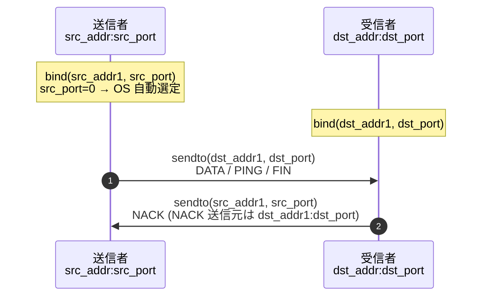
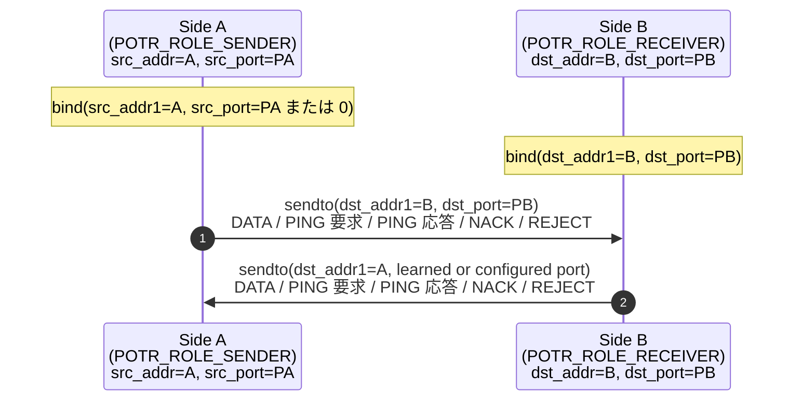
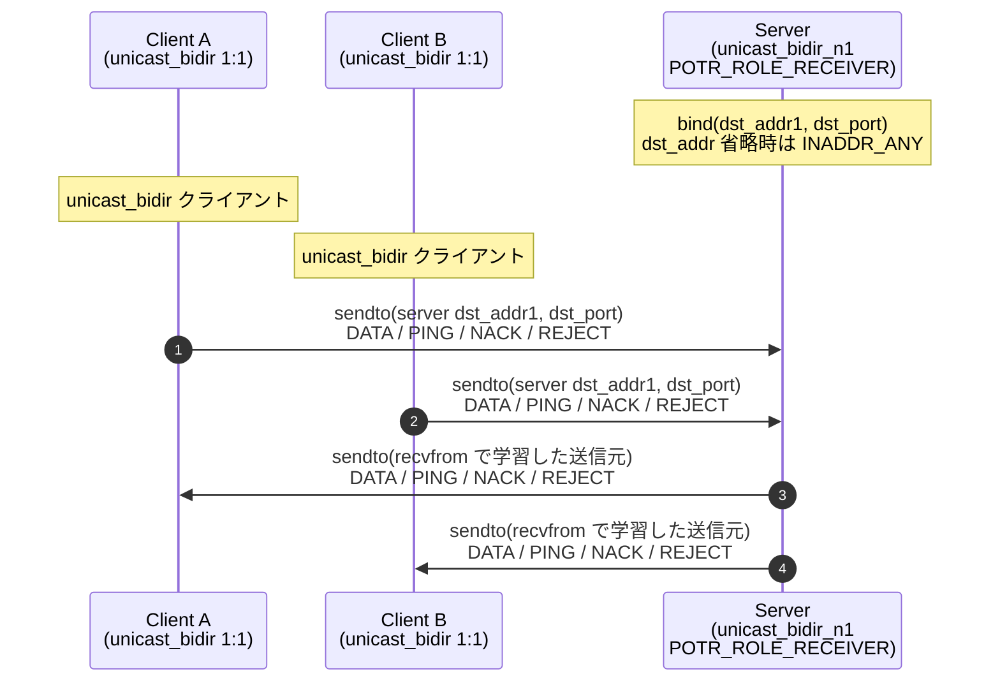
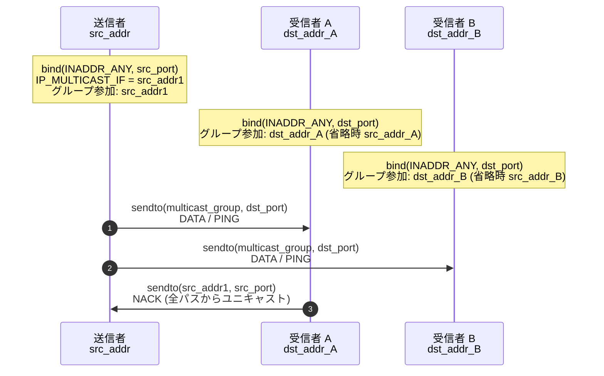
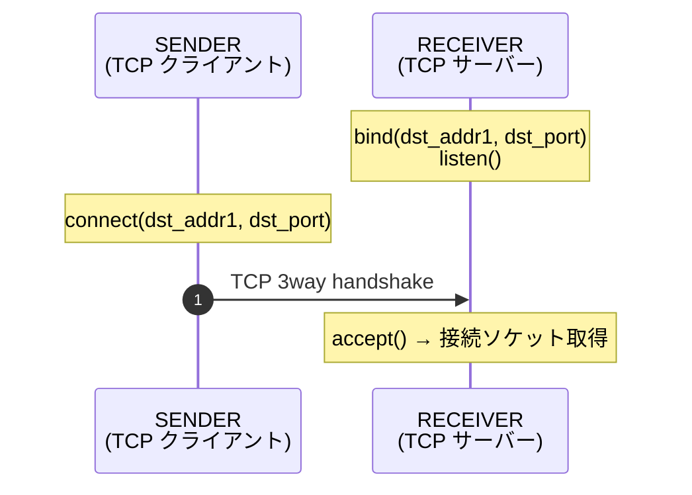

# 設定ファイル仕様

## 概要

porter は JSONC 形式のテキスト ファイルでサービスを定義します。サンプル ファイルの拡張子には `.jsonc` を使用します。ファイル名による形式の制限はなく、`.json` のファイルも読み込めます。  
1 つの設定ファイルに定義できるサービス数に上限はありません (初期バッファー容量は 64 で、超過時は自動拡張されます)。

`potr_service_open_from_config()` 呼び出し時にファイルを読み込み、指定した `service_id` のエントリを使用します。  
以後はファイルを参照しないため、起動後にファイルを変更しても動作に影響はありません。  
`potr_service_open()` を直接呼び出す場合は設定ファイルを使用せず、`potr_global_config` / `potr_service_def` 構造体を直接渡します。

## ファイル形式

```jsonc
{
  // 全サービス共通の設定
  "global": {
    "window_size": 64,
  },
  "services": {
    // キーはサービス ID の十進文字列
    "1001": {
      "type": "unicast",
      "src_addr1": "127.0.0.1",
      "dst_addr1": "127.0.0.1",
      "dst_port": 5001,
    }
  }
}
```

`global` は共通設定、`services` はサービス ID を十進文字列のキーとするオブジェクトです。ID は符号付き 64 ビット整数の範囲で指定します。存在しない項目には既定値を適用します。構文または内容が不正なファイルは `POTR_ERR_INVALID_CONFIG`、開けないまたは読み取りに失敗したファイルは `POTR_ERR_IO` を返します。

### 読み取り・NUL 検査・位置と秘匿情報の消去

- **バイナリ モード読み取り**: 設定ファイルは `"rb"` で開き、Windows のテキスト モードで `0x1A` がファイル終端とみなされないようにします。`setvbuf(_IONBF)` で入力バッファリングを無効化し、`fread()` 後に `ferror()` を確認して読み取り途中の入出力失敗を `POTR_ERR_IO` として検出します。
- **NUL と文字列内 `\u0000` の拒否**: ファイル内の生の NUL バイト、およびコメントと `\\u0000` を除いた JSON 文字列中の `\u0000` エスケープは、解析前に最初の位置 (1 始まりの行と byte 単位の列) とともに構文エラー (`POTR_CONFIG_ISSUE_SYNTAX`) として拒否します。
- **構文誤りの位置**: `cjson_app_cJSON_ParseJSONCWithLengthOpts()` が報告する位置は、解析器が解析を止めた byte オフセットを行 (1 始まり) と列 (1 始まり、byte 単位) へ変換したものです。入れ子の構文の誤りでは「解析を止めた位置」であり、不正な字句の先頭とは限りません (例えば `{,}` では `,` ではなく終端の `}` を指す場合があります)。閉じていないブロック コメントはそのコメントの開始位置を指します。
- **キー パスの形式**: 誤りや認証ファイルの参照で報告する `key_path` は RFC 6901 の JSON Pointer 形式です (`~` を `~0`、`/` を `~1` にエスケープ)。ルートの誤りは空文字列 `""` です。
- **所有領域の消去**: porter と cJSON が所有する入力バッファー (拡張前の旧領域を含む)、作業チャンク、導出した鍵を含む一時構造体、および cJSON ツリーは、成功・失敗の全経路で解放前に容量全体をゼロ消去します。利用側所有の入力や OS・暗号ライブラリ内部の領域は各所有者が管理します。誤りの内容と ERROR トレースには `encrypt_key` などの設定値を含めません。

### 入力型の規則

- **整数の項目** (`uint8` / `uint16` / `uint32`): JSON の整数 (`int64` で正確に表せる値) または十進数の文字列を受け付けます。文字列は先頭の空白と正号 (`+`) を許し、負号 (`-`) は `-1` を受け付ける項目の `"-1"` だけを許します (`"-0"` を含むその他の負数文字列は拒否)。JSON 数値の `-0` は `0` として扱います。小数、指数表記で整数でない値、真偽値、`null`、配列、オブジェクトは型の誤りです。整数として解釈できない文字列は値の誤り、型・項目の範囲外や `4294967295` (専用の値 `-1` の内部表現) は値域の誤りです。
- **文字列の項目**: JSON の文字列だけを受け付けます (数値や真偽値などは型の誤り)。アドレスとホスト名の項目 (`src_addr1` 〜 `src_addr8`、`dst_addr1` 〜 `dst_addr8`、`multicast_group`、`broadcast_addr`) は 1 から 63 byte です (64 byte 以上は値域の誤り)。
- **文字列の配列の項目** (`pinned_certs`、`peer_names`): 1 要素以上の JSON 配列で、すべての要素が空でない文字列である必要があります。

### サービス ID・重複キー・検証 API と検査範囲

- **サービス ID の表記**: `services` のキーは正規の十進表記の符号付き 64 ビット整数 (`"0"` または任意の `-` に続く `[1-9][0-9]*`、`INT64_MIN` .. `INT64_MAX`) でなければなりません。`"010"`、`"+1"`、`" 1"`、`"-0"` などは `POTR_CONFIG_ISSUE_INVALID_SERVICE_ID` です。
- **重複キー**: `root`、`global`、`services`、各サービス オブジェクト内で同じ名前 (byte 単位・大文字小文字区別) のキーが 2 つ以上ある場合、2 つ目以降を重複キー誤り (`POTR_CONFIG_ISSUE_DUPLICATE_KEY`) とし、重複キーの値は検査しません。重複したサービス ID がある場合はどのサービスも開けず、重複 ID のサービス本文は検査しません。
- **公開の検証・列挙 API**:
    - `potr_config_validate_file()` は設定ファイル全体 (ルート、`global`、全サービス) を検証し、見つけた誤りを `potr_config_issue` としてコールバックへ渡します (トレース出力なし)。ルート構造に誤りがなければ、本文検査前に `on_service` で各サービス ID をファイル順で通知します。また、証明書方式の有効なファイル パスを `on_auth_file` で通知します。構文・読み取り・メモリ不足を除き、独立した項目とサービスのすべての誤りを報告します。
    - `potr_config_list_service_ids()` と `potr_config_service_ids_free()` は、ルートの構造とサービス ID の正規性を検証した上で、定義された ID をファイル順で返します。

| 誤りの場所と内容 | `potr_config_validate_file()` | `potr_config_list_service_ids()` | `potr_service_open_from_config()` / `potr_service_get_type()` |
|---|---|---|---|
| 文書全体の構文・生 NUL・文字列内 `\u0000` | 拒否 | 拒否 | 拒否 |
| ルートの構造 (知らないキー・不正 ID・重複 ID) | 拒否 | 拒否 | 無関係な ID の誤りも拒否 |
| `global` 本体の誤り | 拒否 | 検査しない | 拒否 |
| 指定サービス本体の誤り | 拒否 (全サービス) | 検査しない | 拒否 |
| ほかのサービス本体の誤り | 拒否 (全サービス) | 検査しない | 検査しない |

Table: 設定操作ごとの検査範囲

## global オブジェクト

すべてのサービスに適用されるグローバル設定です。範囲外の値、解釈できない値、重複キー、知らないキーはすべて `POTR_ERR_INVALID_CONFIG` になります。

| キー | 型 | 値域 | 既定値 | 説明 |
|---|---|---|---|---|
| `window_size` | uint16 | 2〜256 | 64 | スライディング ウィンドウ サイズ (パケット数) |
| `max_payload` | uint16 | 64〜65,435 | 1,400 | DATA パケットのペイロード上限バイト数 |
| `max_message_size` | uint32 | `max_payload` 以上 (4,294,967,294 以下) | 65,535 | 1 回の potr_service_send で送信できる最大メッセージ長 (バイト) |
| `send_queue_depth` | uint32 | 2〜4,294,967,294 | 1,024 | 非同期送信キューの最大エントリ数 |
| `udp_health_interval_ms` | uint32 | 0〜2,147,483,646 | 3,000 | UDP 通信種別の PING 送信判定間隔 (ms)。0 で無効化。上限は種別と役割によらず検査します |
| `udp_health_timeout_ms` | uint32 | 0〜4,294,967,294 | 10,000 | UDP 通信種別の受信タイムアウト (ms)。0 で無効化 |
| `tcp_health_interval_ms` | uint32 | 0〜2,147,483,646 | 10,000 | TCP 通信種別の定周期 PING 送信間隔 (ms)。上限は種別と役割によらず検査します |
| `tcp_health_timeout_ms` | uint32 | 0〜715,827,882 | 31,000 | TCP 通信種別の PING 応答待機タイムアウト (ms)。RECEIVER の初回先読みは 3 倍を使用。上限は種別と役割によらず検査します |
| `tcp_close_timeout_ms` | uint32 | 0〜2,147,483,646 | 5,000 | TCP 通信種別の `FIN_ACK` 最大待機時間 (ms)。上限は種別と役割によらず検査します |
| `reorder_timeout_ms` | uint32 | 0〜4,294,967,294 | 0 | 欠番検出後の NACK / DISCONNECTED 遅延時間 (ms) |
| `flow_control_capacity` | uint32 | 0〜4,294,967,294 (0 は無効) | 0 | 受信側の通知キュー容量 (バイト)。`global` では `-1` 指定不可。0 以外では余裕が `max_message_size` 以上必要 |
| `flow_control_suppress_percent` | uint32 | 0〜100 (0 は既定値) | 80 | 受信側が抑制を要求するしきい値 (%) |
| `flow_control_resume_percent` | uint32 | 0〜99 (0 は既定値) | 50 | 受信側が解除するしきい値 (%)。実効値は `suppress_percent` 未満が必要 |
| `flow_control_request_interval_ms` | uint32 | 0〜2,147,483,646 (0 は既定値) | 200 | 抑制の要求の再送周期 (ms) |
| `flow_control_request_lifetime_ms` | uint32 | 0〜2,147,483,646 (0 は既定値) | 1,000 | 抑制の要求の有効期限 (ms)。実効値は `request_interval_ms` より大きい値が必要 |
| `flow_control_excluded_receiver_count` | uint32 | `-1`、0〜4,294,967,294 (0 は既定値) | 1 | 除外・切断する受信者 / ピア数の上限 (台)。`-1` で台数上限を無効化 |
| `flow_control_excluded_receiver_percent` | uint32 | `-1`、0〜100 (0 は既定値) | 10 | 除外・切断する受信者 / ピア数の上限 (%)。`-1` で割合上限を無効化 |
| `flow_control_grace_ms` | uint32 | 0〜2,147,483,646 (0 は既定値) | 200 | 遅い相手が全体を止めてよい猶予時間 (ms) |
| `flow_control_feedback_percent` | uint32 | 0〜100 (0 は既定値) | 5 | 監視対象から受けるフロー制御パケット数の予算 (DATA 100 パケットあたり) |
| `flow_control_monitored_receiver_count` | uint32 | 0〜64 (0 は下限なし) | 4 | 監視対象として選ぶ受信者数の下限。`global` では `-1` 指定不可 |
| `flow_control_receive_buffer_percent` | uint32 | `-1`、0〜100 (0 は既定値) | 100 | OS 受信バッファーに基づく送出上限の割合 (%)。`-1` で無効化 |
| `udp_receive_buffer_size` | uint32 | `-1`、0〜4,294,967,294 (0 は既定値) | 4,194,304 | UDP ソケットへ要求する受信バッファーの大きさ (バイト)。`-1` で要求しない |

Table: global オブジェクトの設定項目一覧

### window_size の影響

ウィンドウ サイズは再送可能な過去パケット数の上限です。  
送信側ウィンドウが満杯になると最古エントリが evict (削除) されます。  
evict 済みの通番を受信者が NACK で要求した場合、REJECT を返します。

通信の安定性を高めるには、往復遅延時間と送信レートに応じてウィンドウ サイズを調整してください。

既定値 (`window_size` = 64、`max_payload` = 1,400) では、送信と受信の保持領域として、セッションごとに約 190 KB (64 ビット環境で 189,568 byte) を確保します。`unicast_bidir_n1` のサーバーは、接続するピアごとに同じ領域を確保します。

### max_payload の影響

ペイロード エレメント 1 個分のデータ サイズ上限です。  
`potr_service_send()` で送信するデータがこのサイズを超える場合、複数のフラグメントに分割されます。

### reorder_timeout_ms の使い所

| 構成 | 推奨値 | 理由 |
|---|---|---|
| 単一パス・同一 LAN | 0 (無効) | 遅延変動が小さく追い越しが極めて稀な環境 |
| マルチパス (2 経路以上) | 10〜30 ms | 経路差異で数 ms〜数十 ms の追い越しが起こりうる |
| 遠距離 WAN / 無線 LAN | 30〜100 ms | 遅延変動が大きく再順序付けが頻繁に発生する環境 |

Table: 構成別の reorder_timeout_ms 推奨設定

- 設定値を大きくするほど、追い越しを吸収できるが NACK の遅延 (= 再送遅延) も増加します。
- RAW モードでは DISCONNECTED の遅延にも直結するため、リアルタイム性の要件と合わせて調整してください。
- タイムアウト経過後も欠落パケットが到着した場合は NACK なしで正常にウィンドウへ取り込まれます (次の `thread_recv_window_accept_outer()` (`thread/thread_recv_window.c`) 呼び出しで自動検出)。

### マルチキャスト/ブロードキャスト通常モードでの NACK 分散

`multicast` / `broadcast` の通常モードかつ `reorder_timeout_ms > 0` の場合、複数の受信者が同一欠番を同時に NACK すると送信者への負荷が集中します (NACK implosion)。

これを回避するため、タイマー起動時に **100%〜200%** の範囲でランダムなジッタを自動付加します。

| 通信種別 | 実効タイムアウト |
|---|---|
| `unicast` (通常モード) | `reorder_timeout_ms` (固定) |
| `multicast` / `broadcast` (通常モード) | `reorder_timeout_ms` 〜 `reorder_timeout_ms × 2` (ランダム分散) |
| `*_raw` (RAW モード全種別) | `reorder_timeout_ms` (固定、DISCONNECTED 発行用) |

Table: 通信種別ごとの実効並べ替えタイムアウト

- ジッタは monotonic クロックのナノ秒部を乱数源とするため、外部 RNG への依存はありません。
- `reorder_timeout_ms = 20` に設定すると実際のタイマーは **20〜40 ms** の範囲に分散されます。
- NACK が遅延する分だけ再送が遅れる可能性があるため、`reorder_timeout_ms` の設定値には余裕を持たせてください。

### フロー制御の設定

フロー制御は、受信側の利用側コールバックの処理が追い付かないときに、受信側の要求で送信側が新しい DATA の送出を止める仕組みです。  
受信側は、抑制の要求と解除に加えて、「この通番まで送ってよい」という送出上限を送信側へ知らせます。送信側は送出上限に達したら自分で止まります。  
パケットの形式と送受信側の動作は [プロトコル仕様](protocol.md) の「フロー制御」を参照してください。

通知キューの占有量に基づくフロー制御は、受信側の構成で `flow_control_capacity` を指定した場合に働きます。  
これとは別に、`unicast`、`multicast`、`broadcast`、`unicast_bidir`、`unicast_bidir_n1` の受信側は、容量の指定によらず、OS の受信バッファーに基づく送出上限を送信側へ知らせます (既定で有効)。後述の「OS の受信バッファーに基づく送出上限」を参照してください。  
送信側は、自身の設定によらず、受けた抑制の要求と送出上限に常に従います。  
RAW モード (`unicast_raw` / `multicast_raw` / `broadcast_raw`) は、フロー制御の設定を無視します。

| 設定 | 使う側 |
|---|---|
| `flow_control_capacity`、`flow_control_suppress_percent`、`flow_control_resume_percent`、`flow_control_request_interval_ms` | 受信側 (双方向の通信種別では両端) |
| `flow_control_request_lifetime_ms` | 送信側 (双方向の通信種別では両端)。`multicast` / `broadcast` の受信側は、監視対象の一覧の有効期限にも使います |
| `flow_control_excluded_receiver_count`、`flow_control_excluded_receiver_percent`、`flow_control_grace_ms` | `multicast` / `broadcast` の送信側、および `unicast_bidir_n1` のサーバー |
| `flow_control_feedback_percent`、`flow_control_monitored_receiver_count` | `multicast` / `broadcast` の送信側 |
| `flow_control_receive_buffer_percent` | `unicast`、`multicast`、`broadcast`、`unicast_bidir`、`unicast_bidir_n1` の受信側 (双方向の通信種別では両端) |

Table: フロー制御の設定を使う側

#### 値の決まり方

- `global` の値は、そのまま使います。`flow_control_capacity` の `0` は「無効」、`flow_control_monitored_receiver_count` の `0` は「下限を指定しない」です。
- サービス側の `0` と省略は、「`global` の値を使用」です。
- サービス側で「無効」にする場合は、`-1` を指定します。`-1` を指定できるのは、サービス側の `flow_control_capacity`、`flow_control_monitored_receiver_count` と、`global` とサービス側の `flow_control_excluded_receiver_count`、`flow_control_excluded_receiver_percent`、`flow_control_receive_buffer_percent`、`udp_receive_buffer_size` だけです。その他の項目は、負号付きの値を受け付けません。
- `flow_control_excluded_receiver_count`、`flow_control_excluded_receiver_percent`、`flow_control_receive_buffer_percent`、`udp_receive_buffer_size` は既定で有効で、`0` が「既定値を使用」(サービス側では「`global` の値を使用」) を表すため、`global` でも `-1` で無効 (要求しない) にできます。
- `flow_control_excluded_receiver_count` と `flow_control_excluded_receiver_percent` の両方が無効の場合は、どの受信者も除外しません (送信側は、止める状態の受信者に合わせて止まり続けます)。
- `flow_control_monitored_receiver_count` の「無効」(サービス側の `-1`、`global` の `0`) は、監視する数の下限を設けないことを表します。
- `potr_service_def` と `potr_global_config` を直接指定する場合は、`-1` の代わりに `POTR_FLOW_CONTROL_DISABLED` を指定します。
- `potr_global_config` を直接指定する場合、しきい値、再送周期、有効期限、`flow_control_excluded_receiver_count`、`flow_control_excluded_receiver_percent`、`flow_control_grace_ms`、`flow_control_feedback_percent`、`flow_control_receive_buffer_percent`、`udp_receive_buffer_size` の `0` には既定値を使います。構造体を 0 で初期化した利用側が、構成の検査でエラーにならないようにするためです。

```jsonc
{
  "global": {
    // 全サービスの受信側で、容量 4 MiB のフロー制御を有効にする
    "flow_control_capacity": 4194304,
    // 1 対 N の猶予時間を 300 ms にする
    "flow_control_grace_ms": 300
  },
  "services": {
    "1001": {
      "type": "multicast",
      "src_addr1": "192.168.1.20",
      "dst_port": 6001,
      "multicast_group": "239.0.0.1",
      // このサービスは除外を行わず、すべての受信者に合わせる
      "flow_control_excluded_receiver_count": -1,
      "flow_control_excluded_receiver_percent": -1
    },
    "1002": {
      "type": "unicast",
      "src_addr1": "192.168.1.20",
      "dst_addr1": "192.168.1.10",
      "dst_port": 5002,
      // このサービスはフロー制御を使わない
      "flow_control_capacity": -1
    },
    "1003": {
      "type": "unicast",
      "src_addr1": "192.168.1.20",
      "dst_addr1": "192.168.1.10",
      "dst_port": 5003,
      // このサービスの受信側は、OS の受信バッファーに基づく送出上限を使わない
      "flow_control_receive_buffer_percent": -1
    }
  }
}
```

#### 容量の決め方

占有量が容量を超えると、受信側は超えた DATA を破棄し、その相手との通信を切断として通知します。  
送出上限により、送信側は占有量が要求のしきい値に達する付近で止まります。要求のしきい値から容量までの余裕「容量 × (100 − `flow_control_suppress_percent`) ÷ 100」は、送出上限で抑えられない次の量を受け止めるために使います。

| 余裕で受け止める量 | 目安 |
|---|---|
| 圧縮した DATA の展開による増加 | 展開後の大きさと `max_payload` の差 |
| 最初の送出上限が届く前に送出された DATA | 初期の幅 (4 パケット) |
| 送出上限を 1 パケット分超える送出と、フラグメントの途中にある DATA | `max_message_size` 程度 |

Table: 容量の余裕で受け止める量

余裕が `max_message_size` 未満の構成は、検証およびサービスを開く処理が設定エラー (`POTR_ERR_INVALID_CONFIG`) を返します。フラグメントの途中にあった最大長のメッセージ 1 件が、送出上限で止まった後に完成するだけで、容量を超えるためです。  
既定の要求のしきい値 (80%) では、容量が `max_message_size` の 5 倍以上であることに相当します。要求のしきい値を 100% にした構成は、余裕が 0 になるため、容量が 0 でない限り設定エラーになります。

送出上限は、容量の超過を完全には防ぎません。圧縮した DATA、最初の送出上限が届く前の初期の幅 (4 パケット) の送出、一対多で除外された受信者、一対多で監視対象に選ばれていない受信者は、抑制の要求が働き、それでも容量を超えた場合は切断になります。  
余裕が不足する場合は、容量を大きくするか、`flow_control_suppress_percent` を小さくします。

- 容量は、メモリ使用量の厳密な上限ではありません。占有量は DATA のバイト数だけを数え、通知ごとの管理情報は含みません。
- `unicast_bidir_n1` のサーバーは、占有量をピアごとに数えます。メモリ使用量の目安は「容量 × 接続中のピア数」です。

#### 再送周期と有効期限

| 設定 | 既定値 | 意味 |
|---|---|---|
| `flow_control_request_interval_ms` | 200 ms | 受信側が、要求中の間に抑制の要求を再送する周期です。フロー制御が有効な受信側は、受信スレッドの待ち時間の上限をこの値にします。 |
| `flow_control_request_lifetime_ms` | 1,000 ms | 送信側が、受けた抑制の要求を有効とみなす時間です。送出上限で止まっている間に、相手からのパケットが途絶えたとみなして送出上限を破棄するまでの時間にも使います。 |

Table: 抑制の要求の再送周期と有効期限

既定値は、要求の再送が数回続けて失われても抑制が外れず、受信側が停止した場合も約 1 秒で送信側が送出を再開する組み合わせです。

- `flow_control_request_interval_ms` と `flow_control_request_lifetime_ms` は、送信側と受信側で同じ値を構成してください。受信側の再送周期が送信側の有効期限以上の場合、要求の再送の間に抑制が外れます。この組み合わせは、片側の構成からは検査できません。
- 経路の損失が多い場合は、有効期限を再送周期の 5 倍以上に保ったまま、再送周期を短くします。再送周期を短くすると、抑制の要求のパケットが増えます。
- 受信側が停止したときに、送信側が早く送出を再開する必要がある場合は、有効期限を短くします。有効期限を短くすると、抑制の要求の喪失が続いたときに、抑制が外れやすくなります。

通知された送出上限で止まっている間は、相手から何らかのパケット (フロー制御パケット、受信報告、NACK、PING、DATA) が届いている限り、有効期限が経過しても送出上限を破棄しません。失われた通知は、問い合わせで回復します。最初の問い合わせは、止まり始めてから 10 ms 後に送り、以後の間隔は 2 倍ずつ延ばして、`flow_control_request_interval_ms` を上限とします。有効期限の間、相手から何も届かない場合は、相手がいないものとして送出上限を破棄します。破棄の後に相手からパケットが届いた場合は、その時点から初期の幅 (4 パケット) までに送出を抑え、問い合わせを送ります。最初の通知を受ける前の初期の幅で止まっている間は、相手からパケットが届いていても、有効期限の後に相手がいないものとして扱います。

#### OS の受信バッファーに基づく送出上限

UDP では、送信側が連続して送出すると、受信スレッドが読み出すより速くパケットが届き、受信側の OS の受信バッファーがあふれます。あふれた DATA の数が送信側の再送用の保持範囲 (`window_size`) を超えると、再送できずに切断になります。  
これを防ぐため、受信側は、OS の受信バッファーに収まると見積もった DATA パケットの数 (受信バッファーの幅) を求め、送出上限の許可数をこの幅で抑えます。

| 通信種別 | 働く受信側 |
|---|---|
| `unicast` | 受信者 |
| `multicast`、`broadcast` | 受信報告を送る構成 (実効 `health_interval_ms` が 0 でない) の受信者。送出上限を知らせるのは、送信側が選んだ監視対象の受信者だけ |
| `unicast_bidir`、`unicast_bidir_n1` | 両端 (双方向のそれぞれに働く) |
| `tcp`、`tcp_bidir`、RAW モード | 働かない (TCP は下位の通信が受信バッファーを守り、RAW モードは再送を行わない) |

Table: OS の受信バッファーに基づく送出上限が働く受信側

受信バッファーの幅は、次の式で求めます。

```text
パケット長           = ヘッダー長 (72) + max_payload + 認証タグ長 (16)
1 パケットの見積もり = 2 × パケット長 + 2,048
受信バッファーの幅   = OS の受信バッファーの大きさ × flow_control_receive_buffer_percent ÷ 100
                       ÷ 1 パケットの見積もり (切り捨て)
```

- OS の受信バッファーの大きさは、サービスを開くときに、受信に使うソケットから取得した値 (cplat の `cplat_socket_get_receive_buffer_size()` が返す、OS の `SO_RCVBUF` の取得値) です。経路が複数ある場合は、最も小さい値を使います。
- 認証タグ長は、暗号化の有無によらず加えます。
- 幅が 4 未満になる場合は、4 とします。この下限は、全体の幅に適用します。
- `unicast_bidir_n1` のサーバーは、すべてのピアが 1 つのソケットを共有するため、全体の幅を送信中のピアの数で割ります (切り捨て)。ピアごとの幅が 4 未満になる場合は、順番に、4 パケットずつ許可します。順番の許可の規則は、[プロトコル仕様](protocol.md) の「N 対 1 サーバーの幅の配分と順番の許可」を参照してください。
- ソケットから大きさを取得できなかった場合は、警告を診断出力に記録し、そのサービスでは OS の受信バッファーに基づく送出上限を使いません。
- 容量 (`flow_control_capacity`) も指定した受信側は、占有量による許可数と受信バッファーの幅の小さいほうを許可数にします。

1 パケットの見積もりは、パケット 1 個が OS の受信バッファーを使う量の、安全側の見積もりです。Linux は、受信したパケットを、データの長さではなく、管理情報を含む確保済みの領域の大きさで数えます。領域は 2 のべき乗の大きさで確保されるため、最大でデータの長さの約 2 倍に管理情報を加えた量になります。Windows も同じ式を使います。

| 構成 | OS の受信バッファーの大きさ | 受信バッファーの幅 | 送出上限の更新 |
|---|---|---|---|
| 要求しない Linux (`net.core.rmem_default`)、`max_payload` 1,400 | 212,992 byte | 42 パケット | 21 パケットにつき 1 個 |
| 既定の要求 4 MiB で、Linux の `net.core.rmem_max` が既定 (212,992) のまま、`max_payload` 1,400 | 425,984 byte (取得値) | 84 パケット | 42 パケットにつき 1 個 |
| 取得値が 4 MiB、`max_payload` 1,400 | 4,194,304 byte | 約 834 パケット | 約 417 パケットにつき 1 個 |
| 要求しない Windows、`max_payload` 1,400 | 65,536 byte | 13 パケット | 約 6 パケットにつき 1 個 |
| 既定の要求 4 MiB のあと、Linux の `net.core.rmem_max` が既定のままの `unicast_bidir_n1` のサーバーで、送信中のピアが 4 つ | 425,984 byte (取得値) | ピアごとに 21 パケット | ピアごとに約 10 パケットにつき 1 個 |

Table: 受信バッファーの幅の例

受信側は、前回知らせた範囲の半分を受信するたびに送出上限を更新するため、更新のフロー制御パケットは「受信バッファーの幅 ÷ 2」パケットにつき 1 個です。幅が大きいほど更新が減り、一時的な遅れを受け止められます。あふれの回避と処理件数を両立させるには、OS の受信バッファーを大きくします。幅は、OS の受信バッファーの大きさに比例します。

Linux は、`SO_RCVBUF` の設定値を 2 倍にして保持し、設定値は `net.core.rmem_max` で切り詰めます。`net.core.rmem_max` が既定 (212,992) のままの場合、4 MiB の要求は 212,992 に切り詰められ、取得値は 425,984 byte になります。要求しない場合の取得値は、`net.core.rmem_default` の 212,992 byte です。したがって、要求によって受信バッファーの幅は約 2 倍 (42 パケットから約 84 パケット) になります。幅をさらに大きくするには、`net.core.rmem_max` を大きくする必要があります。`net.core.rmem_max` を 4 MiB 以上にすると、4 MiB の要求は切り詰められず、取得値は 8,388,608 byte、幅は約 1,670 パケットになります。Windows では、4 MiB の要求がそのまま受け付けられ、幅は約 834 パケットになります。

仮想化された環境などでは、ホスト側のネットワーク アダプターの設定 (受信バッファー、受信キューなど) の見直しが必要になる場合があります。ホスト側の設定は porter の責務の外です。あふれがホスト側で起きると、porter のフロー制御では防げません。

`flow_control_receive_buffer_percent` を小さくすると、幅が小さくなり、あふれに対する余裕が増える代わりに、更新が増えます。

`unicast_bidir_n1` のサーバーは、幅を送信中のピアの数で割るため、送信中のピアが多いほど更新が増え、処理件数が下がります (同じホストの Linux で、4 つのクライアントが要求を送りサーバーが返信する測定では、無効にした場合に比べて約 16% の低下)。処理件数を優先する場合は、OS の受信バッファーを大きくするか、サーバーとクライアントの `flow_control_receive_buffer_percent` を無効にします。無効にした場合、連続送信による OS の受信バッファーのあふれは防げません。

OS の受信バッファーに基づく送出上限は、あふれを完全には防ぎません。次の場合は、欠落が起き、保持範囲を超えると切断になります。

- 一対多の送信側が、初期の幅を適用せず、受信側の最初の受信報告を処理する前に送出する場合。
- `multicast` と `broadcast` で、監視対象に選ばれていない受信者と、除外された受信者。
- `multicast` と `broadcast` で、監視対象に選ばれていない受信者が、臨時の受信報告、または NACK か抑制の要求による選び直しより前に遅れた場合。
- `unicast_bidir_n1` のサーバーで、多数のピアが、最初の送出上限を受ける前に、同時に初期の幅 (4 パケット) の分を送出した場合。
- 再送、PING など、DATA 以外のパケットが多い場合。

一対多の送信側を除き、最初の送出上限が届く前に送出できるのは、初期の幅 (4 パケット) までです。失われた通知は、問い合わせで回復します。届いている間の送出上限の破棄と、未通知のときの扱いは、「再送周期と有効期限」のとおりです。

これらの場合に欠落が問題になるときは、次のいずれかで避けます。

- `multicast` と `broadcast` で、監視する数や除外の設定を見直す (下の「multicast と broadcast の止める判定と除外」および「multicast と broadcast の監視対象」)。
- 送信側の `send_queue_depth` を小さくする。
- 受信側の OS の受信バッファーを大きくする。
- `window_size` を大きくし、欠落からの再送が間に合う範囲を広げる。

#### multicast と broadcast の止める判定と除外

`multicast` と `broadcast` の送信側は、除外していない受信者のうち 1 台でも「止める状態」であれば、新しい DATA の送出を止めます。  
「止める状態」の受信者は、有効な抑制の要求を送ってきている受信者と、受けた送出上限に達している受信者です。

一部の遅い受信者によって全体の送出が止まり続けるのを防ぐため、送信側は、受信者ごとに「その受信者が止める状態で、送信側が送出を止めていた時間」を積算します。

```text
止めていた間     : 積算 = 積算 + 経過時間
止めていない間   : 積算 = 積算 − 経過時間 ÷ 9   (0 を下回らない)
全体が遅い間     : 積算を変えない
積算 ≧ 猶予時間 : その受信者を除外する (除外している数が上限に達していない場合)
```

- 「全体が遅い間」は、止める状態の受信者の数 (除外している活動中の受信者を含む) が、除外する数の上限を超えている間です。この間は、どの受信者の積算も進めず (加算も減算もせず据え置き)、新しく除外もしません。
- 前回の判定からの経過時間は、前回の判定の時点で止める状態だった受信者へ帰属させて加算します。全体が遅い間の判定も、前回の判定の時点で止める状態だった受信者の数で行います。
- 複数の受信者が同時に止める状態で、その数が除外する数の上限以下の場合は、その全員の積算を進めます。
- 除外している数が上限に達している場合は、それ以上除外しません。送信側は、止める状態の受信者に合わせて止まり続けます (全体が遅い状態として扱います)。積算は、猶予時間 (`flow_control_grace_ms`) を上限として保持します。
- 同じ判定で複数の受信者が猶予時間に達した場合は、積算が大きい順 (同じなら受信者の管理表の順) に除外します。

除外する数の上限は、次の式で求めます。

```text
除外する数の上限 = 「flow_control_excluded_receiver_count」と
                   「活動中の受信者数 × flow_control_excluded_receiver_percent ÷ 100 (切り捨て)」の大きいほう
                   ただし、「活動中の受信者数 − 1」を超えない
```

| 活動中の受信者数 | 除外する数の上限 (既定の設定) |
|---|---|
| 1 | 0 |
| 3 | 1 |
| 10 | 1 |
| 50 | 5 |
| 100 | 10 |

Table: 除外する数の上限の例

- 活動中の受信者数は、受信報告が有効期限内に届いている受信者の数 (除外中を含む) です。活動中の受信者が 1 台以下の場合、除外する数の上限は 0 です。
- `flow_control_excluded_receiver_count` と `flow_control_excluded_receiver_percent` の両方を無効 (`-1`) にした場合、除外する数の上限は 0 となり、どの受信者も除外しません。
- 送信側は、除外した受信者の送出上限と抑制の要求を止める判定に使わず、監視対象にも選びません。除外した受信者へ特別な通知は送らず、欠落は NACK で要求し、保持範囲を超えた場合は切断になります。
- 除外は、その受信者が活動中で、かつ受信報告に載った送出上限が送信側の次に割り当てる通番より先にある状態が、猶予時間の 10 倍の間続いた時点で解きます。
- 除外している数は、活動中の受信者だけで数えます。除外した受信者が活動中でなくなった場合 (受信報告が有効期限の間届かない) は、その受信者の除外を解き、積算と除外解除の継続時間の計測を 0 に戻します。
- セッションが変わった受信者は、新しい受信者として扱います。
- 除外と除外の解除は、診断出力 (INFO) に記録します。
- `unicast_bidir_n1` のサーバーで全体を妨げている遅いピアを切断する判定でも、同じ式 (活動中の受信者数を接続中のピア数に置き換えた上限) と前回の判定時点の状態による積算を使います。同時に止める状態にある接続中のピアの数が上限を超えている間は、全体が遅い状態として積算を進めず、切断しません。
- 未通知の状態で初期の幅 (4 パケット) で止まっている間は、相手からパケットが届いていても、止まり始めてから有効期限 (`flow_control_request_lifetime_ms`) が経過した時点で相手がいないものとして扱います。TCP (`tcp`、`tcp_bidir`) では、セッションの採用で通知を取り消さず、接続・再接続時に未通知と要求なしへ戻します。
- 活動中の受信者数は受信報告で把握するため、`multicast` と `broadcast` の受信側で容量を指定する場合は、実効 `health_interval_ms` が 0 でないことが必要です。
- 受信者が再起動すると、古いセッションの記録が `health_timeout_ms` の間、活動中の受信者数に残ります。

#### multicast と broadcast の監視対象

`multicast` と `broadcast` で受信者の全員が送出上限を知らせると、送信側が受けるフロー制御パケットの数が、受信者の台数に比例します。これを避けるため、送出上限を知らせる受信者を、送信側が選んだ監視対象に限ります。  
抑制の要求と解除は、監視対象かどうかによらず、容量を指定した受信者の全員が送ります。

送信側は、除外していない活動中の受信者のうち、受信報告に載った送出上限から求めた余裕 (受信者の送出上限 − 送信側が次に割り当てる通番) と 1 以上の許可数の上限の記録があるものを候補とし、余裕が小さい (遅い) 受信者から「監視する数」の受信者を監視対象に選びます。許可数の上限が 0 の受信者は候補から外します。余裕が同じ受信者の間では、現在の監視対象を優先し、その次に監視対象でなくなってからの時間が長い受信者 (一度も監視対象になっていない受信者を最も長いものとして扱う)、それも同じ場合は管理表の順で選びます。監視対象でない受信者 (除外している受信者を除く) から NACK または抑制の要求を受けた場合は、その受信者の余裕を 0 として扱い、次の受信報告を待たずに選び直します。  
送信側は、監視対象の一覧を、監視対象が変わった時点と `flow_control_request_interval_ms` の周期で、DATA と同じ宛先へ送ります。さらに、送出する DATA があるのに監視対象の送出上限で止まっている間は、問い合わせと同じ間隔 (10 ms 後から 2 倍ずつ、`flow_control_request_interval_ms` を上限) で一覧を送出し直します。監視対象の受信者は、採用している送信者から自身を含む一覧を受けるたびに、その時点の状態と送出上限をフロー制御パケットで 1 回応答します。受信者は、一覧を `flow_control_request_lifetime_ms` の間受け取らなかった場合、監視対象でなくなったものとして扱います。

```text
通知の見込み     = 監視対象の各受信者の「2 ÷ 許可数の上限」の合計   (DATA 1 パケットあたりのフロー制御パケットの数)
条件             : 通知の見込み ≦ flow_control_feedback_percent ÷ 100
監視する数       : 条件を満たす最大の数
                   ただし、flow_control_monitored_receiver_count (下限) 以上、監視する数の上限と候補の数以下
監視する数の上限 = 64 と「(max_payload − 2) ÷ 16 (切り捨て)」の小さいほう
```

| 受信者の OS の受信バッファー | 許可数の上限 | 予算 5% に収まる数 | 監視する数 (既定の下限 4 台を適用) |
|---|---|---|---|
| 要求しない Linux (212,992 byte) | 42 | 1 | 4 (候補が 4 台未満の場合は、全員) |
| 既定の要求後、`net.core.rmem_max` が既定の Linux (425,984 byte) | 84 | 2 | 4 (候補が 4 台未満の場合は、全員) |
| 1 MiB | 約 208 | 5 | 5 |
| 4 MiB | 約 834 | 20 | 20 |

Table: 監視する数の例

- `flow_control_monitored_receiver_count` は監視する数の下限です。既定値は 4 台です。受信者が 4 台以下の構成では、OS の受信バッファーの大きさによらず、全員を監視します。`0` は下限を指定しないことです。予算の条件を満たす数が、そのまま監視する数になります。
- 予算だけで決めると、受信バッファーの幅が小さい場合に、監視する数が 1 台か 2 台になり、監視対象でない受信者が、あふれによる欠落から回復できずに、切断になることがあります。受信者が多い構成では、予算による数が下限を上回る場合に、予算による数になります。
- 監視対象の外の健全な受信者が合図を送る間もなく遅れた場合 (OS が受信スレッドを止めた場合など) は、OS の受信バッファーがあふれ、再送で回復します。あふれを確実に防ぐ受信者を増やすには、OS の受信バッファーを大きくするか、`flow_control_monitored_receiver_count` または `flow_control_feedback_percent` を大きくします。
- 受信者が再起動すると、古いセッションの項目が `health_timeout_ms` の間、活動中の受信者として残ります。古い項目が監視対象に選ばれている場合、その間、監視対象の 1 台分が働きません。

### health_interval_ms と health_timeout_ms の関係

グローバル設定の `udp_*` / `tcp_*` は、コードの組み込み既定値に次ぐ「サービス定義へ適用する既定値」です。最終的な動作は、通信種別に応じて選ばれたグローバル既定値に対し、`services` 内にあるサービスの `health_interval_ms` / `health_timeout_ms` を重ねた実効値で決まります。実効 `health_interval_ms > 0` のとき、片方向 type 1-6 は「最後の PING または有効 DATA 送信」から本値経過時だけ PING を送信し、双方向 UDP は設定周期で PING を送信します。TCP は実効 `health_interval_ms` にかかわらず接続直後に bootstrap PING を送信し、`health_interval_ms > 0` のときだけ定周期 PING と timeout 監視を有効にします。

| 通信モデル / 種別 | PING 送信 | タイムアウト監視 |
|---|---|---|
| 一方向 UDP (`unicast` / `multicast` / `broadcast` / `*_raw`) | SENDER は open 直後の即時 PING を送信せず、最後の `PING` または有効 `DATA` 送信から `health_interval_ms` 経過時にだけ PING を送信します。RECEIVER は返信しません。 | RECEIVER が有効な `PING` / `DATA` の最終受信時刻を監視 |
| 双方向 UDP (`unicast_bidir` / `unicast_bidir_n1`) | 各エンドポイント / 各ピアが周期送信し、要求には即応答します。 | 各エンドポイント / 各ピアが最終受信時刻を監視 |
| TCP (`tcp`) | 接続直後に bootstrap PING を送信します。`health_interval_ms > 0` のときだけ SENDER が周期送信し、RECEIVER が応答します。 | `health_interval_ms > 0` のときだけ SENDER は PING 応答待機、RECEIVER は PING 要求到着を監視 |
| 双方向 TCP (`tcp_bidir`) | 接続直後に両端が bootstrap PING を送信します。`health_interval_ms > 0` のときだけ両端が周期送信し、要求には即応答します。 | `health_interval_ms > 0` のときだけ両端が PING 応答待機と PING 要求到着を監視 |

Table: 通信モデル別のヘルス チェック動作

一方向 UDP (type 1-6) の RECEIVER は、有効な `PING` または `DATA` を受信すると `health_alive` を立てて `POTR_EVENT_CONNECTED` を発火します。`health_interval_ms = 0` で PING 送信が無効でも、有効な `DATA` が到着すれば CONNECTED します。双方向 UDP は、PING の送受信で CONNECTED します。TCP は `health_interval_ms = 0` でも bootstrap PING の往復により CONNECTED できますが、定周期 PING と timeout 監視は無効になります。

双方向 UDP (`unicast_bidir` / `unicast_bidir_n1`) は、相手が返してきた PING ペイロードに `POTR_PING_STATE_NORMAL` が含まれて初めて `CONNECTED` します。したがって実効 `health_interval_ms = 0` で PING 自動送信が無効な構成では、`health_timeout_ms` の有無にかかわらず初回 `CONNECTED` に到達しません。

| 設定 | 効果 |
|---|---|
| `udp_health_interval_ms = 0` | UDP 通信種別に適用する既定の PING 周期を 0 にします。サービス側で `health_interval_ms` を指定しない限り、UDP サービスの実効 PING 周期は無効になります。双方向 UDP ではこの状態のまま `CONNECTED` しません。 |
| `udp_health_timeout_ms = 0` | UDP 通信種別に適用する既定のタイムアウトを 0 にします。サービス側で `health_timeout_ms` を指定しない限り、UDP サービスの実効タイムアウト監視は無効になります。 |
| `tcp_health_interval_ms = 0` | TCP 通信種別に適用する既定の定周期 PING 周期を 0 にします。サービス側で `health_interval_ms` を指定しない限り、TCP サービスは bootstrap PING の往復だけで CONNECTED し、その後の定周期 PING は送信しません。 |
| `tcp_health_timeout_ms = 0` | TCP 通信種別に適用する既定のタイムアウトを 0 にします。サービス側で `health_timeout_ms` を指定しない限り、TCP サービスの PING 要求 / 応答監視は無効になります。 |

Table: ヘルス チェック設定値とその効果

## services の各サービス

`services` のキーには、十進文字列のサービス ID を指定します。

### 全通信種別で共通のフィールド

| キー | 型 | 必須 | 説明 |
|---|---|---|---|
| `type` | 文字列 | 必須 | `unicast` / `multicast` / `broadcast` / `unicast_raw` / `multicast_raw` / `broadcast_raw` / `unicast_bidir` / `unicast_bidir_n1` / `tcp` / `tcp_bidir` |
| `dst_port` | uint16 | 必須 | 宛先ポート番号。サービス ID とは独立して指定します。 |
| `src_addr1` 〜 `src_addr8` | 文字列 | 条件付き | 通常は送信元 bind アドレスまたは受信側の送信元 IP フィルター。マルチキャストでは、送信側のグループ参加 NIC と `IP_MULTICAST_IF`、受信側の許可する送信元と NACK などの返送先。受信側は `dst_addrN` を省略した経路の参加 NIC にも使う。`unicast_bidir` では SENDER・RECEIVER ともに省略可能 (各役割の省略時動作は後述) |
| `dst_addr1` 〜 `dst_addr8` | 文字列 | 条件付き | unicast では送信先または受信側の bind アドレス。マルチキャストの受信側ではグループ参加に使う NIC。省略時は同じ番号の `src_addr` を使う。マルチキャストの送信側では使わない |
| `src_port` | uint16 | 省略可 | 送信者の送信元 bind ポート (0 = OS が自動選定)。証明書方式 (`auth = "cert"`) の片方向通信 (`unicast` / `multicast` / `broadcast` と各 RAW モード) の送信者では 0 以外の指定が必須 |
| `path_group1` 〜 `path_group8` | uint8 | 省略可 | 各経路の優先グループ番号 (1〜4、既定値 `1`)。番号が小さいほど優先度が高い。範囲外の値は設定エラー |
| `group_failback_ms` | uint32 | 省略可 | 上位グループの回復を判定するまでの時間 (ms、既定値 `0`)。`0` の場合は実効 `health_timeout_ms` と同じ値を使用 |
| `health_interval_ms` | uint32 | 省略可 | グローバルの `udp_health_interval_ms` または `tcp_health_interval_ms` をサービス単位でオーバーライドします。値域は 0〜2,147,483,646 (0 はグローバル値を使用)。上限を超える場合、設定エラー (`POTR_ERR_INVALID_CONFIG`) を返します。 |
| `health_timeout_ms`  | uint32 | 省略可 | グローバルの `udp_health_timeout_ms` または `tcp_health_timeout_ms` をサービス単位でオーバーライドします (0〜4,294,967,294、0 はグローバル値を使用)。 |
| `pack_wait_ms` | uint32 | 省略可 | パッキング待機時間 (ミリ秒、0〜4,294,967,294)。0 で即時送信 |
| `auth` | 文字列 | 省略可 | 認証・暗号方式。`"psk"` (既定値、事前共有鍵方式) または `"cert"` (証明書方式) |
| `encrypt_key` | 文字列 | 省略可 | `auth = "psk"` 時の AES-256-GCM 事前共有鍵。以下の 2 形式を受け付けます:<br>**① hex 鍵**: 256 ビット (32 バイト) を 64 文字の 16 進数文字列 (`0-9`、`a-f`、`A-F`) で指定<br>**② パスフレーズ**: 64 文字のうち 1 文字でも 16 進数でない文字がある場合、および 64 文字以外の 1 文字以上の文字列はパスフレーズとして SHA-256 で 32 バイト鍵に変換します。省略時は暗号化なし、`auth = "cert"` では設定エラー |

Table: 全通信種別共通のサービス設定項目

### 通信種別と項目の対応

全種別で指定できる項目は、`type`、`dst_port`、`src_port`、`pack_wait_ms`、`health_interval_ms`、`health_timeout_ms`、`auth`、`encrypt_key`、証明書の 6 項目です。それ以外の項目を `-` の通信種別へ記載すると設定エラー (`POTR_CONFIG_ISSUE_NOT_APPLICABLE` / `POTR_ERR_INVALID_CONFIG`) になります。

| キー | unicast | unicast_raw | multicast | multicast_raw | broadcast | broadcast_raw | unicast_bidir | unicast_bidir_n1 | tcp | tcp_bidir |
|---|---|---|---|---|---|---|---|---|---|---|
| `src_addrN` | 可 | 可 | 可 | 可 | 可 | 可 | 可 | - | 可 | 可 |
| `dst_addrN` | 可 | 可 | 可 | 可 | - | - | 可 | 可 | 可 | 可 |
| `multicast_group`、`ttl` | - | - | 可 | 可 | - | - | - | - | - | - |
| `broadcast_addr` | - | - | - | - | 可 | 可 | - | - | - | - |
| `max_peers` | - | - | 可 | 可 | 可 | 可 | - | 可 | - | - |
| `reconnect_interval_ms`、`connect_timeout_ms` | - | - | - | - | - | - | - | - | 可 | 可 |
| `path_groupN`、`group_failback_ms` | 可 | - | 可 | - | 可 | - | 可 | 可 | 可 | 可 |
| `flow_control_capacity`、`flow_control_suppress_percent`、`flow_control_resume_percent`、`flow_control_request_interval_ms`、`flow_control_request_lifetime_ms` | 可 | - | 可 | - | 可 | - | 可 | 可 | 可 | 可 |
| `flow_control_excluded_receiver_count`、`flow_control_excluded_receiver_percent`、`flow_control_grace_ms` | - | - | 可 | - | 可 | - | - | 可 | - | - |
| `flow_control_feedback_percent`、`flow_control_monitored_receiver_count` | - | - | 可 | - | 可 | - | - | - | - | - |
| `flow_control_receive_buffer_percent` | 可 | - | 可 | - | 可 | - | 可 | 可 | - | - |
| `udp_receive_buffer_size` | 可 | 可 | 可 | 可 | 可 | 可 | 可 | 可 | - | - |

Table: 通信種別ごとに使えるサービスの項目

注記: RAW の 1 対 N 種別 (`multicast_raw`、`broadcast_raw`) の `max_peers` (値域: `1` 〜 `2,147,483,647`、省略時 `1,024`) は、`auth = "cert"` 選択時の受信者証明書管理の上限数として使用します (`receiver_report` 自体は RAW では使用しません)。

### 経路の指定と連続性

経路番号 `N` は `1` から `8` の先頭ゼロなし十進数のみ有効です (`src_addr9` などの範囲外は `OUT_OF_RANGE`、`src_addr` や `src_addr01` は `UNKNOWN_KEY`)。経路を決めるキーは 1 から連続している必要があり、番号の飛びや、経路を決めるキーのない番号のアドレス・`path_groupN` は設定エラーです (`potr_service_open()` に構造体を直接渡す場合も全 8 経路を走査して同じ連続性を検査します)。

| 種別 | 経路を決めるキー | 経路ごとの必須 | 経路ごとの任意 | そのほかの必須 |
|---|---|---|---|---|
| `unicast`、`unicast_raw` | `src_addrN` | `src_addrN` と `dst_addrN` の両方 | `path_groupN` (`unicast` のみ) | `src_addr1` |
| `multicast`、`multicast_raw` | `src_addrN` | `src_addrN` | `dst_addrN`、`path_groupN` (`multicast` のみ) | `src_addr1`、`multicast_group` |
| `broadcast`、`broadcast_raw` | `src_addrN` | `src_addrN` | `path_groupN` (`broadcast` のみ) | `src_addr1` |
| `unicast_bidir` | `dst_addrN` | `dst_addrN` | `src_addrN`、`path_groupN` | 役割依存 (静的 RECEIVER は全経路で両アドレス必須、SENDER は `dst_addr1` 必須、動的 RECEIVER は経路 1 のみ許可) |
| `unicast_bidir_n1` | `dst_addrN` | `dst_addrN` | `path_groupN` | なし (`dst_addr1` 省略時は暗黙の経路 1 のみ使用) |
| `tcp`、`tcp_bidir` | `dst_addrN` | `dst_addrN` | `src_addrN`、`path_groupN` | `dst_addr1` |

Table: 通信種別ごとの経路の指定

### multicast 専用フィールド

| キー | 型 | 必須 | 既定値 | 説明 |
|---|---|---|---|---|
| `multicast_group` | 文字列 | 必須 | — | マルチキャスト グループ IPv4 アドレス (`224.0.0.0` 〜 `239.255.255.255`) |
| `ttl` | uint8 | 省略可 | 1 | マルチキャスト送信 TTL (`1` 〜 `255`、送信側ソケットに適用。設定ファイルの `0` は値域誤り、直接構造体の `0` は既定値 1 として扱います) |

Table: multicast 専用の設定項目

### unicast_raw / multicast_raw / broadcast_raw (RAW モード)

RAW モードは通常モード (`unicast` / `multicast` / `broadcast`) と同一のアドレス・ポート フィールドを使用します。  
追加の専用フィールドはありません。

**通常モードとの差異**:

| 項目 | 通常モード | RAW モード |
|---|---|---|
| 再送制御 | NACK ベース再送あり | 再送なし |
| ギャップ検出時 | NACK を返送して欠落パケットを待機 | 即 `POTR_EVENT_DISCONNECTED` を発行し、次の正規パケットで `POTR_EVENT_CONNECTED` |
| `potr_service_send` の動作 | `flags` 引数に従う (非ブロッキング / ブロッキング) | 常にブロッキング送信 (`POTR_SEND_BLOCKING` 相当) |
| 通番 (`seq_num`) | 再送制御・ウィンドウ管理に使用 | AES ノンス生成用のみ (再送制御には使用しない) |
| ヘルス チェック | `health_interval_ms` / `health_timeout_ms` に従う | 同左 (制限なし) |

Table: 通常モードと RAW モードの機能比較

RAW モードでもスライディング ウィンドウによる **順序整列** と **セッション管理** は有効です。  
RAW モードでは優先グループ (`path_group1` 〜 `path_group8`) とフロー制御の項目は種別に合わない項目として設定エラー (`POTR_ERR_INVALID_CONFIG`) になります (構造体を直接渡す場合の `path_group[i]` が `0` または `1` のときは既定値として許容し、`2` 以上は設定エラーになります)。

### unicast_bidir 専用フィールド

`unicast_bidir` は常に **1:1 双方向通信** です。SENDER・RECEIVER の双方が独立して送受信・NACK・ヘルス チェックを行います。

| src 情報の指定 | SENDER の bind 動作 | RECEIVER の bind 動作 | 送信元フィルター |
|---|---|---|---|
| `src_addr1` + `src_port` 指定 | `src_addr1:src_port` で bind | `dst_addr1:dst_port` で bind | アドレス + ポート |
| `src_addr1` のみ指定 | `src_addr1:エフェメラル` で bind | `dst_addr1:dst_port` で bind | アドレスのみ |
| `src_addr1` 省略 (SENDER) | `INADDR_ANY:src_port` で bind (OS がアダプターを自動選択) | — | なし |
| `src_addr1` 省略 (RECEIVER) | — | `dst_addr1:dst_port` で bind し、最初の受信パケットから SENDER のアドレスを動的学習します。 | なし (学習後は学習アドレスから受信) |

Table: unicast_bidir の送信元指定に応じた bind およびフィルター動作

| キー | 型 | 必須 | 説明 |
|---|---|---|---|
| `src_addr1` | 文字列 | 省略可 | SENDER: 省略時は `INADDR_ANY` で bind し OS がアダプターを自動選択。RECEIVER: 省略時は SENDER アドレスを動的学習します。 |
| `src_port` | uint16 | 省略可 | SENDER の bind ポート。`0` または省略でエフェメラル ポートを使用し、RECEIVER がパケット受信後に動的学習します。 |
| `dst_addr1` | 文字列 | 条件付き | SENDER: 送信先アドレス。RECEIVER: bind アドレス。省略時は `INADDR_ANY` で bind します。 |
| `dst_port` | uint16 | 必須 | SENDER: 送信先ポート (RECEIVER の bind ポート) |

Table: unicast_bidir 専用の設定項目

### unicast_bidir_n1 専用フィールド

`unicast_bidir_n1` は **N:1 双方向通信** です。サーバー (`POTR_ROLE_RECEIVER`) が複数クライアントを同時に受け入れます。クライアントは `unicast_bidir` (1:1) として接続します。

| キー | 型 | 必須 | 説明 |
|---|---|---|---|
| `dst_addr1` | 文字列 | 省略可 | サーバーの bind アドレス。省略時は `INADDR_ANY` で bind します。 |
| `dst_port` | uint16 | 必須 | サーバーの受信ポート |
| `src_port` | uint16 | 省略可 | 送信元ポート フィルター。`0` または省略でフィルターなし (全クライアント受け入れ) |
| `max_peers` | uint32 | 省略可 | 最大同時接続クライアント数。既定値は `1024` |

Table: unicast_bidir_n1 専用の設定項目

### tcp / tcp_bidir 専用フィールド

| キー | 型 | 必須 | 既定値 | 説明 |
|---|---|---|---|---|
| `dst_addr1` | 文字列 | 必須 | — | SENDER: 接続先アドレス (ホスト名可)。RECEIVER: bind アドレス |
| `dst_port` | uint16 | 必須 | — | SENDER: 接続先ポート。RECEIVER: listen ポート |
| `src_addr1` | 文字列 | 省略可 | — | SENDER: ローカル bind アドレス (省略で自動選択)。RECEIVER: 接続元 IP フィルター (省略でフィルターなし) |
| `src_port` | uint16 | 省略可 | 0 | SENDER: ローカル bind ポート (`0` または省略でエフェメラル)。RECEIVER: 接続元ポート フィルター (`0` または省略でフィルターなし) |
| `reconnect_interval_ms` | uint32 | 省略可 | 5,000 | SENDER の自動再接続間隔 (ms)。`0` で自動再接続なし。RECEIVER では使用しない。上限は 2,147,483,646 で、役割によらず検査します。超える場合、設定エラー (`POTR_ERR_INVALID_CONFIG`) を返します。 |
| `connect_timeout_ms` | uint32 | 省略可 | 10,000 | SENDER の TCP 接続タイムアウト (ms)。`0` で OS 既定値 (porter の期限を設けません)。RECEIVER では使用しない |

Table: tcp および tcp_bidir 専用の設定項目

**tcp / tcp_bidir では誤りになるフィールド** (参照: 「通信種別と項目の対応」表)

`tcp` と `tcp_bidir` で次のフィールドを設定ファイルへ記述すると、`POTR_CONFIG_ISSUE_NOT_APPLICABLE` (`POTR_ERR_INVALID_CONFIG`) になります。

| フィールド | 他の種別での用途 |
|---|---|
| `multicast_group`、`ttl` | マルチキャスト グループ / TTL |
| `broadcast_addr` | ブロードキャスト宛先 |
| `max_peers` | 1 対 N / N:1 の最大ピア数 |
| `flow_control_excluded_receiver_count`、`flow_control_excluded_receiver_percent`、`flow_control_grace_ms` | 1 対 N / N:1 の除外設定 |
| `flow_control_feedback_percent`、`flow_control_monitored_receiver_count` | 1 対 N の監視設定 |
| `flow_control_receive_buffer_percent`、`udp_receive_buffer_size` | UDP 受信バッファー関連 |

Table: TCP 通信で誤りになる他種別専用項目

### TCP マルチパス設定

`dst_addr1` 〜 `dst_addr8` (最大 8 エントリ) に接続先アドレスを設定すると、各エントリに対して独立した TCP 接続 (path) が確立されます。  
エントリが 1 つのみの場合は単一接続として動作します。

```jsonc
{
  "services": {
    // TCP の経路ごとに送信元と宛先を指定
    "1": {
      "type": "tcp",
      "dst_addr1": "192.168.1.10",
      "dst_addr2": "192.168.2.10",
      "dst_port": 5000,
      "src_addr1": "192.168.1.20",
      "src_addr2": "192.168.2.20"
    }
  }
}
```

#### SENDER の bind 動作 (src_addr1 / src_port の組み合わせ)

各 path[i] に独立して適用されます。

| `src_addr1` | `src_port` | `connect()` 前の `bind()` 動作 |
|---|---|---|
| 未指定 | `0` または省略 | `bind()` しない |
| 未指定 | 指定 | `INADDR_ANY:src_port` で bind |
| 指定 | `0` または省略 | `src_addr1:0` (エフェメラル ポート) で bind |
| 指定 | 指定 | `src_addr1:src_port` で bind |

Table: TCP SENDER における送信元指定別の bind 動作

#### RECEIVER の接続フィルター動作 (src_addr1 / src_port の組み合わせ)

各 path[i] の `accept()` 後に接続元を検証します。

| `src_addr1` | `src_port` | フィルター動作 |
|---|---|---|
| 未指定 | `0` または省略 | 全接続を受理 |
| 未指定 | 指定 | 接続元ポートが一致する接続のみ受理 |
| 指定 | `0` または省略 | 接続元 IP が一致する接続のみ受理 |
| 指定 | 指定 | 接続元 IP・ポートの両方が一致する接続のみ受理 |

Table: TCP RECEIVER における接続元検証動作

### broadcast 専用フィールド

| キー | 型 | 必須 | 説明 |
|---|---|---|---|
| `broadcast_addr` | 文字列 | 省略可 (`255.255.255.255`) | 送信者: 送信先ブロードキャスト アドレス (有効な IPv4 表記。例: `192.168.1.255`) |

Table: broadcast 専用の設定項目

`broadcast` 選択時のネットワーク負荷に関する注意事項は、後述の「broadcast (1:N 通信)」を参照してください。

### encrypt_key の詳細

`encrypt_key` を設定すると AES-256-GCM による暗号化・認証タグが有効になります。

| 項目 | 説明 |
|---|---|
| **形式① hex 鍵** | 256 ビット鍵を 16 進数文字列 (64 文字、英数字) で記述します。 |
| **形式② パスフレーズ** | 64 文字 hex 以外の任意の文字列。SHA-256 ハッシュで 32 バイト鍵を自動導出します。 |
| 暗号化範囲 | DATA、PING、REPORT (受信報告)、KEY (グループ鍵配布) パケットのペイロード部分を AES-256-GCM で暗号化します。ヘッダー 72 バイトは平文です。 |
| AAD | ヘッダー 72 バイト全体を追加認証データ (AAD) として使用するため、ヘッダー改ざんも検知します。 |
| 認証タグ (DATA) | 16 バイトの GCM 認証タグを暗号文末尾に付与します。実効ペイロードが `max_payload - 16` バイトに減少します。 |
| 認証タグ (その他) | PING / REPORT / KEY はペイロード暗号文の末尾に 16 バイトの GCM 認証タグを付与します。NACK / REJECT / FIN / FIN_ACK は平文ペイロードが 0 バイトであり、AAD (ヘッダー 72B) に対して 16 バイトの GCM 認証タグのみを付与してヘッダー改ざんを検知します。 |
| 双方一致 | 送信者・受信者ともに同一の `encrypt_key` を設定する必要があります。 |
| 受信要件 | 暗号化が有効な受信側は `POTR_FLAG_ENCRYPTED` 付きパケットのみ受理します。平文パケット、およびタグ検証失敗パケットは破棄します。 |
| マルチキャスト | 受信者全員が同一の `encrypt_key` を持っていれば動作します。 |

Table: 暗号化鍵の指定形式と仕様

#### ノンス構成

GCM ノンス (12 バイト) は以下の構成です。

```
[session_id: 4B NBO][tx_counter: 8B NBO]
```

| フィールド | バイト | 内容 |
|---|---|---|
| `session_id` | 4 | 送信元の自セッション ID (ネットワーク バイト オーダー) |
| `tx_counter` | 8 | セッションごとの送出通番 (ネットワーク バイト オーダー)。経路ごとの複製や制御パケットも含め、送出ごとに 1 増える |

Table: GCM ノンスのフィールド構成

各パケット種別の flags 値 (例):

| パケット種別 | flags (16 進) |
|---|---|
| DATA (暗号化あり) | `0x0021` (DATA \| ENCRYPTED) |
| PING (暗号化あり) | `0x0024` (PING \| ENCRYPTED) |
| NACK (暗号化あり) | `0x0022` (NACK \| ENCRYPTED) |
| REJECT (暗号化あり) | `0x0028` (REJECT \| ENCRYPTED) |
| FIN (暗号化あり) | `0x0030` (FIN \| ENCRYPTED) |
| FIN_ACK (暗号化あり) | `0x00A0` (FIN_ACK \| ENCRYPTED) |
| REPORT (暗号化あり) | `0x0120` (REPORT \| ENCRYPTED) |
| HANDSHAKE | `0x0200` (HANDSHAKE) |
| KEY (暗号化あり) | `0x0420` (KEY \| ENCRYPTED) |

Table: パケット種別別の flags 値一覧

### 証明書方式 (auth = "cert")

`auth` に `"cert"` を指定すると、事前共有鍵 (`encrypt_key`) ではなく X.509 証明書による相互認証と、TLS 1.3 (TCP) / DTLS 1.2 (UDP) のハンドシェイクで確立した鍵による通信保護を行います。証明書方式では暗号化が必須となり、平文の通信は受理しません。

| キー | 型 | 必須 | 既定値 | 説明 |
|---|---|---|---|---|
| `auth` | 文字列 | 省略可 | `"psk"` | `"psk"` (事前共有鍵方式) または `"cert"` (証明書方式) |
| `cert_file` | 文字列 | `auth = "cert"` で必須 | — | 自端の証明書ファイル (PEM 形式) |
| `key_file` | 文字列 | `auth = "cert"` で必須 | — | 自端の秘密鍵ファイル (PEM 形式) |
| `ca_file` | 文字列 | 条件付き必須 | — | 信頼する CA の証明書ファイル (PEM 形式、複数可) |
| `pinned_certs` | 文字列の配列 | 条件付き必須 | — | 直接登録する相手の証明書ファイル (PEM 形式のパス配列) |
| `crl_file` | 文字列 | 省略可 | — | 失効リスト ファイル (PEM 形式) |
| `peer_names` | 文字列の配列 | `ca_file` 指定時必須 | — | CA で検証する相手の名前。証明書の SAN の DNS 名または URI と照合する |

Table: 証明書方式のサービス設定項目

`ca_file` と `pinned_certs` は少なくとも一方の指定が必要です。`ca_file` を指定した場合、`peer_names` は必須であり、省略すると設定エラーになります。  
証明書、秘密鍵、CRL は `potr_service_open()` / `potr_service_open_from_config()` 時に 1 回だけ読み込みます。証明書や CRL を更新して反映するには、サービスを開き直す必要があります。

証明書方式では、全通信種別で両端が互いの証明書を検証するため、受信者も `cert_file` と `key_file` を持ちます。また、返送経路を使ってハンドシェイクを行うため、片方向通信および RAW モードでも返送経路を前提とします。片方向通信 (`unicast`、`multicast`、`broadcast` と各 RAW モード) の送信者では、受信者が送信者のユニキャスト アドレスとポートに対してハンドシェイクを開始するため、`src_port` を 0 以外に固定する必要があります (`src_port = 0` または省略は設定エラー)。

相手の証明書の検証に失敗した場合、その相手との通信を確立せずに理由をログへ記録して再試行します。UDP で実効 `health_interval_ms` が 0 の場合も、認証の再試行は UDP の既定の監視間隔 (`POTR_DEFAULT_UDP_HEALTH_INTERVAL_MS` = 3,000 ms) で行います。

`potr_service_open()` へ直接渡す `potr_service_def` では、次のメンバーで同じ設定を指定します (構造体を 0 で初期化した場合は `POTR_AUTH_PSK` となり、事前共有鍵方式として動作します)。

| メンバー | 型 | 対応するキー |
|---|---|---|
| `auth` | `potr_auth` (`POTR_AUTH_PSK = 0`、`POTR_AUTH_CERT = 1`) | `auth` |
| `cert_file`、`key_file`、`ca_file`、`crl_file` | `const char *` | 同名のキー (`crl_file` 省略時は `NULL`) |
| `pinned_certs`、`pinned_cert_count` | `const char *const *`、`size_t` | `pinned_certs` |
| `peer_names`、`peer_name_count` | `const char *const *`、`size_t` | `peer_names` (`ca_file` 指定時は 1 以上) |

Table: 証明書方式の設定を渡す `potr_service_def` のメンバー

これらのポインターおよび配列内の文字列は `potr_service_open()` の呼び出し中だけ参照し、porter は保持しません。

### アドレスの指定形式と DNS 解決

`src_addr1` 〜 `src_addr8`、`dst_addr1` 〜 `dst_addr8` には以下のいずれかを指定できます。

- **IPv4 アドレス** (例: `192.168.1.10`)
- **DNS で解決できるホスト名** (例: `receiver.local`)

#### DNS 解決のポリシー

| 項目 | 仕様 |
|---|---|
| 解決タイミング | `potr_service_open_from_config()` / `potr_service_open()` 呼び出し時に 1 回のみ解決します。 |
| 再解決 | プロセス生存中は再解決しません。DNS 更新後に接続できなくなった場合はプロセスを再起動します。 |
| 複数アドレス返却時 | 仕様上未定義。実装上は先頭アドレスを採用します。 |
| IPv6 | 非対応 |

Table: DNS 解決のポリシー仕様

## 通信種別ごとのソケット動作

### unicast (1:1 通信)



Figure: unicast のソケット bind / sendto

| | 送信者 | 受信者 |
|---|---|---|
| bind アドレス | `src_addr1` | `dst_addr1` |
| bind ポート | `src_port` (0 = OS 自動) | `dst_port` |
| 送信先 | `dst_addr1:dst_port` | — |
| 送信元フィルター | — | `src_addr1` |

Table: unicast (1:1) のソケット動作仕様

受信者は `dst_addr1` でソケットを bind するため、`dst_addr1` は当該ホストの NIC に割り当てられているアドレスでなければなりません。

### unicast_bidir

#### 1:1 モード



Figure: unicast_bidir 1:1 のソケット bind / sendto

| | Side A (SENDER) | Side B (RECEIVER) |
|---|---|---|
| bind アドレス | `src_addr1` | `dst_addr1` |
| bind ポート | `src_port` (省略可、`0` でエフェメラル) | `dst_port` |
| 送信先アドレス | `dst_addr1` | `src_addr1` (省略時は最初の受信パケットから動的学習) |
| 送信先ポート | `dst_port` | `src_port` (`0` / 省略時は受信した送信元ポートを動的学習) |
| 送信元フィルター | — | `src_addr1` 指定時はアドレスを照合。省略時は動的学習後に学習済みアドレスを照合 |

Table: unicast_bidir (1:1) のソケット動作仕様

#### N:1 モード (unicast_bidir_n1)



Figure: unicast_bidir_n1 のソケット bind / sendto

| | N:1 サーバー (unicast_bidir_n1) | クライアント (unicast_bidir) |
|---|---|---|
| bind アドレス | `dst_addr1` (省略時 `INADDR_ANY`) | `src_addr1` |
| bind ポート | `dst_port` | `src_port` (省略可) |
| 送信先 | `recvfrom` で学習した各ピアの送信元 | `dst_addr1:dst_port` |
| 送信元フィルター | `src_port` 指定時のみポートで照合 | — |
| 最大接続数 | `max_peers` | — |

Table: unicast_bidir_n1 (N:1) のソケット動作仕様

`encrypt_key` を設定した N:1 サーバーは、`POTR_FLAG_ENCRYPTED` の確認と GCM タグ検証を新規 peer 確保より前に行います。認証失敗パケットは `max_peers` を消費しません。

### multicast (1:N 通信)



Figure: multicast のソケット bind / sendto

| | 送信者 | 受信者 |
|---|---|---|
| bind アドレス | `INADDR_ANY` | `INADDR_ANY` |
| bind ポート | `src_port` (0 = OS 自動) | `dst_port` |
| マルチキャスト設定 | `IP_MULTICAST_IF = src_addrN` <br>グループ参加: `src_addrN` | グループ参加: `dst_addrN` (省略時 `src_addrN`) |
| 送信先 | `multicast_group:dst_port` | — |
| 送信元フィルター | — | `src_addrN` |
| NACK の返送先 | — | `src_addrN` |

Table: multicast (1:N) のソケット動作仕様

送信側と受信側が別のホストにある場合は、`src_addrN` に送信側のアドレスを、`dst_addrN` に受信側の参加 NIC を指定します。次の例は、送信側 `192.168.1.10`、受信側の NIC `192.168.1.20` です。

```jsonc
"2002": {
  "type": "multicast",
  "src_addr1": "192.168.1.10",
  "dst_addr1": "192.168.1.20",
  "dst_port": 6002,
  "multicast_group": "239.0.0.2"
}
```

### broadcast (1:N 通信)

| | 送信者 | 受信者 |
|---|---|---|
| bind アドレス | `src_addr1` | `INADDR_ANY` |
| bind ポート | `src_port` (0 = OS 自動) | `dst_port` |
| ソケット オプション | `SO_BROADCAST` 有効 | `SO_BROADCAST` 有効 |
| 送信先 | `broadcast_addr:dst_port` | — |
| 送信元フィルター | — | `src_addr1` |

Table: broadcast (1:N) のソケット動作仕様

> [!WARNING]
> 同一セグメント内の 1:N 配信であっても、原則として `broadcast` (`broadcast_raw`) ではなく `multicast` (`multicast_raw`) の使用を推奨します。  
> IPv4 ブロードキャストは L2 スイッチによって同一セグメント内の全ポートへ無条件にフラッディングされ、各機器の NIC もフレームを受信して OS へ割り込みで引き上げます。  
> そのため、大きなトラフィックを送信すると、porter を利用していない機器でもポート未待ち受けとして破棄するまでの受信処理負荷が発生します。  
> 特に、NTP サーバーや、PLC、センサー、プリンター、ネットワーク カメラなどの組み込み・周辺機器のように、汎用サーバー以外の専用機は CPU 性能や受信バッファー容量が小さいことが多く、大量のブロードキャスト パケットによってバッファーあふれによるパケット欠落や応答遅延など、本来の送受信動作に支障をきたす懸念があります。  
> マルチキャストであれば、該当グループに参加していない機器は NIC のハードウェア フィルターでフレームを破棄できるため、CPU やプロトコル スタックへの受信負荷を抑えられます。  
> さらに、経路上の L2 スイッチで IGMP スヌーピングを有効にしておくと、非参加ポートへの転送自体も抑えられます (IGMP スヌーピングが無効な環境では、スイッチ側で全ポートへフラッディングされるためリンク帯域は消費されます)。  
> ブロードキャストは、トラフィック量が小さい場合や、ネットワーク機器の制約でマルチキャストを利用できない場合に限定して使用してください。

### tcp / tcp_bidir (TCP 接続)



Figure: tcp のソケット connect / accept

| | SENDER | RECEIVER |
|---|---|---|
| ソケット種別 | `SOCK_STREAM` | `SOCK_STREAM` |
| 動作 | `connect(dst_addr1, dst_port)` | `bind(dst_addr1, dst_port)` → `listen()` → `accept()` |
| listen ソケット | なし | あり (接続待機専用) |
| 接続ソケット | `connect()` の fd | `accept()` の fd |

Table: TCP および TCP_BIDIR のソケット動作仕様

RECEIVER が先に `potr_service_open_from_config()` / `potr_service_open()` を呼び出して `listen()` に入っている必要があります。

## 送信元フィルタリング

受信スレッドは通信種別とモードに応じて送信元を検査します。

- `unicast` / `broadcast`: `src_addr1` を用いて送信元 IP アドレスを照合します
- `multicast` / `multicast_raw`: `src_addrN` を用いて送信元 IP アドレスを照合します。照合はグループ参加 NIC とは独立しています
- `unicast_bidir` (src_addr1 指定): `src_addr1` で送信元 IP アドレスを照合します
- `unicast_bidir` (src_addr1 省略・RECEIVER 動的学習): 学習前は全パケットを受理、学習後は学習済みアドレスから受信します。セッション追跡により 1:1 が保証されます
- `unicast_bidir_n1`: `src_addr1` は照合しません。`src_port` が 0 以外のときのみ送信元ポートを照合します

マルチキャスト (`multicast` と `multicast_raw`) の受信側は、送信元の照合に `src_addrN` を使います。グループ参加に使う NIC は `dst_addrN` で、省略した経路は `src_addrN` で参加します。NACK、受信報告、証明書認証の返送先も `src_addrN` です。

経路は 1 から順に列挙し、`src_addrN` が空の最初の経路で列挙を終えます。`src_addrN` がなく `dst_addrN` だけがある経路は使いません。この規則は、ほかの UDP 通信種別の経路の列挙と同じです。

一致しないパケットはアプリケーション層で破棄します。

### 1:1 モードと N:1 モードの使い分け

| 用途 | 推奨する type |
|---|---|
| 双方向 1:1 通信 (相手アドレス既知) | `unicast_bidir` (src_addr1 あり) |
| RECEIVER が SENDER のアドレスを事前に知らない 1:1 | `unicast_bidir` (RECEIVER 側 src_addr1 省略) |
| 複数クライアントを同時に受け入れる N:1 サーバー | `unicast_bidir_n1` |

Table: 用途別の推奨通信種別

## マルチパスと優先グループ設定

最大 8 経路 (`src_addr1` 〜 `src_addr8`、`dst_addr1` 〜 `dst_addr8`) を設定できます。  
各経路は独立したソケットを持ち、`path_group1` 〜 `path_group8` によって優先グループ番号 (1〜4、既定値 1) に割り当てられます。番号が小さいほど優先度が高く、送信者は到達可能な最上位グループの経路だけに DATA と再送パケットを送ります。すべての経路が同じグループ (または `path_group` 省略) の場合は、全経路へ同時に送信されます。

```jsonc
// マルチパスと優先グループ設定の例
{
  "services": {
    "1001": {
      "type": "unicast",
      "src_addr1": "192.168.1.20",
      "dst_addr1": "192.168.1.10",
      "path_group1": 1,
      "src_addr2": "10.0.0.20",
      "dst_addr2": "10.0.0.10",
      "path_group2": 2,
      "src_addr3": "172.16.0.20",
      "dst_addr3": "172.16.0.10",
      "path_group3": 2,
      "group_failback_ms": 5000,
      "dst_port": 5001
    }
  }
}
```

PING、ハンドシェイク、鍵配布、FIN、FIN_ACK は、待機グループの監視や制御のため全グループの全経路へ送出します。また、グループ番号に欠番がある構成 (グループ 1 とグループ 3 のみなど) も受け付け、経路のないグループは選択対象から外します。

## 設定エラーの条件

次のいずれかに該当する場合、`potr_service_open_from_config()`、`potr_service_get_type()`、`potr_config_validate_file()`、および `potr_service_open()` は設定エラーとして `POTR_ERR_INVALID_CONFIG` (ファイルを開けない場合や読み取りの `ferror()` が真の場合、名前解決・ソケット失敗時は `POTR_ERR_IO`) を返します。なお、`potr_service_open()` などの API の呼び出し方の誤り (NULL 引数、未定義の役割、役割とコールバックの組み合わせ、未定義フラグ等) は `POTR_ERR_INVALID_ARGUMENT` を返します。

| 区分 | 誤りの種別 / 内容 |
|---|---|
| 構文と NUL (`SYNTAX`) | JSONC の構文誤り、生の NUL バイト、文字列内の `\u0000` (1 件報告して打ち切り) |
| 知らないキー (`UNKNOWN_KEY`) | `root` / `global` / `services` 各要素の未定義キー、経路キーの非数字・先頭ゼロ付き名 (`src_addr`、`src_addr01`) |
| 重複キー (`DUPLICATE_KEY`) | 同一オブジェクト内の同名キー重複 (2 つ目以降を報告。重複サービス ID は本文を検査しません) |
| サービス ID (`INVALID_SERVICE_ID`) | 正規の符号付き 64 ビット十進表記以外 (`"010"`、`"+1"`、`" 1"`、`"-0"`、範囲外) |
| 型の不一致 (`TYPE_MISMATCH`) | 数値項目への真偽値・小数・非整数指数表記等、文字列項目への数値等、配列項目への非配列等 |
| 値の誤り (`INVALID_VALUE`) | 未知の `type` / `auth`、解釈できない数値文字列、空文字列、不正な IPv4 表記、経路の番号飛び・対象外キー |
| 値域の誤り (`OUT_OF_RANGE`) | 型・項目・待機の時間の上下限外、`4294967295`、`src_addr` 等の 63 byte 超過、`src_addr9` 等の経路番号範囲外 |
| 対象外項目 (`NOT_APPLICABLE`) | 通信種別または認証方式 (`auth`) と合わない項目 (`ca_file` なしの `crl_file` / `peer_names`、RAW の `path_groupN >= 2`) |
| 必須項目不足 (`MISSING`) | `type`、`dst_port`、経路ごとの必須アドレス、`multicast_group`、証明書方式の必須ファイル/`peer_names` の欠如 |
| 制約・役割依存 (`CONSTRAINT`) | `max_message_size < max_payload`、フロー制御の実効しきい値・周期・容量余裕、`multicast`/`broadcast` 受信側の `health_interval_ms == 0`、静的/動的 `unicast_bidir`、証明書方式片方向送信者の `src_port == 0` |
| 鍵導出失敗 (`KEY_DERIVATION`) | `encrypt_key` のパスフレーズからの鍵導出失敗 (鍵領域は消去し、値自体はトレースへ出しません) |
| 認証ファイルの読み込み | ファイルを開けない・読み取れない場合は `POTR_ERR_IO`、形式不正や秘密鍵不一致は `POTR_ERR_INVALID_CONFIG` |

Table: 主な設定エラーの条件一覧

## 設定の確認 (porter-config-check)

`porter-config-check` は、サービスを開かずに設定ファイルを検証する確認用コマンド (`prod/cbin/porter-config-check`) です。  
設定ファイルは 1 回だけ読み取り・解析し、検証結果、サービス ID ごとの件数、全体の要約を同じ解析結果から出力します。

```text
porter-config-check [-h] [--check-files] [--role ROLE] config_path
```

| 引数・オプション | 意味 |
|---|---|
| `config_path` | 検証する設定ファイルのパス (必須の位置引数) |
| `--check-files` | 証明書方式の認証のファイル (`cert_file`、`key_file`、`ca_file`、`crl_file`、`pinned_certs` の各要素) が存在し、通常ファイルとして読み取れることも確認します |
| `--role ROLE` | 役割依存の条件を検査する対象を `sender`、`receiver`、`all` から指定します。既定は `all` です |
| `-h`、`--help` | 使い方を標準出力へ出して終了コード 0 で終了します |

Table: `porter-config-check` の引数とオプション

`--check-files` の相対パスはコマンドの作業ディレクトリから解決します。サービスを開く処理も設定ファイルに書かれたパスのまま開くため、確認はサービスのプロセスと同じ作業ディレクトリで実行してください。

### 出力の書式

検証結果 (誤りの行、サービスごとの行、要約の行) は標準出力へ、実行の失敗の診断 (`エラー: ...`) は標準エラー出力へ出します ([共通コーディング規範](../../general/docs/coding-guideline.md) の「プロセスの終了コード」に従います)。

```text
<config_path>:<line>:<column>: error: syntax: <message>
<config_path>: error: <kind>: <key_path>: <message> [expected: <expected>]
<config_path>: service <ID>: OK
<config_path>: service <ID>: <N> error(s)
<config_path>: OK (<S> service(s))
<config_path>: <N> error(s)
```

`<kind>` には、`unknown-key`、`duplicate-key`、`service-id`、`type`、`value`、`range`、`not-applicable`、`missing`、`constraint`、`key-derivation`、`file` (`--check-files` の誤り) のいずれかが入ります。  
`<key_path>` が空 (ルートの誤り) の場合は `/` を出力し、期待する範囲がない場合は `[expected: ...]` を省きます。`<config_path>`、`<key_path>`、および認証ファイルのパスに含まれる制御文字 (0x00 〜 0x1F、0x7F) と `\` は、`\xHH` (`\` は `\\`) で出力します。ルートの構造に誤りがある場合はサービスごとの行を出しません。

### 終了コード

終了コードは、実行失敗を最優先に判定したうえで、設定の誤りの有無で決定します。

| 終了コード | 意味 |
|---|---|
| `0` | 誤りがありません (`-h` / `--help` の表示成功を含みます) |
| `1` | 実行の失敗 (引数の誤り、ファイルを開けない、読み取りの失敗、メモリ不足、出力の書き込み・フラッシュの失敗) |
| `2` | 設定の誤りが 1 件以上あります (構文の誤り、`--check-files` の誤りを含みます) |

Table: `porter-config-check` の終了コード

## サンプル設定ファイル

```jsonc
// サンプル設定の例
{
  "global": {
    "window_size": 64,
    "max_payload": 1400,
    "udp_health_interval_ms": 3000,
    "udp_health_timeout_ms": 10000
  },
  "services": {
    "1001": {
      "type": "unicast",
      "src_addr1": "192.168.1.20",
      "dst_addr1": "192.168.1.10",
      "dst_port": 5001
    },
    "1002": {
      "type": "unicast",
      "src_addr1": "sender.local",
      "dst_addr1": "receiver.local",
      "dst_port": 5002
    },
    "2001": {
      "type": "multicast",
      "src_addr1": "192.168.1.20",
      "dst_port": 6001,
      "multicast_group": "239.0.0.1",
      "ttl": 1
    },
    "3001": {
      "type": "broadcast",
      "src_addr1": "192.168.1.20",
      "dst_port": 7001,
      "broadcast_addr": "192.168.1.255"
    },
    "1021": {
      "type": "unicast_raw",
      "src_addr1": "127.0.0.1",
      "dst_addr1": "127.0.0.1",
      "dst_port": 5021
    },
    "2021": {
      "type": "multicast_raw",
      "src_addr1": "127.0.0.1",
      "dst_port": 6021,
      "multicast_group": "239.0.0.21",
      "ttl": 1
    },
    "1010": {
      "type": "unicast",
      "src_addr1": "192.168.1.20",
      "dst_addr1": "192.168.1.10",
      "dst_port": 5010,
      "encrypt_key": "0a1b2c3d4e5f6a7b8c9d0e1f2a3b4c5d6e7f0a1b2c3d4e5f6a7b8c9d0e1f2a3b"
    },
    "4020": {
      "type": "unicast_bidir",
      "src_addr1": "127.0.0.1",
      "src_port": 9020,
      "dst_addr1": "127.0.0.1",
      "dst_port": 9021
    },
    "4021": {
      "type": "unicast_bidir",
      "src_addr1": "127.0.0.1",
      "src_port": 9021,
      "dst_addr1": "127.0.0.1",
      "dst_port": 9020
    },
    "4050": {
      "type": "unicast_bidir_n1",
      "dst_addr1": "0.0.0.0",
      "dst_port": 9050,
      "max_peers": 256
    },
    "4051": {
      "type": "unicast_bidir_n1",
      "src_port": 19050,
      "dst_addr1": "192.168.1.10",
      "dst_port": 9051,
      "max_peers": 64
    },
    "4052": {
      "type": "unicast_bidir",
      "src_addr1": "192.168.1.20",
      "src_port": 19050,
      "dst_addr1": "192.168.1.10",
      "dst_port": 9051
    },
    "4031": {
      "type": "unicast_bidir",
      "src_addr1": "192.168.1.10",
      "src_port": 9031,
      "dst_addr1": "192.168.1.20",
      "dst_port": 9031,
      "encrypt_key": "mysecretphrase"
    },
    "5001": {
      "type": "tcp",
      "dst_addr1": "127.0.0.1",
      "dst_port": 9001
    },
    "5002": {
      "type": "tcp",
      "dst_addr1": "192.168.1.100",
      "dst_port": 9002,
      "reconnect_interval_ms": 5000,
      "connect_timeout_ms": 10000
    },
    "5003": {
      "type": "tcp",
      "dst_addr1": "192.168.1.100",
      "dst_port": 9003,
      "encrypt_key": "mysecretphrase"
    },
    "5004": {
      "type": "tcp",
      "dst_addr1": "192.168.1.100",
      "dst_port": 9004,
      "reconnect_interval_ms": 0
    },
    "5010": {
      "type": "tcp_bidir",
      "dst_addr1": "192.168.1.100",
      "dst_port": 9010,
      "reconnect_interval_ms": 5000,
      "connect_timeout_ms": 10000
    }
  }
}
```
