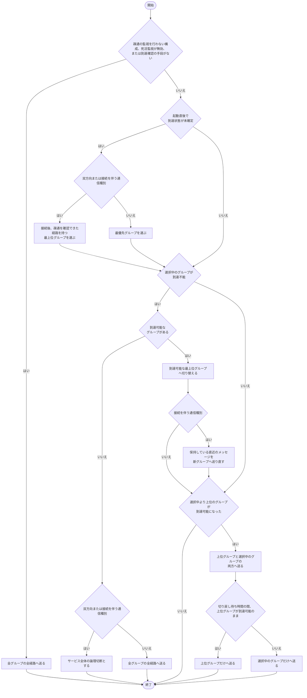

# マルチパス (multipath) 機能仕様

## 概要

マルチパス機能は、1 つのサービスに複数の経路を構成し、経路の一部が利用できなくなっても通信を継続できるようにします。

利用側から見た送信と受信の手順は、経路が 1 つの場合と同一です。  
経路ごとの状態は、サービス全体の状態とは別に通知されます。

## 解決する課題

単一の経路で通信する場合、その経路が利用できなくなると通信が途絶えます。  
利用側が複数の通信を独自に集約すると、重複の排除と経路ごとの状態の管理を実装することになります。

また、サービス全体としては通信できていても、一部の経路だけが利用できない状態があります。  
この状態を区別できなければ、経路の異常を検知しないまま冗長性を失った運用を続けることになります。

マルチパス機能は、複数の経路への送出、重複の排除、経路単位の状態の管理を担います。

## 機能要件

| 要件 ID | porter の要件 |
|---|---|
| `POTR-MULTIPATH-FUNC-002` <!-- potr-req: uuid=fb836333-cc7b-4934-9e71-afff2fe0c6c1 --> | porter のマルチパス機能は、複数の経路から到達した同一のメッセージを、1 度だけ利用側へ引き渡します。 |
| `POTR-MULTIPATH-FUNC-003` <!-- potr-req: uuid=d2cd21be-52d7-4e5b-8d77-0a7a2076dc76 --> | porter のマルチパス機能は、一部の経路が利用できなくなった場合も、残る経路で送信と受信を継続します。 |
| `POTR-MULTIPATH-FUNC-004` <!-- potr-req: uuid=04760ac3-a56d-4d44-a618-fabe6f4539eb --> | porter のマルチパス機能は、経路ごとの接続と切断を、サービス全体の接続と切断とは別に利用側へ通知します。 |
| `POTR-MULTIPATH-FUNC-005` <!-- potr-req: uuid=1069f99c-620c-4e88-9eb1-9a709bba4fdc --> | porter のマルチパス機能は、複数の経路の状態が一度に変化した場合、経路ごとの通知を経路の番号の昇順で行い、そのあとにサービス全体の通知を行います。 |
| `POTR-MULTIPATH-FUNC-006` <!-- potr-req: uuid=b5c4422b-7287-4f53-aa33-c87e7f447d73 --> | porter のマルチパス機能は、経路ごとの通知に、すべての経路の状態を含めます。 |
| `POTR-MULTIPATH-FUNC-008` <!-- potr-req: uuid=19b418a0-1ada-426a-95d9-6d701625c5ac --> | porter のマルチパス機能は、1 つのサービスに複数の経路を構成し、各経路を優先グループに割り当てられるようにします。 |
| `POTR-MULTIPATH-FUNC-009` <!-- potr-req: uuid=9b67cec7-e99b-4123-a3a0-8de822aed0a7 --> | porter のマルチパス機能は、選択中のグループが到達不能になった場合、到達可能な最上位のグループへ送信先を切り替えます。 |
| `POTR-MULTIPATH-FUNC-010` <!-- potr-req: uuid=3898341f-5581-42f6-a502-94ac26eb1631 --> | porter のマルチパス機能は、選択中のグループより上位のグループが到達可能になった場合、構成で指定された待ち時間の間は双方のグループへ送出し、その間上位グループが到達可能なままであれば上位グループへ切り戻します。 |
| `POTR-MULTIPATH-FUNC-011` <!-- potr-req: uuid=d11508a5-78aa-4b55-be5f-3ff4d65d541f --> | porter のマルチパス機能は、双方向または接続を伴う通信種別において到達可能なグループが 1 つも存在しない場合、サービス全体の切断を利用側へ通知し、送信を失敗として返します。 |
| `POTR-MULTIPATH-FUNC-012` <!-- potr-req: uuid=34ea576f-d2a2-45ac-bc38-6e7e2ff32265 --> | porter のマルチパス機能は、片方向または一対多の通信種別において到達可能なグループが 1 つも存在しない場合、送信を失敗させず、すべてのグループの全経路へメッセージを送出します。 |
| `POTR-MULTIPATH-FUNC-013` <!-- potr-req: uuid=4ef6bf53-7837-4079-8a4a-2fee29f04193 --> | porter のマルチパス機能は、接続を伴う通信種別において到達不能によりグループを切り替える場合、保持している直近の送信済みメッセージを新しいグループへ通番順に送り直してから後続のメッセージを送出します。 |
| `POTR-MULTIPATH-FUNC-014` <!-- potr-req: uuid=e5efaaf4-9b3c-4098-9871-c34a892f5f39 --> | porter のマルチパス機能は、到達確認の手段がない構成では、すべてのグループの全経路へメッセージを送出します。 |
| `POTR-MULTIPATH-CONS-001` <!-- potr-req: uuid=0fcae889-0911-48ca-97a8-26a42c9b0ef2 --> | porter のマルチパス機能は、1 つのサービスが持つ経路の数の上限を 8 とします。 |
| `POTR-MULTIPATH-CONS-002` <!-- potr-req: uuid=34bb74a6-3b9e-48dc-b24c-d00167e7f4ea --> | porter のマルチパス機能は、1 つのサービスにおける優先グループの数を 1 から 4 までとし、経路のない欠番のグループを許容します。 |
| `POTR-MULTIPATH-QUAL-001` <!-- potr-req: uuid=38f71d72-174e-43bc-a690-1d9bcc5d8a65 --> | porter のマルチパス機能は、経路ごとの受信の状態を互いに独立に保ち、1 つの経路の状態が他の経路の受信に影響しないようにします。 |

Table: マルチパス機能の機能要件一覧

## 経路の構成

経路は、サービスごとに構成で指定します。  
1 つのサービスが持つ経路の数の上限は 8 です。

各経路は、優先グループ番号 1 から 4 のいずれかに属します。  
番号が小さいほど優先度が高くなり、省略された経路はグループ 1 に属します。  
グループあたりの経路数と使用するグループ数は固定せず、経路のない欠番のグループも許容します。  
経路が割り当てられていないグループは、選択の対象から外します。

経路を 1 つだけ構成した場合も、動作は複数の経路を構成した場合と同じ規則に従います。  
この場合、経路ごとの通知とサービス全体の通知は同一の契機で発生します。

## 優先グループによる送信先の選択

グループ内に到達可能な経路が 1 つ以上ある場合、そのグループは到達可能と判定されます。  
一対多の通信種別では、報告中のすべての受信者について、そのグループに到達可能な経路が 1 つ以上あるときに到達可能とし、1 者でも届かない受信者がいるグループは到達不能とします。

送信者は、通常のメッセージと再送メッセージの送信先として、次の規則で 1 つまたは 2 つのグループを選択します。

CodeBlock: 送信グループの選択

経路ごとに送出の成否は異なる場合がありますが、利用側へ返される結果は送信の要求全体に対する 1 つの結果です。  
一部の経路が利用できなくなった場合も、同じグループ内の残る経路または別の到達可能なグループで送信を継続します。

## 切り替えと切り戻し

選択中のグループが到達不能になった場合、送信者は到達可能な最上位のグループへ送信先を切り替えます。

選択中のグループより上位のグループが到達可能になった場合、送信者は構成で指定された切り戻し待ち時間の間、上位グループと選択中のグループの双方へ送出します。  
その間、上位グループが到達可能なままであれば上位グループだけへ切り戻します。  
待ち時間中に上位グループが再び到達不能になった場合は切り戻さず、選択中のグループだけへの送出を続けます。

グループの切り替えと切り戻しが発生した場合、時刻、サービス識別子、切り替え前後のグループ番号を診断出力へ記録します。  
グループの切り替えおよび切り戻しに関する公開の通知イベントは発生しません。

## 全グループ不達時と到達確認がない構成

双方向または接続を伴う通信種別において到達可能なグループが 1 つも存在しない場合、サービス全体の論理切断として扱い、利用側へ通知するとともに送信を失敗として返します。  
片方向または一対多の通信種別において到達可能なグループが 1 つも存在しない場合は、送信を失敗させず、すべてのグループの全経路へ送出します。

次のいずれかに該当する到達確認の手段がない構成では、グループによる絞り込みを行わず、すべてのグループの全経路へ送出します。

- 疎通の監視を行わない通信種別
- 死活監視の間隔または切断判定時間のいずれかに 0 を構成した状態
- 片方向の送信側が起動後に切断判定時間を経過しても受信報告を 1 件も受けていない状態

疎通の監視を行わない通信種別に優先グループを設定した場合、グループ設定は無視されて全経路へ送出され、警告が診断出力へ記録されます。

## 接続を伴う通信種別での切り替え時の送り直し

接続を伴う通信種別では、受信側が欠けた通番を受け取ると接続を切断します。  
到達不能によるグループの切り替え時に不達の検出前で旧グループだけへ送出されたメッセージの欠落を防ぐため、送信者は送信済みの直近の保持範囲分のメッセージを保持します。

切り替えが発生した場合、送信者は保持しているメッセージを新しいグループへ通番順に送り直してから、後続の新しいメッセージを送出します。  
受信側は、すでに受信済みの通番を重複排除によって破棄します。  
保持範囲を超える欠番が残った場合は、受信側が接続を切断します。

## 制御メッセージと受信側の扱い

通常のメッセージと再送メッセージは選択中のグループ (切り戻し中は双方のグループ) の経路へ送出します。  
一方、疎通を確認するためのメッセージ、終了の通知、認証のハンドシェイクおよび鍵配布は、待機グループの監視や確立のため全グループの全経路へ送出します。  
再送の要求と受信報告は、受信側の全経路へ送出します。  
片方向の送信側が送出する疎通確認の送信間隔は、待機グループを含めて経路ごとに判定します。

受信側は、どのグループから届いたメッセージも受け取り、全経路で受信を継続します。  
グループの構成は送信側だけの設定であり、通信する両端で一致させる必要はありません。  
双方向の通信では、両端がそれぞれ自端の送信グループを選択します。

## 重複の排除

複数の経路から同じメッセージが到達した場合、利用側へ引き渡すのは 1 度だけです。  
どの経路から到達したかによって、引き渡す内容は変わりません。

経路ごとの受信の状態は互いに独立に保たれます。  
1 つの経路で欠落が生じても、他の経路の受信は影響を受けません。

## 経路単位の通知

経路ごとの接続と切断は、サービス全体の接続と切断とは別に利用側へ通知されます。  
利用側は、通信を継続したまま、どの経路が利用できているかを把握できます。

通知には、その通知の対象となった経路の番号と、すべての経路の状態を含めます。  
通知に含まれる状態は、その通知の処理が完了するまでの間だけ有効です。

## 通知の順序

複数の経路の状態が一度に変化した場合、経路ごとの通知は経路の番号の昇順で行われます。  
経路ごとの通知がすべて完了したあとに、必要であればサービス全体の通知が行われます。

この順序により、利用側はサービス全体の通知を受け取った時点で、各経路の状態を把握できます。

## 適用範囲外

- 複数の経路を用いた負荷の分散
- 経路ごとの遅延や損失率の測定と報告
- 通信継続中における経路の追加または削除
- 経路の数を超える構成の自動的な縮退
- 経路ごとに異なる通信種別または保護設定の適用

## 前提と制約

複数の経路は、互いに独立したネットワークであることを前提とします。  
同じ物理的な経路を共有する構成では、経路を分離しても可用性は向上しません。

選択中のグループ内に複数の経路がある場合、または切り戻し中や全経路送出時には、送出先の経路数に比例して送出するデータ量が増加します。

経路の状態は、経路ごとの疎通の監視によって判定します。  
このため、経路が切断されてから切断と判定されるまでに時間を要します。

## 選択の指針

経路の数と優先グループの構成は、可用性の要求と送出するデータ量の増加を考慮して選択します。

| 状況 | 経路と優先グループの構成 |
|---|---|
| 単一のネットワークで十分な可用性が得られる | 1 経路 |
| ネットワークを二重化し、同時送出で無瞬断の継続を優先する | 同一グループに 2 経路以上 |
| 主経路と待機経路を分け、通常時の帯域消費を抑える | 優先グループを分けて各グループに 1 経路以上 |

Table: 状況に応じたマルチパス経路数と優先グループの選択指針

同じグループ内の経路を増やすほど送出するデータ量が増加します。  
帯域に余裕のない構成では、待機用の経路を別の優先グループへ分離するか、経路そのものの信頼性を優先します。

## 関連する機能仕様と外部仕様

- [通信種別 (transport) 機能仕様](transport.md)
- [死活監視 (health) 機能仕様](health.md)
- [メッセージ配送 (delivery) 機能仕様](delivery.md)
- [サービス管理 (service) 機能仕様](service.md)
- [構成 (config) 機能仕様](config.md)
