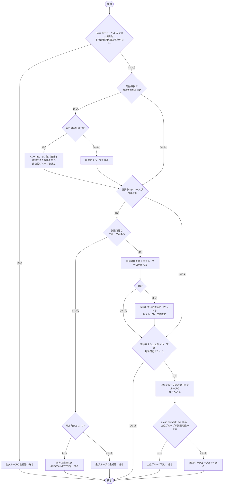

<!--
生成元: agree-before-implement スキル
文書種別: 最終仕様 (design)
最終更新エージェント: claude code / セッション ID: session_01KJc53U2rrJbqpruzwVQpnp
上流文書: 261109-porter-path-priority-timestamp-auth-discussion.md (検討用 Markdown、合意版: 版 12)。削除されている場合があります。
再開手順: このファイルを開いたエージェントは、作業の前に agree-before-implement スキルを読み込んでください。上流文書が存在する場合は、上流文書の再開手順に従って進行位置を確認し、判断の経緯を上流文書の Q&A で確認します。存在しない場合は、この文書を単体の最終仕様として扱います。最終更新エージェントのセッション情報が参照可能であれば再開時のコンテキストとして利用し、別エージェントからの引き継ぎや担当変更によりセッションが見つからない場合も異常とせず、文書の記載から継続してください。
-->

# porter の経路優先グループ・送信時刻・証明書認証 最終仕様

## 文書の識別

検討 ID: porter-path-priority-timestamp-auth  
対象: `app/porter` (参照版 `abb0a21`)、`app/cplat` (時計 API の追加)  
版: 第 4 版  
状態: 承認済み (2026-11-09、第 2 ゲート通過)

この文書は、porter に次の 3 つの機能を追加するための最終仕様です。

- 最大 8 経路と、最大 4 つの優先グループによる送信先の切り替え
- 全パケットのヘッダーへの送信時の実時刻と単調増加時刻の格納
- 証明書による相互認証と、認証で確立した鍵による通信の保護

## 前提条件

本案件の実装は、次の 2 つの作業が完了してから着手します。どちらも本案件とは別の作業として行います。

| 前提の作業 | 完了の条件 |
|---|---|
| `app/openssl` の新設 | 下記の仕様案に沿って、Linux/GCC と Windows/MSVC の両方でビルドできること |
| cplat の Linux 実装の切り替え | `app/cplat/prod/libsrc/cplat/crypto/crypto_linux.c`、`random_linux.c` が、システムの OpenSSL ではなく `app/openssl` を使い、cplat の既存テストが通ること |

Table: 本案件の前提となる作業と完了の条件

### app/openssl の仕様案

`app/openssl` に期待する内容を次に示します。最終的な内容は `app/openssl` の作業で確定しますが、本案件はこの内容を前提にします。

| 項目 | 期待する内容 |
|---|---|
| 名称と配置 | `app/openssl`。`app/zlib` と同じく、外部由来の配布物をサブモジュールとして取り込み、手動変更の対象外とする |
| 版 | OpenSSL 3.5 系 (長期サポート版) の、取り込み時点で最新の修正版 |
| ライセンス | Apache License 2.0。配布物とともにライセンス文を保持する |
| ビルド成果物 | 静的ライブラリの libcrypto と libssl、および公開ヘッダー |
| ビルド方法 | OpenSSL 付属の Configure と make/nmake を makefw から呼び出す。共有ライブラリは作らない (`no-shared`)。TLS 1.3 と DTLS 1.2 を有効にする |
| アセンブラー | 両 OS でアセンブラー実装を有効にする。アセンブルは OpenSSL 自身のビルドが行うため、makefw にアセンブラーの規則は追加しない |
| ビルド環境 | Linux は GCC (GNU アセンブラーを含む) と Perl。Windows は MSVC、Perl、NASM。開発環境と CI の両方に用意する。Perl の種類と NASM の版は OpenSSL の手順書に従う |
| 利用者 | cplat と porter が、それぞれ静的ライブラリをリンクする |
| 関数名の衝突の防止 | cplat と porter の共有ライブラリから OpenSSL の関数を公開しない (Linux はリンク時に静的ライブラリの関数を公開対象から外す)。利用側のプロセスがシステムの OpenSSL を読み込んでも衝突しない |

Table: app/openssl に期待する仕様案

> [!NOTE]
> OpenSSL の API は Linux と Windows で同じであり、OS 差異がありません。porter のプラットフォーム抽象化規範が cplat の責務とするのは OS 差異の吸収であるため、porter は cjson と同じく OpenSSL を直接使います。データの AES-256-GCM は、既存の cplat の暗号 API を引き続き使います。
>
> cplat と porter がそれぞれ静的にリンクするため、プロセス内には OpenSSL の写しが 2 つできます。両者の間で受け渡すのは鍵などのバイト列だけであり、OpenSSL のオブジェクトは受け渡しません。

> [!IMPORTANT]
> Linux では、cplat のデータ保護が `app/openssl` の libcrypto を使います。アセンブラー実装を有効にすることで、CPU の AES 命令を使う実装となり、システムの OpenSSL を使う現行と同等の速度を保ちます。

## 経路と優先グループ

### 経路数と優先グループ番号

最大経路数を 4 から 8 に増やします (`POTR_MAX_PATH = 8`)。  
各経路は優先グループ番号 1 から 4 のいずれかに属します (`POTR_MAX_PATH_GROUP = 4`)。番号が小さいほど優先度が高くなります。

グループあたりの経路数と、使用するグループ数は固定しません。欠番も許します。たとえば、2 経路ずつ 4 グループ、8 経路を 1 グループ、3 経路と 5 経路の 2 グループ、グループ 1 とグループ 3 だけの構成を、いずれも受け付けます。経路のないグループは選択の対象から外します。

### 設定項目

設定ファイルの経路キーを `src_addr1` から `src_addr8`、`dst_addr1` から `dst_addr8` に広げ、次の項目を追加します。

| キー | 型 | 既定値 | 説明 |
|---|---|---|---|
| `path_group1` 〜 `path_group8` | uint8 | 1 | 各経路の優先グループ番号 (1〜4)。範囲外の値は設定エラーとする |
| `group_failback_ms` | uint32 | 0 | 上位グループの回復を判定するまでの時間 [ms]。0 の場合は実効 `health_timeout_ms` と同じ値を使う |

Table: 優先グループのために追加するサービス設定項目

`potr_service_def` には `uint8_t path_group[POTR_MAX_PATH]` と `uint32_t group_failback_ms` を追加します。  
`path_group` を省略した既存の設定は、全経路が優先グループ 1 に属し、現行の全経路送出と同じ動作になります。

RAW モード (`unicast_raw`、`multicast_raw`、`broadcast_raw`) に優先グループ番号を設定した場合は、設定を無視して全経路へ送り、警告をログに記録します。

### 経路の到達の判定

経路が届くかどうかは、既存のヘルス チェックによる論理接続状態で判定します。通信種別ごとの判定元は次のとおりです。

| 通信種別 | 送信者が使う経路状態 |
|---|---|
| `unicast_bidir`、`unicast_bidir_n1` | 相手から返る PING ペイロードの経路状態 (既存) |
| `tcp`、`tcp_bidir` | 経路ごとの TCP 接続と PING の状態 (既存) |
| `unicast`、`multicast`、`broadcast` | 受信者からの受信報告 (新設、[受信報告](#受信報告) を参照) |
| RAW モード | 判定しない (全経路へ送る) |

Table: 通信種別ごとの経路状態の判定元

グループは、そのグループに届く経路が 1 つ以上あるときに「到達可能」とします。  
一対多 (`multicast`、`broadcast`) では、報告中の全受信者について、そのグループに届く経路が 1 つ以上あるときに到達可能とします。1 者でも届かない受信者がいれば、そのグループは到達不能です。

### 送信先の選択

送信者は、DATA と再送パケットの送信先として、次の規則で 1 つまたは 2 つのグループを選びます。



CodeBlock: 送信グループの選択

受信側は、どのグループから届いたパケットも受け取ります。受信側は全経路で受信を続け、既存の `seq_num` による重複排除で重複を除きます。グループの設定は送信側だけの設定値であり、両端で一致させる必要はありません。双方向通信では、両端がそれぞれ自端の送信グループを選びます。

> [!IMPORTANT]
> 「到達確認の手段がない」構成とは、実効 `health_interval_ms` または `health_timeout_ms` が 0 の構成と、片方向の送信者が受信報告を 1 件も受け取っていない状態です。片方向の送信者は、起動後に実効 `health_timeout_ms` が経過しても受信報告がない場合、全グループの全経路へ送ります。

### 制御パケットの送出経路

| パケット | 送出経路 |
|---|---|
| DATA | 選択中のグループ (切り戻し中は 2 グループ) の経路 |
| 再送 (NACK への応答) | 選択中のグループの経路 |
| PING | 全グループの全経路 (待機グループの監視を含む) |
| NACK、受信報告 | 受信者の全経路 |
| REJECT | 選択中のグループの経路 |
| FIN、FIN_ACK | 全グループの全経路 |
| ハンドシェイク、鍵配布 | 全グループの全経路 |

Table: パケット種別ごとの送出経路

片方向の送信者の PING は、現行では「最後の PING または有効 DATA の送信」から `health_interval_ms` が経過したときに送ります。待機グループには DATA が流れないため、この判定を経路ごとに行います。

### 全グループ不達時の送信 API

双方向通信と TCP では、全グループ不達は全経路の切断と同じであり、既存の論理切断として扱います。`potr_service_send()` は現行どおり `POTR_ERR_DISCONNECTED` を返します。

片方向と一対多では、`potr_service_send()` を失敗させず、全グループの全経路へ送ります。片方向の送信 API の既存の契約を維持し、一部の受信者の停止が他の受信者への送信を止めないようにするためです。

### TCP の切り替え時の送り直し

TCP の受信側は、欠けた通番を受け取るとストリームを切断します。グループを切り替えると、不達の検出前に旧グループだけへ書き込んだ通番が届かないため、送信者は次の手順で欠番を防ぎます。

- 送信者は、送信済みの DATA の写しを直近 `window_size` 個保持します。
- 到達不能による切り替えのとき、保持している写しを通番順に新グループへ書き込み、その後に新しい DATA を書き込みます。
- 受信側は、受信済みの通番を既存の重複排除で捨てます。
- 保持数を超える欠番が残った場合は、現行どおり受信側がストリームを切断します。

各通番を少なくとも 1 つの経路へ必ず書き込む既存の規則は、選択中のグループの経路を対象に適用します。

### 切り替えの記録

グループの切り替えと切り戻しは、公開イベントを追加せず、時刻、サービス ID、切り替え前後のグループ番号をログに記録します。経路ごとの既存イベント (`POTR_EVENT_PATH_CONNECTED`、`POTR_EVENT_PATH_DISCONNECTED`) は変更しません。片方向の送信者は、受信報告から得た経路状態を経路イベントで通知しません。

## 受信報告

片方向・一対多の送信者が経路ごとの到達を知るため、通常モードの `unicast`、`multicast`、`broadcast` の受信者は受信報告を送ります。RAW モードの受信者は送りません。

### 受信報告の形式

新しい外側パケット フラグ `POTR_FLAG_REPORT` (`0x0100`) を設けます。

| 項目 | 内容 |
|---|---|
| ヘッダーのセッション識別子 | 受信者が `potr_service_open()` 時に生成する自身のセッション識別子 (送信者と同じ方法) |
| `seq_num`、`ack_num` | 0 |
| ペイロード | 経路ごとに 1 バイトの受信状態 (`POTR_PING_STATE_*`)、`POTR_MAX_PATH` バイト。PING ペイロードと同じ形式 |
| 暗号化 | サービスで暗号化が有効な場合、PING と同じくペイロードを暗号化し、ヘッダーを改ざん検出の対象にする |
| 宛先 | 送信者のアドレスとポート (NACK と同じ) |

Table: 受信報告パケットの形式

### 送出の間隔

受信者は実効 `health_interval_ms` ごとに、全経路から受信報告を送ります。  
`multicast` と `broadcast` では、報告が送信者へ同時に集中しないよう、各回の間隔を `health_interval_ms` の 100% から 150% の範囲でばらつかせます。乱数には cplat の乱数 API を使います。

### 受信者の管理

送信者は、受信報告のセッション識別子 (`session_id`、`session_tv_sec`、`session_tv_nsec` の組) で受信者を識別し、受信者ごとの経路状態を保持します。

- 保持できる受信者数の上限には、既存の `max_peers` (既定値 1024) を使います。上限を超えた受信者の報告は、ログに記録して破棄します。
- 全経路から受信報告が実効 `health_timeout_ms` の間届かない受信者は、離脱したものとして管理から外し、到達の判定から除きます。
- 受信者の経路状態は、報告の到着時刻と内容から、PING と同じ規則 (`NORMAL`、`ABNORMAL`、`UNDEFINED`) で更新します。

## ヘッダーと送信時刻

### ワイヤー形式

プロトコル版を 2 に上げます (`POTR_PROTOCOL_VERSION = 2`)。ヘッダーは 40 バイトから 72 バイトになります。版 1 のパケットは、現行の規則どおり受信時に破棄します。

| オフセット | フィールド | 型 (NBO) | 内容 |
|---|---|---|---|
| 0 | `service_id` | int64 | 既存 |
| 8 | `session_tv_sec` | int64 | 既存 |
| 16 | `session_id` | uint32 | 既存 |
| 20 | `session_tv_nsec` | int32 | 既存 |
| 24 | `seq_num` | uint32 | 既存 |
| 28 | `ack_num` | uint32 | 既存 |
| 32 | `flags` | uint16 | 既存 |
| 34 | `payload_len` | uint16 | 既存 |
| 36 | `protocol_version` | uint32 | 既存 (値は 2) |
| 40 | `tx_counter` | uint64 | 送出通番。送出ごとに 1 増える |
| 48 | `tx_tv_sec` | int64 | 送出時の実時刻 (POSIX 秒) |
| 56 | `tx_tv_nsec` | int32 | 送出時の実時刻 (ナノ秒部、0〜999,999,999) |
| 60 | `reserved` | uint32 | 予約。送信時は 0 とし、受信時は値を無視する |
| 64 | `tx_mono_ns` | uint64 | セッション開始からの経過時間 [ns] |

Table: プロトコル版 2 の外側パケット ヘッダー

`protocol_version` の位置は版 1 と同じです。版 1 の受信者も版の不一致を検出して破棄できます。  
送出時の実時刻の秒部とナノ秒部を隣り合わせに置き、64 ビットのフィールドを 8 バイト境界にそろえるため、`tx_tv_nsec` の後に 4 バイトの `reserved` を設けます。`reserved` もヘッダーの一部として改ざん検出の対象に含めます。

ペイロード上限 1,400 バイトのとき、IPv4 と UDP のヘッダーを含めた最大長は 1,500 バイトです。一般的な Ethernet の MTU 1,500 バイトにちょうど収まり、余裕はありません。VPN などで MTU が小さい経路では、既存の `max_payload` 設定 (`global` オブジェクト、既定値 1,400) でペイロード上限を下げます。TCP の受信側は、ヘッダーを 72 バイト読み取ってから `payload_len` バイトを読み取ります。

`max_payload` の検査の上限 (`POTR_MAX_PAYLOAD`) は、UDP の最大ペイロード 65,507 バイトからヘッダー長 72 バイトを引いた 65,435 バイトに改めます。現行の上限 65,507 バイトはヘッダー長を含めていないため、上限近くの設定では UDP データグラムが最大長を超えます。

### 送出通番と nonce

`tx_counter` は、送信側のセッションごとに 0 から始まり、パケットを 1 回送出するたびに 1 増えます。経路ごとの複製、再送、PING、NACK、受信報告、FIN、ハンドシェイクを含む、すべての送出が対象です。`unicast_bidir_n1` のサーバーは、ピアごとの自セッションに対して `tx_counter` を持ちます。`tx_counter` が上限に達した場合は、そのセッションを閉じます。

AES-256-GCM の nonce (12 バイト) は、`session_id` (4 バイト) と `tx_counter` (8 バイト) で構成します。ヘッダー全体 (72 バイト) を改ざん検出の対象 (AAD) にします。同じ鍵の下で nonce が重複しないため、時刻が送出ごとに異なっても安全です。

受信側は、送信元のセッションごとに直近 256 個の `tx_counter` を記録し、記録済みまたは記録範囲より古い `tx_counter` のパケットを、復号の後に破棄します (リプレイ対策)。経路ごとの複製は異なる `tx_counter` を持つため、この記録とは干渉しません。

> [!NOTE]
> 現行の版 1 では、PING が通番を消費しないため、DATA を送らない間の PING が同じ nonce を使い続ける問題がありました。`tx_counter` による nonce は、この問題も解消します。

### 送信時刻の取得

| フィールド | 取得元 | 取得の時点 |
|---|---|---|
| `tx_tv_sec`、`tx_tv_nsec` | cplat の実時刻 API (Linux は `CLOCK_REALTIME`、Windows は FILETIME による 100 [ns] 単位) | 各経路への送出直前。再送時も取り直す |
| `tx_mono_ns` | 新設する cplat の高分解能の単調増加時計 API。セッション開始時に採取した値との差 | 同上 |

Table: 送信時刻フィールドの取得元と時点

時刻は経路ごとに取得するため、暗号化を有効にした場合は経路ごとに暗号処理を行います。  
時計の取得に失敗した場合は、実時刻を `tx_tv_sec = 0`、`tx_tv_nsec = -1`、単調増加時刻を `tx_mono_ns = UINT64_MAX` とし、送出は続けます。  
受信側は時刻を受信の判定や破棄に使わず、利用側にも渡しません。時刻は障害調査でパケットを解析するための情報です。

> [!NOTE]
> サスペンド中の単調増加時計の扱いは OS で異なります。Linux の `CLOCK_MONOTONIC` はサスペンド中に進みません。Windows の `QueryPerformanceCounter()` の扱いは、cplat に API を追加する際に Microsoft の公式リファレンスで確認し、cplat の文書に記載します。

## 証明書方式

### 方式の選択

サービスごとに、既存の事前共有鍵方式と証明書方式のいずれかを選びます。証明書方式では暗号化を必須とし、平文の通信は受理しません。

| キー | 型 | 説明 |
|---|---|---|
| `auth` | 文字列 | `"psk"` (既定、既存の `encrypt_key` を使う) または `"cert"` |
| `cert_file` | 文字列 | 自端の証明書 (PEM)。`auth = "cert"` で必須 |
| `key_file` | 文字列 | 自端の秘密鍵 (PEM)。`auth = "cert"` で必須 |
| `ca_file` | 文字列 | 信頼する CA の証明書 (PEM、複数可) |
| `pinned_certs` | 文字列の配列 | 直接登録する相手の証明書 (PEM ファイルのパス) |
| `crl_file` | 文字列 | 失効リスト (PEM)。省略可 |
| `peer_names` | 文字列の配列 | CA で検証する相手の名前。証明書の SAN の DNS 名または URI と照合する |

Table: 証明書方式のサービス設定項目

`ca_file` と `pinned_certs` の少なくとも一方が必要です。`ca_file` を指定した場合、`peer_names` は必須で、省略は設定エラーとします。

相手の証明書は、次のいずれか一方を満たせば受理します。

- `ca_file` の CA から発行された証明書チェーンが検証でき、有効期限内で、`crl_file` で失効しておらず、SAN が `peer_names` のいずれかと一致する
- `pinned_certs` に登録した証明書と一致し、有効期限内である

証明書、秘密鍵、CRL は `potr_service_open()` 時に 1 回だけ読み込みます。更新を反映するには、サービスを開き直します。これは、起動後に設定ファイルを参照しない既存の規則と同じです。

### 認証の範囲

証明書方式では、全通信種別で両端が互いの証明書を検証します (相互認証)。受信者も証明書と秘密鍵を持ちます。  
返送経路を使ってハンドシェイクを行うため、片方向通信と RAW モードでも返送経路を前提とします。返送経路のない網では、証明書方式は使えません。

### ハンドシェイクと鍵の確立

ハンドシェイクは、porter が OpenSSL のメモリ入出力 (メモリ BIO) を直接使って行い、その送受信バイト列を porter の新しいパケット種別 `POTR_FLAG_HANDSHAKE` (`0x0200`) のペイロードで運びます。OpenSSL を呼び出す処理は porter の内部の 1 つのモジュールに集め、他の処理からは OpenSSL の型を見せません。

| 通信種別 | 方式 | 鍵の導出 |
|---|---|---|
| UDP の全通信種別 | DTLS 1.2 | RFC 5705 の鍵導出機能 |
| `tcp`、`tcp_bidir` | TLS 1.3 | RFC 8446 7.5 節の鍵導出機能 |

Table: 通信種別ごとのハンドシェイクの方式

- 暗号の組は、一時的な鍵交換 (ECDHE) と認証付き暗号 (AES-256-GCM) の組に限定し、前方秘匿性を確保します。
- ハンドシェイクの役割は、接続を開始する側 (TCP の SENDER、`unicast_bidir` の SENDER、片方向の受信者) をクライアント、他方をサーバーとします。
- 鍵の導出のラベルは `EXPORTER-porter-v2` とし、文脈には両端のセッション識別子を使います。導出した 64 バイトを、方向ごとの 32 バイトの鍵 2 つに分けます。送信方向ごとに鍵が異なるため、両端の `session_id` が偶然一致しても nonce は衝突しません。
- 導出した鍵は、全経路で共通に使います。データの保護は、既存の AES-256-GCM の形式 (nonce と AAD は上記) をそのまま使います。
- ハンドシェイクは全経路へ送り、最初に完了したものを採用します。TCP では、最初に接続した経路で行い、後から接続した経路はハンドシェイクを行いません。全経路が切断して再接続した場合は、ハンドシェイクからやり直します。

### 一対多のグループ鍵

`multicast` と `broadcast` では、送信者がセッションごとに 32 バイトのグループ鍵を生成します。

- 各受信者は、送信者のユニキャスト アドレスとポートに対してハンドシェイクを行います。このため、証明書方式の一対多の送信者は `src_port` を 0 以外に固定します。
- 送信者は受信者の証明書を検証した後、ハンドシェイクで導出した受信者用の鍵でグループ鍵を暗号化し、新しいパケット種別 `POTR_FLAG_KEY` (`0x0400`) で受信者へ送ります。
- DATA と PING はグループ鍵で保護します。受信報告と NACK は、受信者ごとの鍵で保護します。
- 受信者によるなりすまし (グループ鍵を持つ受信者が送信者を装うこと) は、対策の対象外とします。

グループ鍵は、送信者のセッションを開き直すまで変えません。

### 認証前のパケットと認証失敗

ハンドシェイクが完了するまで、ハンドシェイク以外のパケットは破棄し、経路状態、受信ウィンドウ、セッション状態を変更しません。

相手の証明書の検証に失敗した場合は、その相手との通信を確立せずに、理由をログへ記録します。再試行は既存の周期で行います。TCP は `reconnect_interval_ms` で再接続し、UDP は DTLS の再送の後、実効 `health_interval_ms` ごとにハンドシェイクをやり直します。一対多では、認証に失敗した受信者を除いて、他の受信者との通信を続けます。

## cplat に追加する API

本案件では、cplat に高分解能の単調増加時計の API を 1 つ追加します。

| 区分 | 内容 | Linux | Windows |
|---|---|---|---|
| 時計 | 高分解能の単調増加時計をナノ秒で返す関数 | `clock_gettime(CLOCK_MONOTONIC)` | `QueryPerformanceCounter()` |

Table: cplat に追加する API

新しい API の Doxygen コメントは、OS の公式リファレンスを根拠に記載し、OS ごとの差異だけを追記します。cplat の既存の暗号 API (`cplat_crypto_encrypt()` など) は変更しません。

## porter の OpenSSL の利用

| 項目 | 内容 |
|---|---|
| リンク | `prod/libsrc/porter/makepart.mk` で `app/openssl` の libssl と libcrypto を静的にリンクする。共有ライブラリから OpenSSL の関数を公開しない |
| 利用範囲 | 証明書と秘密鍵の読み込み、証明書の検証 (CA、直接登録、CRL、相手名)、DTLS 1.2 と TLS 1.3 のハンドシェイク、鍵の導出 |
| 集約 | OpenSSL を呼び出す処理は porter 内部の 1 つのモジュールに集め、内部ヘッダーには OpenSSL の型を出さない |
| テスト | OpenSSL の失敗を注入するため、porter のテストに OpenSSL の関数への mock を用意する。既存の第三者共有ライブラリ向けの mock の作り方に従う |

Table: porter による OpenSSL の利用

## 正本文書への反映計画

| 反映先 | 反映する内容 |
|---|---|
| `docs/functional-spec/multipath.md` | 最大 8 経路、優先グループ、切り替えと切り戻しの要件。適用範囲外の「優先順位付け」を削除 |
| `docs/functional-spec/health.md` | 片方向・一対多の受信報告と受信者の離脱の要件 |
| `docs/functional-spec/security.md` | 証明書方式、相互認証、前方秘匿性の要件。適用範囲外の「個体の認証」「過去の通信の秘匿性」を見直し |
| `docs/functional-spec/config.md` | 優先グループと証明書方式の設定の要件 |
| `docs/protocol.md` | 版 2 のヘッダー、nonce、受信報告、ハンドシェイク、鍵配布、送出経路 |
| `docs/config.md` | 追加する設定項目と既定値、設定エラーの条件 |
| `docs/api.md` | 片方向・一対多で全グループ不達でも送信が成功すること |
| `prod/include/porter/*.h` の Doxygen | 定数、設定構造体、パケット構造体の説明 |
| `docs/platform-abstraction-guideline.md` | OS 差異のない外部ライブラリ (cjson、OpenSSL など) は porter が直接使えること。OS 差異の吸収は引き続き cplat の責務であること |
| `app/cplat/docs/` と公開ヘッダー | 追加する時計 API の契約 |

Table: 正本文書への反映計画

機能仕様には、関数名、型名、実装方式を記載せず、利用側から見た要件と振る舞いだけを記載します。

### 図の記法

本案件の作業で図を追加または編集する場合は、Mermaid で記載します。対象は、機能仕様、`docs/` 配下の文書、cplat の文書など、本案件で変更するすべての文書の図です。

- 図を追加する場合は、Mermaid で作成します。
- PlantUML などで書かれた既存の図を編集する場合は、その図を Mermaid に書き換えてから編集します。編集しない既存の図は書き換えません。
- 図の書式は、リポジトリの既存の Mermaid の図と同じく ` ```mermaid ` のコード ブロックとし、キャプションはブロックの直後に `CodeBlock: キャプション` の形式で記載します ([コード ブロックのキャプション](../../../../../framework/docsfw/docs/codeblock-caption.md))。

> [!NOTE]
> 本案件の変更対象のうち、`docs/config.md` などには PlantUML の図があります。これらの図は、内容を変更する場合に限り Mermaid へ書き換えます。

## 受入条件

| 区分 | 条件 |
|---|---|
| 経路と設定 | `max_payload` に 65,435 を受理し、65,436 を拒否する。8 経路を受理し、9 経路目の設定を拒否する。グループ番号 0 と 5 を設定エラーにする。欠番のある構成を受理する |
| 送信先の選択 | 2 経路 × 4 グループ、8 経路 × 1 グループ、2 グループの各構成で、選択中のグループの経路だけに DATA を送る |
| 切り替え | グループ内の 1 経路の断では同じグループを続け、グループ内の全経路の断で次の到達可能なグループへ切り替える |
| 切り戻し | 上位グループの回復後、`group_failback_ms` の間は 2 グループへ送り、その後に上位グループだけへ送る。待ち時間中に再び不達になった場合は切り戻さない |
| 全断 | 双方向と TCP は `POTR_ERR_DISCONNECTED` を返す。片方向と一対多は送信が成功し、全経路へ送る |
| TCP の送り直し | TCP でグループを切り替えても、`window_size` 以内の欠番では受信側がストリームを切断しない |
| 受信報告 | 片方向の送信者が受信報告で経路状態を得る。一対多で 1 受信者だけが届かない場合に切り替える。報告が途絶えた受信者を管理から外す |
| 到達確認なし | RAW モードとヘルス チェック無効の構成で、全経路へ送る。RAW モードのグループ設定で警告を記録する |
| ヘッダーと時刻 | 版 2 の 72 バイトのヘッダーを符号化・復号できる。`reserved` を 0 で送り、受信時に値を無視する。1,400 バイトのペイロードで UDP データグラムが 1,500 バイトを超えない。版 1 のパケットを破棄する。経路ごと・再送ごとに時刻が更新される。時計の取得失敗時に既定の値が入る |
| nonce | 暗号化時、PING、経路ごとの複製、再送、受信報告を含めて、同じ鍵で同じ nonce を 2 回使わない。リプレイしたパケットを破棄する |
| 証明書方式 | CA 検証、直接登録、その両方の構成で認証が成功する。信頼しない CA、名前の不一致、期限切れ、失効、未登録の証明書で認証が失敗する。認証前と認証失敗時に状態が変わらない |
| 一対多の鍵 | 認証に成功した受信者だけがグループ鍵を受け取り、データを復号できる |
| 既存方式 | 事前共有鍵方式の既存テストが通る |
| 検証環境 | Linux と Windows の両方で局所テストが通り、Linux と Windows の間で相互接続を確認する。内容のある `.warn` がない。変更した Markdown が `text_style_jp.py` の確認を通り、`check_functional_spec.py` が通る |

Table: 受入条件

ビルドとテストの実行はユーザーが行い、エージェントは結果を確認して修正します。framework や複数 app にまたがる全体テストは、コストを説明してから実施を確認します。

## 作業の範囲と順序

| 順序 | 作業 | 主な対象 |
|---|---|---|
| 1 | cplat の時計 API の追加 | `app/cplat/prod/include/cplat/clock/`、`app/cplat/prod/libsrc/cplat/clock/`、`app/cplat/test/` |
| 2 | 定数、設定項目、ヘッダー定義の更新 | `prod/include/porter/porter_const.h`、`porter_type.h`、`prod/libsrc/porter/protocol/` |
| 3 | 直列化、送出通番と nonce、送信時刻 | `prod/libsrc/porter/protocol/packet.c`、送信・ヘルス チェック・受信の各スレッド |
| 4 | 優先グループの選択、切り替え、切り戻し、TCP の送り直し | `prod/libsrc/porter/thread/`、`prod/include_internal/porter/potr_context.h` |
| 5 | 受信報告と受信者の管理 | `prod/libsrc/porter/thread/`、`prod/libsrc/porter/potr_peer_table.c` |
| 6 | 証明書方式と OpenSSL の mock | OpenSSL を呼び出す内部モジュール、設定の読み込み、接続処理、受信の検証、`prod/libsrc/porter/makepart.mk`、`test/` の mock |
| 7 | 文書の同期 (図は [図の記法](#図の記法) に従い Mermaid で記載) | [正本文書への反映計画](#正本文書への反映計画) の各文書 |
| 8 | テストと検証 | `test/`、`exportTest.cc` (公開関数は追加しないが、確認を行う) |

Table: 作業の範囲と順序
