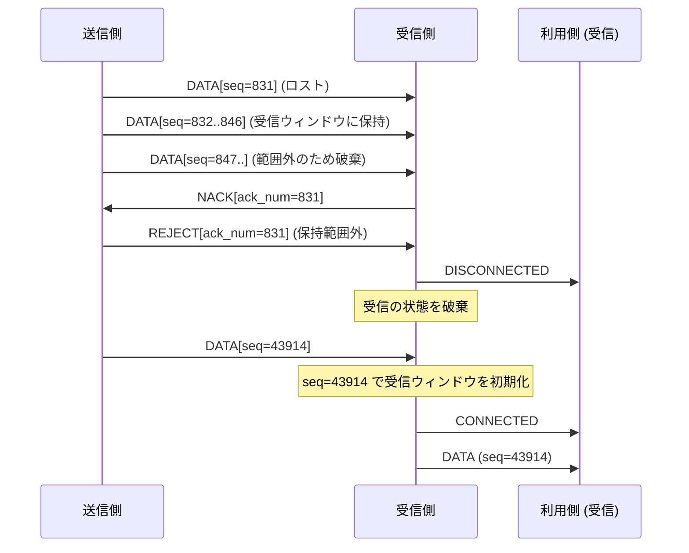

<!--
生成元: agree-before-implement スキル
文書種別: 最終仕様 (design)
最終更新日時: 2026-11-15 22:10:00 JST
最終更新エージェント: claude code / セッション ID: session_01KJc53STZ6gsPHA4EQ62685
稼働 OS: Windows
上流文書: `261115-porter-reject-recovery-discussion.md` (検討用 Markdown、合意版: 版 4)。削除されている場合があります。
再開手順: このファイルを開いたエージェントは、作業の前に agree-before-implement スキルを読み込んでください。上流文書が存在する場合は、上流文書の再開手順に従って進行位置を確認し、判断の経緯を上流文書の Q&A で確認します。存在しない場合は、この文書を単体の最終仕様として扱います。最終更新エージェントのセッション情報や稼働 OS・最終更新日時が参照可能であれば再開時のコンテキストや環境差分の把握に利用し、別エージェントや別環境・別 OS からの引き継ぎ、担当変更によりセッションが見つからない場合も異常とせず、文書の記載から継続してください。
-->

# porter の REJECT 受信後の受信再開 最終仕様

ファイル名: `261115-porter-reject-recovery-design.md`

## 目的と範囲

UDP の再送を行う通信種別 (`POTR_TYPE_UNICAST`、`POTR_TYPE_MULTICAST`、`POTR_TYPE_BROADCAST`、`POTR_TYPE_UNICAST_BIDIR` とその N:1) で、受信側が大きく遅れて再送不能の通知 (REJECT) を受けた後も、受信を再開できるようにします。あわせて、リオーダー待ちの期限切れに関する機能仕様と詳細設計の記述を、現在の実装に合わせてそろえます。

対象は次のとおりです。

- REJECT を受けた際の受信側の振る舞い
- 受信ウィンドウの範囲外のパケットを捨てる際の振る舞いとログ
- 機能仕様 [メッセージ配送](../../functional-spec/delivery.md) の要件と本文
- 詳細設計の文書 (`protocol.md`、`fin-ordering.md`、`sequence-data.md`)

対象外は次のとおりです。

- 送受信の形式 (パケットのヘッダー、フラグ、公開ヘッダーの定義)。変更しません。
- 送信側の NACK と REJECT の処理。変更しません。
- RAW の通信種別と TCP の通信種別。変更しません。
- 対策元の残課題のうち、TCP_NODELAY (BL-001) と、小さいメッセージと圧縮送信の処理件数 (BL-003)。本案件の残課題一覧へ転記します。

> [!NOTE]
> 受信が止まる原因は次の 3 点でした。REJECT を受けても受信ウィンドウが 1 通番しか進まないこと、範囲外のパケットを捨てる際に再送要求 (NACK) を送らないこと、REJECT の通番を確かめずに切断を通知することです。送信側の保持範囲は最大 256 通番のため、受信側が数万通番遅れると、1 通番ずつの NACK と REJECT の往復では回復しません。

## REJECT 受信時の振る舞い

### 自分の欠番の判定

受信側は、REJECT の `ack_num` (再送不能の通番) が自分の欠番に当たるかを、受信ウィンドウの `next_seq` (次に配信する通番) と比べて判定します。

| `ack_num` の位置 | 判定 | 処理 |
| --- | --- | --- |
| `next_seq` より前 (配信済み) | 欠番ではない | 無視する |
| `next_seq` 以降で、受信ウィンドウ内に受信済み | 欠番ではない | 無視する |
| `next_seq` 以降で、受信ウィンドウ内に未受信 | 欠番 | 再送不能の欠落として処理する |
| 受信ウィンドウより先 | 欠番 | 再送不能の欠落として処理する |

Table: REJECT の通番の位置と判定

前後の比較は、通番の周回を考慮した符号付きの差 (`(int32_t)(ack_num - next_seq) >= 0`) で行います。受信ウィンドウ内の受信済みかどうかは `potr_internal_window_recv_has_packet()` で判定し、受信ウィンドウより先の通番は未受信として扱います。

無視した REJECT は、ログ (VERBOSE) だけを記録し、経路の状態と受信の状態を変更しません。

> [!NOTE]
> 送信側は REJECT を、選択中のグループの宛先へ送ります。マルチキャストとブロードキャストでは、他の受信者の NACK に対する REJECT も届きます。また、同じ欠番へ NACK を 200[ms] 以上の間隔で繰り返した場合、REJECT が複数回届きます。判定により、これらで欠番のない受信者が切断することを防ぎます。

### 再送不能の欠落の処理

自分の欠番に対する REJECT を受けた場合、受信側は次の順に処理します。

1. ログ (WARNING) に「REJECT received (packet unrecoverable)」を記録します。N:1 では peer の識別子も含めます。
2. FIN を保留中 (`pending_fin` が 1) の場合は、目標通番までのデータを揃えられないため、`thread_recv_fin_fire()` で FIN を直ちに発火して終わります。FIN の発火は、切断の通知と受信の状態の初期化を行い、N:1 では peer を解放します。
3. FIN を保留していない場合は、全経路を切断状態にして切断を通知します (現在の処理と同じ)。
4. 受信の状態を破棄します。対象は、受信ウィンドウの保持内容、フラグメント途中の状態 (`frag_buf_len`、`frag_compressed`)、リオーダー待ち (`reorder_pending`)、セッションの既知状態 (`peer_session_known` を 0) です。

受信の状態を破棄した後は、次に届いた DATA または PING を新しいセッションとして採用し (`thread_recv_session_adopt()`)、その通番で受信ウィンドウを初期化します。最初の DATA の配信で経路が接続状態に戻り、接続が通知されます。

最終受信時刻 (`last_recv_ts`) は変更しません。REJECT は送信側が動いていることを示すため、ヘルス チェックの判定を継続します。

> [!IMPORTANT]
> 欠番より後で受信ウィンドウに保持していたパケット (最大で受信ウィンドウの大きさより 1 件少ない数) は、利用側へ渡さずに捨てます。これらは切断の通知より後のデータであり、機能仕様は切断の通知後の回復を適用範囲外としています。



Figure: REJECT による切断と受信の再開

### 不要になる関数

`potr_internal_window_recv_skip()` (`prod/libsrc/porter/protocol/window.c`) は、REJECT 受信時に 1 通番進めるためだけに使われていました。本仕様では呼び出し元がなくなるため、関数、宣言 (`prod/include_internal/porter/protocol/window.h`)、単体テスト (`test/src/libporter/windowTest/windowTest.cc` の該当テスト) を削除します。

## 受信ウィンドウの範囲外のパケット

### NACK の送出

RAW 以外の通信種別で、`potr_internal_window_recv_push()` が範囲外 (`POTR_ERR_OUT_OF_WINDOW`) で失敗した場合、パケットを捨てた後に次を行います。

- パケットの通番が受信ウィンドウより先 (`(int32_t)(seq_num - base_seq) >= window_size`) の場合は、先頭の欠番 `next_seq` について `slot_gap_ready()` を通し、送出可能であれば NACK を送ります。範囲外の通番が届いた時点で、`next_seq` から先は欠けています。
- 配信済みの古い通番 (再送の重複など) の場合は、NACK を送りません。

`slot_gap_ready()` は、範囲内のパケットと同じくリオーダー待ちを適用します。`reorder_timeout_ms` が 0 でない場合、範囲外のパケットが続いても NACK の送出は待ち時間ごとに 1 回です。0 の場合は範囲外のパケットごとに送りますが、送信側は同じ通番の NACK を 200[ms] の間は処理しません。

範囲外のパケットでは、これまでどおり経路の生存の更新と配信の処理を行いません。

### ログ

範囲外で捨てる際のログを、事象に合わせて次の文言にします。出力水準 (ERROR) と出力項目は変えません。

```text
recv[service_id=%lld]: peer=%u seq=%u out of recv_window, dropping (base_seq=%u window_size=%u)
```

## リオーダー待ちの期限切れの振る舞い

再送を行う通信種別では、リオーダー待ち (`reorder_timeout_ms`) の期限を過ぎても欠落が解消しない場合、欠落した通番の再送を要求します。切断は通知しません。欠落が解消するまで、待ち時間ごとに再送の要求を繰り返します。

欠落が解消しないまま送信側が送信を続けると、送信側の保持範囲から欠落した通番が外れ、REJECT を受けて切断が通知されます。送信側が送信をやめた場合は、ヘルス チェックの期限切れで切断が通知されます。

この振る舞いは現在の実装、`config.md`、`architecture.md`、`sequence-data.md`、`health-check.md`、`docs/README.md` と一致しています。実装は変更せず、機能仕様と、食い違っている詳細設計の記述を合わせます。

> [!NOTE]
> 期限切れで切断する方式は、`reorder_timeout_ms` の既定値 0 で、欠番を見つけた時点で切断することになり、再送の仕組みが働きません。また、再送が 1 回届かないだけで切断し、欠落のない引き渡しという目的と相反します。そのため、期限切れは再送の要求の契機として扱います。

## 機能仕様の変更

[機能仕様 メッセージ配送](../../functional-spec/delivery.md) を次のとおり変更します。要件 ID と UUID の扱いは [機能仕様の記載規範](../../../../general/docs/functional-spec-guideline.md) の「要件 ID と UUID の変更」に従います。

| 要件 | 変更 | 要件文 |
| --- | --- | --- |
| `POTR-DELIVERY-FUNC-005` (`f7deed1b-170c-4007-9e48-1b4a8c92d7af`) | 廃止 (別の論理要件に置き換えるため) | 削除 |
| `POTR-DELIVERY-FUNC-011` <!-- potr-req: uuid=5f4ebd3c-2656-428f-9683-340467f3b7ca --> (`5f4ebd3c-2656-428f-9683-340467f3b7ca`) | 新設 | porter のメッセージ配送機能は、再送を行う通信種別において、構成で指定された待ち時間を超えても欠落が解消しない場合、欠落した範囲の再送を送信側へ繰り返し要求します。 |
| `POTR-DELIVERY-FUNC-007` <!-- potr-req: uuid=b7ac35fc-7901-4f33-9ec3-ed139ffec8c1 --> (`b7ac35fc-7901-4f33-9ec3-ed139ffec8c1`) | 具体化 (UUID を維持) | porter のメッセージ配送機能は、自身の欠落した範囲について再送できないことを通知された場合、その通信を切断として利用側へ通知します。 |

Table: メッセージ配送の機能要件の変更

`POTR-DELIVERY-FUNC-011` <!-- potr-req: uuid=5f4ebd3c-2656-428f-9683-340467f3b7ca --> の番号は、Git 履歴を含めて過去に使用した最大番号 (`FUNC-010`) の次です。新設の行は、機能要件の表で `FUNC-010` の次に置きます。

本文は次のとおり変更します。

| 節 | 現在 | 変更後 |
| --- | --- | --- |
| 順序の保証と引き渡し | 欠落がある場合、後続のメッセージは、欠落が解消するか待ち時間を超えるまで引き渡されません。 | 欠落がある場合、後続のメッセージは、欠落が解消するか、その通信が切断として通知されるまで引き渡されません。 |
| 欠落の検知と再送 | (追記) | 一対多の通信種別では、他の受信側に対する再送できない旨の通知も届きます。通知された範囲が自身の欠落に当たらない場合、受信側はその通知を無視します。 |
| 順序の復元と待ち時間 | 待ち時間を超えても欠落が解消しない場合、その通信を切断として利用側へ通知します。 | 待ち時間を超えても欠落が解消しない場合、欠落した範囲の再送を送信側へ要求します。欠落が解消するまで、待ち時間ごとに要求を繰り返します。 |
| 切断の通知 | 表の 1 行目「待ち時間を超えても欠落が解消しない」 | 行を削除する |

Table: メッセージ配送の本文の変更

「順序の復元と待ち時間」の「欠落した範囲を除外して後続のメッセージを引き渡すことはありません。」は維持します。

## 詳細設計の文書の変更

| 文書 | 節 | 変更 |
| --- | --- | --- |
| `docs/protocol.md` | REJECT の役割 | 自分の欠番の判定、受信の状態の破棄、次のパケットからの再開、保留中の FIN の発火を記載する |
| `docs/protocol.md` | 受信ウィンドウの動作 | 範囲外の先の通番で NACK を送ることを記載する |
| `docs/protocol.md` | ペンディング中のエッジ ケース | REJECT の行を「FIN を直ちに発火」に改め、`reorder_timeout_ms` の行を「NACK を再送し、REJECT またはヘルス チェックで解消」に改める |
| `docs/fin-ordering.md` | エッジ ケース | `protocol.md` と同じ 2 行を同じ内容に改める |
| `docs/sequence-data.md` | REJECT による切断と復帰 | 「欠落 seq=0 をスキップ、seq=1 から再開」を「受信の状態を破棄」に改め、次に届いたパケットで初期化する流れにする |

Table: 詳細設計の文書の変更

## コードの変更

| ファイル | 変更 |
| --- | --- |
| `prod/libsrc/porter/thread/thread_recv_window.c` | `thread_recv_window_on_reject()` に自分の欠番の判定、保留中の FIN の発火、受信の状態の破棄を実装する。`thread_recv_window_accept_outer()` の範囲外の処理に NACK の送出とログ文言の変更を実装する |
| `prod/libsrc/porter/thread/thread_recv_window.h` | `thread_recv_window_on_reject()` の Doxygen コメントを、判定と破棄の振る舞いに合わせて更新する |
| `prod/libsrc/porter/protocol/window.c`、`prod/include_internal/porter/protocol/window.h` | `potr_internal_window_recv_skip()` を削除する |
| `test/src/libporter/windowTest/windowTest.cc` | `potr_internal_window_recv_skip()` のテストを削除する |
| `test/src/libporter/threadRecvWindowTest/` | 単体テストを追加する (次節)。必要に応じて `makepart.mk` と `thread_recv_window.inject.*` を更新する |

Table: コードの変更対象

## 単体テスト

`test/src/libporter/threadRecvWindowTest/` に、次の観点のテストを追加します。テストは [テスト方法](../../../../../framework/testfw/docs/how-to-test.md) と既存テストの書式に従います。

| 観点 | 期待する結果 |
| --- | --- |
| `next_seq` と同じ通番の REJECT | 切断を通知し、`peer_session_known` が 0、受信ウィンドウの保持内容が空、フラグメント途中の状態とリオーダー待ちが解除される |
| 受信ウィンドウより先の通番の REJECT | 上と同じ |
| 配信済みの通番の REJECT | 切断を通知せず、受信の状態を変更しない |
| 受信ウィンドウ内の受信済みの通番の REJECT | 切断を通知せず、受信の状態を変更しない |
| FIN を保留中の欠番の REJECT | `thread_recv_fin_fire()` を目標通番で呼ぶ |
| REJECT の後に届いた DATA | その通番で受信ウィンドウを初期化して配信する |
| 受信ウィンドウより先の DATA | パケットを捨て、`next_seq` の NACK を送る |
| 配信済みの古い通番の DATA | パケットを捨て、NACK を送らない |

Table: 追加する単体テストの観点

## 受入条件

- ユーザーが実行する `make` と `make test` (app/porter) が成功し、対象範囲の `.warn` に新たな警告がないこと。
- 前節の単体テストがすべて成功すること。
- Windows で P3 (受信コールバックが 1 件ごとに 1[ms] 待機し、5000 バイトを 10000 件、間隔なしで送信) を 5 回実行し、全回で受信が止まらないこと。判定は、REJECT を受けた後に受信が再開していること (「REJECT received」の後に「out of recv_window, dropping」が続いて受信が終わらないこと) とします。欠落の件数は、REJECT による切断の前後で失われた分だけとなり、測定区間の全件 (10000 件) の欠落が起きないことを確かめます。
- `python3 app/general/bin/check_functional_spec.py` (ワークスペース ルートで実行) が成功すること。
- 変更した Markdown が `text_style_jp.py --dry-run` で指摘なしとなり、`--in-place` を適用済みであること。

P3 の再測定は、前案件の測定用プログラム (`bench.cc`、`build-windows.ps1`、`run-matrix-windows.ps1`) をこのセッションの一時ディレクトリへ複製し、エージェントが現行版だけをビルドして実行します。リポジトリ内には成果物を作りません。結果は検討用 Markdown の「反映と検証の記録」に記録します。

> [!NOTE]
> 受信が遅れる負荷では、REJECT による切断の時点で、送信側の保持範囲より前のデータが失われます。P3 の受入は「欠落が 0 件であること」ではなく、「受信が止まらず再開すること」で判定します。

## 知見の反映計画

| 反映先 | 内容 |
| --- | --- |
| 機能仕様 `delivery.md` | 「機能仕様の変更」の要件と本文 |
| `protocol.md`、`fin-ordering.md`、`sequence-data.md` | 「詳細設計の文書の変更」の内容 |
| `thread_recv_window.c` のコメント | 自分の欠番に限って REJECT を扱う理由 (一対多では他の受信者向けの REJECT も届くこと)、受信の状態を破棄して次のパケットから再開する理由 (1 通番ずつでは送信側の保持範囲に追い付けないこと)、範囲外の先の通番で NACK を送る理由 |
| `thread_recv_window.h` の Doxygen | `thread_recv_window_on_reject()` の振る舞い (判定、FIN の発火、状態の破棄) |

Table: 知見の反映先

## 残課題の扱い

- 対策元 `261115-porter-handle-lifecycle-perf-backlog.md` の BL-002 は、状態を「対応済み」にし、本案件の名前と対処の内容を経緯に追記します。
- 対策元の BL-001 と BL-003 は、本案件の残課題一覧 `261115-porter-reject-recovery-backlog.md` へ転記し、対策元の各項目に転記先を追記します。
- 本案件の残課題一覧に作業中に記録した「リオーダー待ちの期限切れの食い違い」は、本案件で解消するため、整理の段階で除外します。
