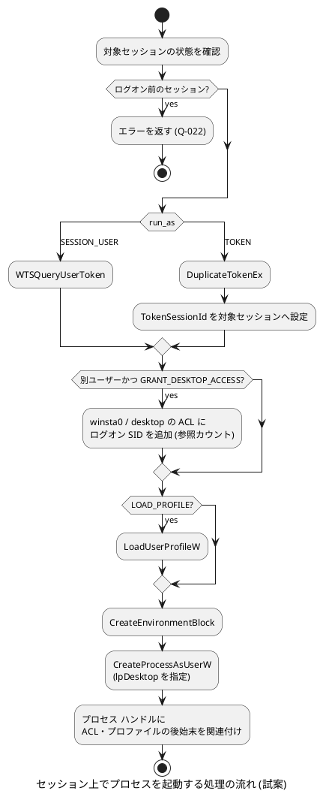

<!--
生成元: agree-before-implement スキル
文書種別: 検討用 Markdown (discussion)
最終更新エージェント: claude code / セッション ID: session_01KJc53TLTyUhwagD7HNyT5P
下流文書: `cplat-account-session-design.md` (最終仕様)、`cplat-account-session-backlog.md` (残課題一覧)。いずれもこの文書と同じディレクトリに置きます。未作成の場合や、削除されている場合があります。
再開手順: このファイルを開いたエージェントは、作業の前に agree-before-implement スキル (c-modernization-kit の `app/general/.agents/skills/agree-before-implement/SKILL.md`) を読み込んでください。ユーザーが編集した最新版を読み直し、作業 WBS の `← **CURRENT**` の項目から再開します。最終更新エージェントのセッション情報が参照可能であれば再開時のコンテキストとして利用し、別エージェントからの引き継ぎや担当変更によりセッションが見つからない場合も異常とせず、文書の記載から継続してください。`← **CURRENT**` の項目は処理が中止された項目である場合があり、どこまで進んでいたかは文書だけでは分かりません。対象成果物の内容を確認して実施済みの範囲を特定してから、作業を再開してください。`← **CURRENT**` がなく、作業 WBS がすべて完了 (✅) であれば、この案件の合意フローは完了しています。
補足: この文書は porter リポジトリの `docs/prompts/current/` に置いていますが、対象成果物は cplat (app/cplat、リポジトリ hondarer/app_cplat) です。cplat の作業規則は cplat の `AGENTS.md` を参照してください。
-->

# cplat のユーザー識別・セッション・別ユーザー起動の抽象化に関する検討

ファイル名: `cplat-account-session-discussion.md`

## 検討の識別

検討 ID: CPLAT-ACCOUNT-SESSION

版: 1

状態: 検討中

## 作業 WBS と進捗管理

この検討用 Markdown が管理する作業 WBS です。検討用 Markdown のための情報収集と質問の実施、残懸念がないことの確認 (第 1 ゲート: 最終仕様作成への着手)、最終決定事項 (最終仕様) を記載した `cplat-account-session-design.md` の作成、最終仕様の承認の受付 (第 2 ゲート)、承認された最終仕様に従った作業の実施、および作業完了後の成果物の承認の受付 (第 3 ゲート) に至る手順を記載します。  
作業対象のパスは、特記がない限り cplat リポジトリのルートからの相対パスです。Q&A のターンごとに必要に応じて見直します。見送りの決定や範囲外の気付きは、どの段階でも生じた時点で `cplat-account-session-backlog.md` に追記します。

凡例: ⏸️ 未着手、🔄 実施中、🚫 ブロック中、⚠️ 要注意、✅ 完了。現在取り組んでいる項目の末尾に `← **CURRENT**` を付けます。

- 🔄 1. 検討用 Markdown のための情報収集と質問の実施
    - ✅ 1.1. 前提条件と要求事項の調査 (対話セッションでの設計検討、cplat の公開ヘッダー・規範・機能仕様の確認)
    - ✅ 1.2. 課題・論点の抽出と明確化のための確認項目 ([Q-001](#q-001-成果物の実装先) 〜 [Q-024](#q-024-実装の段階分け)) の作成
    - 🔄 1.3. Q&A ターンごとのユーザー回答の受付と記録 (JST 日時、Git ユーザー名または発言者) ← **CURRENT**
    - ⏸️ 1.4. 回答に基づく前提・制約の検証と WBS の見直し
    - ⏸️ 1.5. 事前検証が必要な技術的事実の確認 ([技術的な未確認事項](#技術的な未確認事項) の V-001 〜 V-006。Windows 実機が必要なものは確認方法と結果を記録)
- ⏸️ 2. 前提合意と残懸念の解消 (第 1 ゲート: 最終仕様作成への着手)
    - ⏸️ 2.1. 全論点に対する未解決事項および質問の解消確認
    - ⏸️ 2.2. 方針・前提条件の合意確定 (懸念がないことをもってフェーズ 2 へ着手)
- ⏸️ 3. 最終決定事項 (最終仕様) の作成と承認の受付
    - ⏸️ 3.1. `cplat-account-session-design.md` の作成 (公開 API、型、結果コードの対応、OS ごとの実装方式、知見の反映計画)
    - ⏸️ 3.2. 最終仕様における受入条件と整合性の確認 (cplat の coding-guideline、link-policy、mock-cplat-guideline、機能仕様の記載規範)
    - ⏸️ 3.3. 対話セッションにおける最終仕様 (design.md) の承認の受付 (第 2 ゲート: 作業着手の合意)
- ⏸️ 4. 承認された最終仕様に従った作業の実施 (段階の分け方は [Q-024](#q-024-実装の段階分け) で確定し、必要に応じて本項を再構成する)
    - ⏸️ 4.1. 機能仕様の追加
        - ⏸️ 4.1.1. `docs/functional-spec/` への新しい機能カテゴリの Markdown 追加 ([Q-002](#q-002-機能仕様のカテゴリ構成) の結果に従う)
        - ⏸️ 4.1.2. `docs/functional-spec/README.md` の文書一覧の更新
        - ⏸️ 4.1.3. `docs/functional-spec-guideline.md` のカテゴリと主語の表の更新
        - ⏸️ 4.1.4. `docs/functional-spec/runtime.md` の子プロセス起動の要件 (CPLAT-RUNTIME-FUNC-004) と「適用範囲外」の見直し
    - ⏸️ 4.2. 公開ヘッダーの追加・変更
        - ⏸️ 4.2.1. ユーザー識別 (`prod/include/cplat/account/account.h` など。名称は [Q-004](#q-004-型と関数の名前の接頭辞) に従う)
        - ⏸️ 4.2.2. 起動用の資格 (トークン) (`prod/include/cplat/account/account_token.h`、Windows 固有部分は `account_token_windows.h`)
        - ⏸️ 4.2.3. セッションの列挙 (`prod/include/cplat/session/session.h`)
        - ⏸️ 4.2.4. セッション上でのプロセス起動 (`prod/include/cplat/session/session_process.h`)
        - ⏸️ 4.2.5. セッション変化の通知 (`prod/include/cplat/session/session_monitor.h`)
        - ⏸️ 4.2.6. 子プロセス起動オプションの拡張 (`prod/include/cplat/runtime/process.h`、[Q-008](#q-008-起動ユーザー指定の追加方法) に従う)
        - ⏸️ 4.2.7. 必要な場合の結果コード追加 (`prod/include/cplat/base/result.h` と `docs/coding-guideline.md` の写し)
    - ⏸️ 4.3. 実装の追加・変更
        - ⏸️ 4.3.1. `prod/libsrc/cplat/account/` (Linux / Windows)
        - ⏸️ 4.3.2. `prod/libsrc/cplat/session/` (Linux / Windows)
        - ⏸️ 4.3.3. `prod/libsrc/cplat/runtime/process.c` (Linux の `fork()` 後の ID 切り替え、Windows の起動 API の選択)
        - ⏸️ 4.3.4. `prod/libsrc/cplat/makepart.mk` のリンク指定 (Windows: wtsapi32、userenv、advapi32 の要否。Linux: [Q-017](#q-017-linux-の-logind-への依存方式) に従う) と `docs/link-policy.md` の更新
    - ⏸️ 4.4. テスト資産の追加・変更
        - ⏸️ 4.4.1. `mock_cplat` への mock 追加 (cplat の `create-mock-cplat-mock` スキルを使用)
        - ⏸️ 4.4.2. `test/src/libcplatTest/exportTest/exportTest.cc` の `CPLAT_EXPORT_TABLE_COMMON` / `CPLAT_EXPORT_TABLE_PLATFORM` の更新
        - ⏸️ 4.4.3. `test/src/libcplatTest/` への単体テスト追加 (account、session、process の identity)
        - ⏸️ 4.4.4. Windows 実機での手動検証手順と結果の記録 ([Q-023](#q-023-windows-実機検証の扱い) に従う)
    - ⏸️ 4.5. 文書の更新
        - ⏸️ 4.5.1. `docs/api-cheatsheet.md` の該当箇所の追加
        - ⏸️ 4.5.2. 公開ヘッダーの Doxygen コメント (スレッド セーフ、必要な権限、OS 差の明記)
        - ⏸️ 4.5.3. 正本ドキュメントおよびコード コメントへの永続的知見の反映 (トークンとセッションの関係、デスクトップ ACL の後始末、fork 後の非同期シグナル安全性など)
    - ⏸️ 4.6. `make` と `make test` による機械的検証、および Markdown のフォーマット チェック
    - ⏸️ 4.7. 受入条件への適合確認 (全完確認)
    - ⏸️ 4.8. 残課題一覧 (`cplat-account-session-backlog.md`) の再構築と整理 (当該作業中に解消・容認した項目の除外、起票できる詳細度への書き直し)
- ⏸️ 5. 成果物の承認の受付 (第 3 ゲート)
    - ⏸️ 5.1. 成果物・検証結果・残課題の提示
    - ⏸️ 5.2. 対話セッションにおける成果物の承認の受付 (「承認」または「完了」の受領によるスキル完了)

## 対象と参照資料

対象成果物: cplat (app/cplat、リポジトリ hondarer/app_cplat) の機能仕様、公開ヘッダー、実装、mock_cplat、テスト、関連文書。

今回の対象範囲: ユーザーとグループの識別子の抽象化、名前との相互変換、実ユーザーと実効ユーザーの取得、別ユーザーとしてのプロセス起動に使う資格 (トークン)、ログイン セッションの列挙、セッション上での GUI プロセスの起動 (ログイン中ユーザーおよび任意ユーザー)、セッション変化の通知。

書き込み可能な検討用 Markdown: この文書 (porter リポジトリの `docs/prompts/current/cplat-account-session-discussion.md`)

参照資料と版:

| 資料 | 版 | 確認した内容 |
| --- | --- | --- |
| cplat `AGENTS.md` | 5340cd8 (2026-11-05) | 公開 API と api-cheatsheet の同期、exportTest、mock_cplat、機能仕様の同期の規則 |
| cplat `docs/coding-guideline.md` | 5340cd8 | 共通結果コード、`cplat_error *detail_out`、ラッパー設計方針、ABI 変更の扱い |
| cplat `docs/functional-spec-guideline.md` | 5340cd8 | 要件 ID `CPLAT-<CATEGORY>-<TYPE>-NNN`、カテゴリと主語の表 |
| cplat `docs/functional-spec/runtime.md` | 5340cd8 | CPLAT-RUNTIME-FUNC-004 (子プロセス起動)、005 (権限昇格)、適用範囲外の「Linux での権限昇格手段の提供」 |
| cplat `docs/link-policy.md` | 5340cd8 | cplat は動的ライブラリのみ。Linux のリンク先は cjson、zlib、crypto、dl、stdc++ |
| cplat `prod/include/cplat/runtime/process.h` | 5340cd8 | `cplat_process_options` の構成、`cplat_process_start()` |
| cplat `prod/libsrc/cplat/runtime/process.c` | 5340cd8 | Linux は `fork()` + `execve()`、Windows は `CreateProcessW()` |
| cplat `prod/include/cplat/runtime/elevated_process.h` | 5340cd8 | `cplat_elevated_process_is_elevated()` |
| cplat `prod/include/cplat/win32/win32.h` | 5340cd8 | サービス関連は UTF-8 版ラッパー (`RegisterServiceCtrlHandlerExU()` など) のみで、制御ハンドラーは利用側が持つ |
| cplat `prod/include/cplat/base/result.h` (写しは coding-guideline) | 5340cd8 | `CPLAT_ERR_UNSUPPORTED`、`CPLAT_ERR_PERMISSION_DENIED`、`CPLAT_ERR_NOT_FOUND`、`CPLAT_ERR_IDENTITY_MISMATCH`、`CPLAT_ERR_CANCELED` などの既存コード |
| porter `README.md` | b21d1a4 (2026-10-31) | porter は UDP/IP と TCP/IP の通信ライブラリで、ユーザー識別やセッションの機能は使っていない |
| 対話セッション (session_01KJc53TLTyUhwagD7HNyT5P) | 2026-11-05 〜 2026-11-07 | ユーザーの要求と、AI が提示した設計案 (下記の試案) |

## 現行の合意内容

ユーザーが対話セッションで明示した内容を、発言の出典とともに記載します。AI が提示した設計案は合意済みではないため、ここには含めず、[AI が提示した設計試案](#ai-が提示した設計試案-未合意) と各 Q で確認します。

| ID | 合意内容 | 出典 |
| --- | --- | --- |
| R-001 | cplat で `getuid()` に相当する機能を抽象化します。Windows のユーザー識別は SID とし、ユーザー名からの変換や実効ユーザーの指定などに使う中間表現として抽象化します。 | 対話 1 回目のユーザー発言 (2026-11-05) |
| R-002 | Windows において、起動するプロセスのユーザーを偽装すること (別ユーザーとしての起動) をスコープに含めます。 | 対話 2 回目のユーザー発言 |
| R-003 | Windows サービス (SYSTEM) からユーザーを偽装してプロセスを起動できることを目的に含めます。 | 対話 3 回目のユーザー発言 |
| R-004 | ログイン セッションに介入し、そのセッション上でログイン中のユーザーや任意のユーザーの GUI を実行できることを目的とした API セットにします。 | 対話 3 回目のユーザー発言 |
| R-005 | サインイン画面 (ログオン前) への表示はスコープ外とします。 | 対話 4 回目のユーザー発言 (2026-11-07) |
| R-006 | ユーザーのログオンやセッション切り替えを検知する通知 (サービスの `SERVICE_CONTROL_SESSIONCHANGE`) を対象に含めます。 | 対話 4 回目のユーザー発言。原文「対称にする」を「対象にする」と解釈し、対話で解釈を明示した |
| R-007 | 検討文書を porter の `docs/prompts/current` に置き、続きはローカル エージェントで進めます。 | 対話 5 回目のユーザー発言 |

Table: ユーザーが明示した要求と出典

次の事項は、ユーザーの判断ではなく OS の仕様に由来する技術的な制約です。設計はこれらを前提とします。

| ID | 技術的な制約 | 根拠 |
| --- | --- | --- |
| T-001 | SID は可変長で、最大長は `SECURITY_MAX_SID_SIZE` (68[byte]) です。 | Windows SDK `winnt.h` |
| T-002 | UAC で昇格してもユーザー SID は変わりません。特権の有無は SID からは判定できません。 | Windows のアクセス トークンの仕様 |
| T-003 | `CreateProcessWithLogonW` は LocalSystem から呼び出せません。呼び出し元のトークンにログオン SID が必要なためです。 | Microsoft Learn の `CreateProcessWithLogonW` の Remarks |
| T-004 | `WTSQueryUserToken` は、`SeTcbPrivilege` を持つ LocalSystem から呼び出す必要があります。 | Microsoft Learn の `WTSQueryUserToken` |
| T-005 | トークンの所属セッションを `SetTokenInformation(TokenSessionId)` で変更するには `SeTcbPrivilege` が必要です。 | Microsoft Learn の `SetTokenInformation` |
| T-006 | `SERVICE_CONTROL_SESSIONCHANGE` はサービスの制御ハンドラー (`HandlerEx`) にだけ届き、受け取るには `SERVICE_ACCEPT_SESSIONCHANGE` を指定する必要があります。cplat は制御ハンドラーを持たないため、利用側からの転送が必要です。 | Microsoft Learn の `HandlerEx`、cplat `win32.h` |
| T-007 | Linux の `fork()` 後の子プロセス (マルチスレッドのプロセス) では、非同期シグナル安全な関数だけを呼び出せます。`initgroups()` は NSS を読むため使えず、補助グループは親側で解決しておく必要があります。 | POSIX `fork()`、cplat `process.c` の既存コメント |
| T-008 | Linux で別ユーザーとして起動するには、呼び出し側が root、または `CAP_SETUID` / `CAP_SETGID` を持つ必要があります。 | Linux `setuid(2)`、`capabilities(7)` |

Table: 設計の前提となる技術的な制約

## 観点別の確認

| 観点 | 状態 | 根拠・関連 Q |
| --- | --- | --- |
| 目的・利用者 | 未解決 | R-001 〜 R-004 で目的は明示済み。実装先と利用者の確認は [Q-001](#q-001-成果物の実装先) |
| 範囲・境界 | 未解決 | R-005、R-006 で一部確定。Linux の対応範囲は [Q-007](#q-007-linux-でのパスワードによるログオン)、[Q-016](#q-016-linux-でのセッション上の起動範囲)。追加範囲は [Q-011](#q-011-スレッド単位の偽装-api)、[Q-012](#q-012-昇格したトークンの取得)、[Q-019](#q-019-windows-の非サービス-プロセスでの通知の受信) |
| 入力・根拠 | 確認済み | [対象と参照資料](#対象と参照資料) の表。OS 仕様の事実は T-001 〜 T-008 |
| 整合性・依存関係 | 未解決 | 機能仕様のカテゴリ [Q-002](#q-002-機能仕様のカテゴリ構成)、既存 API の変更 [Q-008](#q-008-起動ユーザー指定の追加方法)、リンク方針 [Q-017](#q-017-linux-の-logind-への依存方式)、結果コード [Q-006](#q-006-名前検索で種別が一致しない場合の結果コード)、[Q-022](#q-022-ログオン前のセッションを起動先に指定した場合の結果コード) |
| 実現性・例外 | 未解決 | 技術的な未確認事項 V-001 〜 V-006。権限不足時の振る舞い [Q-009](#q-009-windows-でトークン指定時に使う起動-api-の順序)、取りこぼし [Q-020](#q-020-通知キューの上限の指定方法) |
| 受入条件・検証 | 未解決 | Windows 実機検証の扱い [Q-023](#q-023-windows-実機検証の扱い)、実装の段階分け [Q-024](#q-024-実装の段階分け) |

## AI が提示した設計試案 (未合意)

対話セッションで AI が提示した設計案を、最新の議論 (R-005 による SYSTEM 起動の削除、T-003 による起動 API の順序見直し) を反映して整理したものです。各要素の採否は Q で確認します。名前は仮であり、[Q-004](#q-004-型と関数の名前の接頭辞) で確定します。

### 層の構成

| 層 | 役割 | 主な要素 |
| --- | --- | --- |
| 識別 | ユーザー・グループを識別し、比較・保存する | `cplat_account_id` (固定長の値型) |
| 資格 | 別ユーザーとして起動するための資格を表す | `cplat_account_token` (ハンドル型) |
| セッション | ログイン セッションの列挙と状態の取得 | `cplat_session_info`、`cplat_session_enumerate()` |
| 通知 | セッションの変化 (ログオン、切り替えなど) を受け取る | `cplat_session_monitor` |
| 起動 | 指定セッション上で、指定ユーザーとしてプロセスを起動する | `cplat_process_options.identity`、`cplat_session_process_start()` |

Table: 設計試案の層と役割

### 識別 (試案)

```{.c caption="prod/include/cplat/account/account.h (試案)"}
#define CPLAT_ACCOUNT_ID_MAX_BYTES 68 /* SECURITY_MAX_SID_SIZE に合わせる */

typedef enum cplat_account_kind {
    CPLAT_ACCOUNT_KIND_USER  = 1,
    CPLAT_ACCOUNT_KIND_GROUP = 2
} cplat_account_kind;

typedef enum cplat_account_which {
    CPLAT_ACCOUNT_REAL      = 1, /* Linux: getuid / Windows: プロセス トークン */
    CPLAT_ACCOUNT_EFFECTIVE = 2  /* Linux: geteuid / Windows: 偽装中ならスレッド トークン、それ以外はプロセス トークン */
} cplat_account_which;

typedef struct cplat_account_id {          /* 中身は非公開扱い */
    uint32_t kind;
    uint32_t size;                         /* value の有効バイト数 */
    uint8_t  value[CPLAT_ACCOUNT_ID_MAX_BYTES]; /* uid/gid または SID。8[byte] 目から始まり 4 バイト境界 */
} cplat_account_id;

int cplat_account_get_current(cplat_account_which which, cplat_account_id *id_out, cplat_error *detail_out);
int cplat_account_lookup_name(const char *name_utf8, cplat_account_kind kind, cplat_account_id *id_out, cplat_error *detail_out);
int cplat_account_get_name(const cplat_account_id *id, char *name_out, size_t name_size, cplat_error *detail_out);
int cplat_account_id_to_string(const cplat_account_id *id, char *out, size_t out_size);
int cplat_account_id_from_string(const char *text, cplat_account_kind kind, cplat_account_id *id_out);
int cplat_account_id_equal(const cplat_account_id *a, const cplat_account_id *b);
/* OS 固有: account_linux.h に get_uid / get_gid、account_windows.h に内部 SID を指す const PSID の取得 */
```

### 資格 (試案)

```{.c caption="prod/include/cplat/account/account_token.h (試案)"}
typedef struct cplat_account_token cplat_account_token;

typedef enum cplat_logon_type {
    CPLAT_LOGON_INTERACTIVE = 1, CPLAT_LOGON_BATCH = 2, CPLAT_LOGON_SERVICE = 3
} cplat_logon_type;

int  cplat_account_token_open_current(cplat_account_token **token_out, cplat_error *detail_out);
int  cplat_account_token_logon(const char *name_utf8, const char *password_utf8, cplat_logon_type type,
                               cplat_account_token **token_out, cplat_error *detail_out); /* Linux は Q-007 */
int  cplat_account_token_from_id(const cplat_account_id *id, cplat_account_token **token_out,
                                 cplat_error *detail_out); /* Linux: passwd/group から解決 / Windows: S4U (SeTcbPrivilege) */
int  cplat_account_token_get_id(const cplat_account_token *token, cplat_account_id *id_out);
void cplat_account_token_dispose(cplat_account_token *token);

/* セッション関連 */
int  cplat_account_token_open_session_user(uint32_t session_id, cplat_account_token **token_out,
                                           cplat_error *detail_out); /* Windows: WTSQueryUserToken */
int  cplat_account_token_bind_session(const cplat_account_token *source, uint32_t session_id,
                                      cplat_account_token **token_out, cplat_error *detail_out);
```

### 起動オプションの拡張 (試案)

```{.c caption="prod/include/cplat/runtime/process.h (試案)"}
typedef enum cplat_process_identity_mode {
    CPLAT_PROCESS_IDENTITY_CURRENT    = 0, /* 既定。現在のユーザー */
    CPLAT_PROCESS_IDENTITY_TOKEN      = 1, /* token で起動 */
    CPLAT_PROCESS_IDENTITY_CREDENTIAL = 2  /* name + password で起動 (Q-010) */
} cplat_process_identity_mode;

typedef struct cplat_process_identity {
    cplat_process_identity_mode mode;
    unsigned int flags;                 /* LOAD_PROFILE / USER_ENVIRONMENT */
    const cplat_account_token *token;   /* 所有権は移動しない */
    const char *name;
    const char *password;
} cplat_process_identity;

typedef struct cplat_process_options {
    /* ... 既存メンバー ... */
    cplat_process_identity identity;    /* ゼロ初期化で従来どおり */
} cplat_process_options;
```

### セッションと起動 (試案)

```{.c caption="prod/include/cplat/session/session.h, session_process.h (試案)"}
#define CPLAT_SESSION_ID_CURRENT UINT32_MAX

typedef enum cplat_session_state {
    CPLAT_SESSION_STATE_ACTIVE = 1, CPLAT_SESSION_STATE_DISCONNECTED = 2,
    CPLAT_SESSION_STATE_NO_USER = 3, CPLAT_SESSION_STATE_OTHER = 4
} cplat_session_state;

typedef struct cplat_session_info {
    uint32_t session_id; uint32_t state; uint32_t flags; uint32_t pad; /* flags: CONSOLE / REMOTE */
    cplat_account_id user;                                            /* NO_USER のとき kind = 0 */
} cplat_session_info;

int cplat_session_enumerate(cplat_session_info *sessions_out, size_t capacity, size_t *count_out, cplat_error *detail_out);
int cplat_session_get_active_console(uint32_t *session_id_out, cplat_error *detail_out);

typedef enum cplat_session_run_as {
    CPLAT_SESSION_RUN_AS_SESSION_USER = 1, /* そのセッションのログイン ユーザー */
    CPLAT_SESSION_RUN_AS_TOKEN        = 2  /* 任意ユーザー (R-005 により SYSTEM 起動は削除) */
} cplat_session_run_as;

typedef struct cplat_session_process_options {
    uint32_t session_id; uint32_t run_as; uint32_t flags; uint32_t pad; /* flags: Q-013、Q-015 */
    const cplat_account_token *token;
    const char *desktop;                 /* NULL なら "winsta0\\default" */
    cplat_process_options process;
} cplat_session_process_options;

int cplat_session_process_start(const cplat_session_process_options *options, cplat_process **process, cplat_error *detail_out);
```

Windows での `cplat_session_process_start()` の処理順序は次のとおりです。



### 通知 (試案)

```{.c caption="prod/include/cplat/session/session_monitor.h (試案)"}
typedef enum cplat_session_event_type {
    CPLAT_SESSION_EVENT_LOGON = 1, CPLAT_SESSION_EVENT_LOGOFF = 2,
    CPLAT_SESSION_EVENT_CONNECT = 3, CPLAT_SESSION_EVENT_DISCONNECT = 4,
    CPLAT_SESSION_EVENT_LOCK = 5, CPLAT_SESSION_EVENT_UNLOCK = 6,
    CPLAT_SESSION_EVENT_RESYNC = 7   /* キューあふれ。enumerate で取り直す */
} cplat_session_event_type;
/* flags: CONSOLE / REMOTE / INITIAL (監視開始時点の状態から合成) */

typedef struct cplat_session_event {
    uint32_t type; uint32_t flags; uint32_t session_id; uint32_t pad;
    cplat_account_id user;           /* LOGOFF は LOGON 時に記録した値を返す */
} cplat_session_event;

typedef struct cplat_session_monitor cplat_session_monitor;

typedef enum cplat_session_monitor_source {
    CPLAT_SESSION_MONITOR_SOURCE_AUTO = 0,    /* Windows: 内部ウィンドウ (Q-019) / Linux: logind */
    CPLAT_SESSION_MONITOR_SOURCE_SERVICE = 1  /* Windows: HandlerEx からの転送のみ */
} cplat_session_monitor_source;

int  cplat_session_monitor_create(cplat_session_monitor_source source, cplat_session_monitor **monitor_out, cplat_error *detail_out);
int  cplat_session_monitor_feed_service_control(cplat_session_monitor *monitor, uint32_t control, uint32_t event_type,
                                                void *event_data, int *handled_out); /* ブロックしない */
int  cplat_session_monitor_wait(cplat_session_monitor *monitor, int timeout_ms, cplat_session_event *event_out, cplat_error *detail_out);
int  cplat_session_monitor_cancel(cplat_session_monitor *monitor);
void cplat_session_monitor_dispose(cplat_session_monitor *monitor);
```

## 技術的な未確認事項

AI が確証を持てない事実です。最終仕様の作成前、または該当する実装段階の前に確認します。確認結果によって Q の推奨や選択肢の前提が変わる場合は、新しい Q-ID で再確認します。

| ID | 未確認事項 | 影響する Q | 確認方法 |
| --- | --- | --- | --- |
| V-001 | `CreateProcessWithLogonW` / `CreateProcessWithTokenW` で、`STARTF_USESTDHANDLES` による標準入出力の指定 (`CPLAT_PROCESS_STDIO_NATIVE_HANDLE`) が `CreateProcessW` と同じように機能するか | [Q-009](#q-009-windows-でトークン指定時に使う起動-api-の順序)、[Q-010](#q-010-資格情報指定での起動の提供) | Microsoft Learn の記述確認と、Windows 実機でパイプを渡す試験 |
| V-002 | セッション 0 で動くサービスから、メッセージ専用ウィンドウ + `WTSRegisterSessionNotification(NOTIFY_FOR_ALL_SESSIONS)` で通知を受け取れるか | [Q-019](#q-019-windows-の非サービス-プロセスでの通知の受信) | Windows 実機のサービスで試験 |
| V-003 | S4U ログオン (`LsaLogonUser` + `KERB_S4U_LOGON` / `MSV1_0_S4U_LOGON`) で得たトークンで GUI プロセスを起動した場合に、ネットワーク資源、DPAPI、EFS へアクセスできない範囲 | [Q-013](#q-013-別ユーザーの-gui-をログイン中ユーザーのデスクトップへ出す場合の-acl-付与) | Microsoft Learn の記述確認と、ドメイン参加・非参加の実機試験 |
| V-004 | `LOGOFF` 通知の時点で `WTSQuerySessionInformation` によりユーザー名を取得できるか (監視側で記録する必要があるか) | [Q-020](#q-020-通知キューの上限の指定方法) | Windows 実機での試験 |
| V-005 | logind の `LockedHint` を、主要なデスクトップ環境 (GNOME、KDE) が設定するか | [Q-021](#q-021-linux-でのロック解除通知の保証範囲) | 各環境での `loginctl show-session` の確認 |
| V-006 | Windows で追加が必要なリンク ライブラリ (wtsapi32、userenv、secur32 など) と、cplat の既存のリンク指定方法 (`makepart.mk` か `#pragma comment(lib)` か) | [Q-017](#q-017-linux-の-logind-への依存方式) | cplat の既存 Windows 実装と makefw の確認 |

Table: 技術的な未確認事項

## 質問一覧

| Q-ID | 論点 | 状態 | 依存・関連 |
| --- | --- | --- | --- |
| [Q-001](#q-001-成果物の実装先) | 成果物の実装先 | 未回答 | なし |
| [Q-002](#q-002-機能仕様のカテゴリ構成) | 機能仕様のカテゴリ構成 | 未回答 | [Q-001](#q-001-成果物の実装先) |
| [Q-003](#q-003-識別子の表現形式) | 識別子の表現形式 | 未回答 | なし |
| [Q-004](#q-004-型と関数の名前の接頭辞) | 型と関数の名前の接頭辞 | 未回答 | [Q-002](#q-002-機能仕様のカテゴリ構成) |
| [Q-005](#q-005-識別子の文字列表現の互換性) | 識別子の文字列表現の互換性 | 未回答 | [Q-003](#q-003-識別子の表現形式) |
| [Q-006](#q-006-名前検索で種別が一致しない場合の結果コード) | 名前検索で種別が一致しない場合の結果コード | 未回答 | なし |
| [Q-007](#q-007-linux-でのパスワードによるログオン) | Linux でのパスワードによるログオン | 未回答 | [Q-010](#q-010-資格情報指定での起動の提供) |
| [Q-008](#q-008-起動ユーザー指定の追加方法) | 起動ユーザー指定の追加方法 | 未回答 | なし |
| [Q-009](#q-009-windows-でトークン指定時に使う起動-api-の順序) | Windows でトークン指定時に使う起動 API の順序 | 未回答 | V-001 |
| [Q-010](#q-010-資格情報指定での起動の提供) | 資格情報指定での起動の提供 | 未回答 | [Q-007](#q-007-linux-でのパスワードによるログオン)、V-001 |
| [Q-011](#q-011-スレッド単位の偽装-api) | スレッド単位の偽装 API | 未回答 | なし |
| [Q-012](#q-012-昇格したトークンの取得) | 昇格したトークンの取得 | 未回答 | なし |
| [Q-013](#q-013-別ユーザーの-gui-をログイン中ユーザーのデスクトップへ出す場合の-acl-付与) | 別ユーザーの GUI を出す場合の ACL 付与 | 未回答 | [Q-014](#q-014-デスクトップ-acl-の後始末) |
| [Q-014](#q-014-デスクトップ-acl-の後始末) | デスクトップ ACL の後始末 | 未回答 | [Q-013](#q-013-別ユーザーの-gui-をログイン中ユーザーのデスクトップへ出す場合の-acl-付与) |
| [Q-015](#q-015-ユーザー環境の作成の既定値) | ユーザー環境の作成の既定値 | 未回答 | なし |
| [Q-016](#q-016-linux-でのセッション上の起動範囲) | Linux でのセッション上の起動範囲 | 未回答 | [Q-017](#q-017-linux-の-logind-への依存方式) |
| [Q-017](#q-017-linux-の-logind-への依存方式) | Linux の logind への依存方式 | 未回答 | V-006 |
| [Q-018](#q-018-通知の受け取り方式) | 通知の受け取り方式 | 未回答 | なし |
| [Q-019](#q-019-windows-の非サービス-プロセスでの通知の受信) | Windows の非サービス プロセスでの通知の受信 | 未回答 | V-002 |
| [Q-020](#q-020-通知キューの上限の指定方法) | 通知キューの上限の指定方法 | 未回答 | [Q-018](#q-018-通知の受け取り方式) |
| [Q-021](#q-021-linux-でのロック解除通知の保証範囲) | Linux でのロック・解除通知の保証範囲 | 未回答 | V-005 |
| [Q-022](#q-022-ログオン前のセッションを起動先に指定した場合の結果コード) | ログオン前のセッションを起動先に指定した場合の結果コード | 未回答 | R-005 |
| [Q-023](#q-023-windows-実機検証の扱い) | Windows 実機検証の扱い | 未回答 | V-001 〜 V-004 |
| [Q-024](#q-024-実装の段階分け) | 実装の段階分け | 未回答 | なし |

## 明確化のための確認項目

再質問や過去の質問への補足質問は、過去のやり取りを編集せず、新たな質問番号 (Q-ID) で継続します。意図不明とされた質問も回答済みとして確定し、そのターンの回答を踏まえて新たな質問番号で再生成します。

### Q-001 成果物の実装先

**Status**

未回答

**Question**

成果物を cplat にだけ実装し、porter はこの検討文書の置き場としてだけ使う、という理解でよいですか。

**Context**

検討文書の置き場所として porter の `docs/prompts/current` が指定されました (R-007)。一方、対話の内容はすべて cplat の API 設計です。porter は UDP/IP と TCP/IP の通信ライブラリで、現行のコードはユーザー識別やセッションの機能を使っていません。porter がこの API の利用者になる予定がある場合は、porter 側の機能仕様と設計も今回の範囲に入るため、確認します。

**Answer**

選択方式: 単一選択

- [ ] A: (推奨) cplat にだけ実装する。porter は検討文書の置き場としてだけ使う。
- [ ] B: cplat に実装し、porter も今回の範囲で利用者として組み込む。
- [ ] C: その他
- [ ] X: 意図不明 (詳細な質問内容に再生成すること)

その他の回答 / 補足:

**Recommendation**

推奨: A  
理由: 対話で示された目的 (R-001 〜 R-006) はすべて cplat の公開 API に関するもので、porter 側の要求は示されていないためです。

### Q-002 機能仕様のカテゴリ構成

**Status**

未回答

**Question**

`docs/functional-spec/` に、どの単位で機能カテゴリを追加しますか。

**Context**

cplat の AGENTS.md は、利用側から見て独立した目的を持つ機能カテゴリを追加した場合、機能仕様の Markdown と文書一覧を同じ変更で追加するよう定めています。カテゴリはファイル名と一対一で対応し、要件 ID の `<CATEGORY>` になります (`docs/functional-spec-guideline.md`)。

今回の機能は「ユーザーの識別と起動用の資格」と「ログイン セッションの列挙・通知・起動」に分けられます。既存の RUNTIME カテゴリには子プロセス起動 (CPLAT-RUNTIME-FUNC-004) と権限昇格 (005) があり、そこへ含める案もあります。

```text
案 A: ACCOUNT (account.md) と SESSION (session.md) の 2 カテゴリを追加
      CPLAT-ACCOUNT-FUNC-001 ... / CPLAT-SESSION-FUNC-001 ...
案 B: ACCOUNT (account.md) の 1 カテゴリにまとめる
      CPLAT-ACCOUNT-FUNC-001 ... (セッションも含む)
案 C: 既存の RUNTIME (runtime.md) に追記する
      CPLAT-RUNTIME-FUNC-018 ...
```

**Answer**

選択方式: 単一選択

- [ ] A: (推奨) ACCOUNT と SESSION の 2 カテゴリを追加する。
- [ ] B: ACCOUNT の 1 カテゴリにまとめる。
- [ ] C: 既存の RUNTIME に追記する。
- [ ] D: その他
- [ ] X: 意図不明 (詳細な質問内容に再生成すること)

その他の回答 / 補足:

**Recommendation**

推奨: A  
理由: ユーザー識別は単独でも使われ (ファイル所有者の比較など)、セッションは Windows サービスからの GUI 起動という別の目的を持つためです。RUNTIME はすでに要件が 17 件あり、目的の異なる要件を追加すると読みにくくなります。子プロセス起動の要件 (CPLAT-RUNTIME-FUNC-004) は RUNTIME に残し、起動ユーザーの指定だけを追記する想定です。

**Related**

[Q-004](#q-004-型と関数の名前の接頭辞)

### Q-003 識別子の表現形式

**Status**

未回答

**Question**

ユーザーとグループの識別子を、固定長の値型とハンドル型のどちらで表しますか。

**Context**

SID は可変長ですが、最大長が 68[byte] に決まっています (T-001)。Linux の uid / gid は 4[byte] の整数です。

```c
/* 案 A: 固定長の値型。コピー・比較・hashtable のキーにそのまま使える。確保と解放は不要 */
cplat_account_id id;
cplat_account_get_current(CPLAT_ACCOUNT_EFFECTIVE, &id, NULL);
cplat_account_id copy = id;   /* 代入でコピーできる */
```

```c
/* 案 B: ハンドル型。中身を完全に隠せるが、確保と解放が必要 */
cplat_account_id *id = NULL;
cplat_account_get_current(CPLAT_ACCOUNT_EFFECTIVE, &id, NULL);
cplat_account_id_dispose(id); /* 解放を忘れるとリークする */
```

案 A は構造体のサイズ (76[byte]) が公開 ABI の一部になります。将来 SID の最大長が変わると ABI が変わりますが、`SECURITY_MAX_SID_SIZE` は長く変わっていません。

**Answer**

選択方式: 単一選択

- [ ] A: (推奨) 固定長の値型にする。
- [ ] B: ハンドル型にする。
- [ ] C: その他
- [ ] X: 意図不明 (詳細な質問内容に再生成すること)

その他の回答 / 補足:

**Recommendation**

推奨: A  
理由: R-001 の「中間表現」として保存・比較・受け渡しを多用するため、確保と解放が不要な値型の方が誤用が起きにくいためです。cplat の coding-guideline でも、全体の再コンパイルで解消できる ABI 変更は許容されています。

**Related**

[Q-005](#q-005-識別子の文字列表現の互換性)

### Q-004 型と関数の名前の接頭辞

**Status**

未回答

**Question**

ユーザー識別の型と関数の接頭辞を何にしますか。

**Context**

識別子はユーザーとグループの両方を表します (Windows ではどちらも SID)。`user` を接頭辞にすると、グループを表すときに名前と中身が合いません。

```text
案 A: cplat_account_id / cplat_account_lookup_name / cplat_account_token
案 B: cplat_user_id    / cplat_user_lookup_name    / cplat_user_token
案 C: cplat_principal_id / cplat_principal_lookup_name / cplat_principal_token
```

**Answer**

選択方式: 単一選択

- [ ] A: (推奨) `cplat_account_*`
- [ ] B: `cplat_user_*`
- [ ] C: `cplat_principal_*`
- [ ] D: その他
- [ ] X: 意図不明 (詳細な質問内容に再生成すること)

その他の回答 / 補足:

**Recommendation**

推奨: A  
理由: Windows の API (`LookupAccountNameW`、`LookupAccountSidW`) が「アカウント」をユーザーとグループの総称として使っており、Linux でも違和感のない一般的な語であるためです。`principal` はセキュリティ分野の専門用語で、利用者に説明が必要になります。

**Related**

[Q-002](#q-002-機能仕様のカテゴリ構成)

### Q-005 識別子の文字列表現の互換性

**Status**

未回答

**Question**

識別子の文字列表現に、OS の種類を判別できる接頭辞を付けますか。

**Context**

文字列表現は、識別子を設定ファイルやログに保存するために使います。OS 間で値の意味は対応しません (Linux の uid 1000 と Windows の SID に関係はない)。

```text
案 A: OS 固有の書式そのまま。Linux "1000"、Windows "S-1-5-21-..."
案 B: 接頭辞付き。Linux "uid:1000" / "gid:1000"、Windows "sid:S-1-5-21-..."
```

案 B は、別 OS で保存した文字列を読み込んだときに `from_string` が誤りとして検出できます。一方、他のツールが出力した値 (`id -u` の結果など) をそのまま読み込めなくなります。

**Answer**

選択方式: 単一選択

- [ ] A: (推奨) OS 固有の書式そのままにし、OS 間で互換性がないことを仕様に明記する。
- [ ] B: OS を判別できる接頭辞を付ける。
- [ ] C: その他
- [ ] X: 意図不明 (詳細な質問内容に再生成すること)

その他の回答 / 補足:

**Recommendation**

推奨: A  
理由: OS の標準ツールの出力と相互に使えることの利点が大きいためです。Windows の SID 文字列は `S-` で始まるため、Linux の数値と取り違える可能性は低いと考えます。

**Related**

[Q-003](#q-003-識別子の表現形式)

### Q-006 名前検索で種別が一致しない場合の結果コード

**Status**

未回答

**Question**

名前からの検索で、指定した種別 (ユーザー) と異なる種別 (グループ) が見つかった場合、どの結果コードを返しますか。

**Context**

Windows の `LookupAccountNameW` は、同じ名前でユーザーとグループのどちらも見つかる場合があり、返される `SID_NAME_USE` で種別が分かります。Linux はユーザーとグループの名前空間が別なので、ユーザーとして検索してグループが見つかることはなく、「見つからない」になります。既存の結果コードには `CPLAT_ERR_NOT_FOUND` (対象の不在) と `CPLAT_ERR_IDENTITY_MISMATCH` (期待する対象の識別値との不一致) があります。

**Answer**

選択方式: 単一選択

- [ ] A: (推奨) `CPLAT_ERR_NOT_FOUND` を返し、`cplat_error` には OS の詳細を残す。
- [ ] B: `CPLAT_ERR_IDENTITY_MISMATCH` を返す。
- [ ] C: その他
- [ ] X: 意図不明 (詳細な質問内容に再生成すること)

その他の回答 / 補足:

**Recommendation**

推奨: A  
理由: Linux では同じ状況が「見つからない」になるため、両 OS で同じ結果コードになり、利用側の分岐が 1 つで済むためです。

### Q-007 Linux でのパスワードによるログオン

**Status**

未回答

**Question**

Linux で、ユーザー名とパスワードによるログオン (トークンの取得) を提供しますか。

**Context**

Windows では `LogonUserW` でパスワードを検証してトークンを得られます。Linux で同じことをするには PAM (Pluggable Authentication Modules、認証の仕組みを差し替える標準ライブラリ) を使う必要があり、libpam への依存が増えます。cplat の Linux のリンク先は現在 cjson、zlib、crypto、dl、stdc++ です (`docs/link-policy.md`)。Linux で別ユーザーとして起動するには root 権限が必要で (T-008)、root であればパスワードの検証なしに `setuid()` できます。

**Answer**

選択方式: 単一選択

- [ ] A: (推奨) 提供せず、Linux では `CPLAT_ERR_UNSUPPORTED` を返す。PAM 対応は backlog に記録する。
- [ ] B: PAM を使って提供する。
- [ ] C: その他
- [ ] X: 意図不明 (詳細な質問内容に再生成すること)

その他の回答 / 補足:

**Recommendation**

推奨: A  
理由: 対話で示された目的 (R-002 〜 R-004) は Windows の要求であり、Linux でパスワード検証が必要という要求は示されていないためです。

**Related**

[Q-010](#q-010-資格情報指定での起動の提供)

### Q-008 起動ユーザー指定の追加方法

**Status**

未回答

**Question**

子プロセスの起動ユーザーの指定を、既存の `cplat_process_options` へのメンバー追加と、別関数の追加のどちらで実現しますか。

**Context**

既存の `cplat_process_start()` は `cplat_process_options` を受け取ります。

```c
/* 案 A: 既存の構造体の末尾に identity を追加する。ゼロ初期化で従来どおりの動作 */
cplat_process_options opt = {0};
opt.argv = argv;
opt.identity.mode  = CPLAT_PROCESS_IDENTITY_TOKEN;
opt.identity.token = token;
cplat_process_start(&opt, &proc);
```

```c
/* 案 B: 既存の構造体は変えず、別関数を追加する */
cplat_process_options opt = {0};
opt.argv = argv;
cplat_process_start_as(&opt, &identity, &proc);
```

案 A は構造体のサイズが変わるため ABI が変わりますが、全体の再コンパイルで解消します (coding-guideline の「全コードの再コンパイルで解消するのであれば、可読性を優先した変更を行うことが第一選択」)。`= {0}` で初期化していない既存の呼び出し元があると、未初期化の identity を読む危険があります。案 B は ABI を保ちますが、起動関数が 2 系統になり、exportTest と mock_cplat の追加が増えます。

**Answer**

選択方式: 単一選択

- [ ] A: (推奨) `cplat_process_options` の末尾に identity を追加する。既存の呼び出し元の初期化方法を確認する作業を WBS に加える。
- [ ] B: 別関数 `cplat_process_start_as()` を追加する。
- [ ] C: その他
- [ ] X: 意図不明 (詳細な質問内容に再生成すること)

その他の回答 / 補足:

**Recommendation**

推奨: A  
理由: cplat の ABI 方針に合い、起動経路が 1 つにまとまるためです。ただし、c-modernization-kit 内の既存の呼び出し元がゼロ初期化しているかの確認が前提です。

### Q-009 Windows でトークン指定時に使う起動 API の順序

**Status**

未回答

**Question**

Windows でトークンを指定して起動する場合、どの API をどの順で試しますか。

**Context**

トークンでの起動には `CreateProcessAsUserW` (`SeAssignPrimaryTokenPrivilege` などが必要。サービスが持つ) と `CreateProcessWithTokenW` (`SeImpersonatePrivilege` が必要。昇格した管理者とサービスが持つ) があります。対話の 2 回目では `CreateProcessWithTokenW` を先に試す案を示しましたが、R-003 (サービスからの起動) を踏まえ、3 回目で `CreateProcessAsUserW` を優先する案に変えました。`CreateProcessWithTokenW` は Secondary Logon サービスを経由するため、そのサービスが停止していると失敗します。また、標準入出力の扱いが `CreateProcessW` と同じかは未確認です (V-001)。

**Answer**

選択方式: 単一選択

- [ ] A: (推奨) `CreateProcessAsUserW` を先に試し、権限不足 (`ERROR_PRIVILEGE_NOT_HELD`) の場合だけ `CreateProcessWithTokenW` を試す。
- [ ] B: `CreateProcessAsUserW` だけを使う (サービス専用とする)。
- [ ] C: `CreateProcessWithTokenW` を先に試す。
- [ ] D: その他
- [ ] X: 意図不明 (詳細な質問内容に再生成すること)

その他の回答 / 補足:

**Recommendation**

推奨: A  
理由: 主目的のサービスからの起動 (R-003) では `CreateProcessAsUserW` が確実に使え、昇格した管理者のプロセスからの起動にも対応できるためです。V-001 の結果によっては、`CreateProcessWithTokenW` で `NATIVE_HANDLE` 指定を拒否する制約を加える必要があります。

### Q-010 資格情報指定での起動の提供

**Status**

未回答

**Question**

ユーザー名とパスワードを直接指定して起動するモード (`CPLAT_PROCESS_IDENTITY_CREDENTIAL`、Windows は `CreateProcessWithLogonW`) を提供しますか。

**Context**

このモードは、特権を持たない一般ユーザーのプロセスから別ユーザーとして起動する唯一の経路です。一方、LocalSystem からは使えません (T-003)。R-003 の主目的 (サービスからの起動) では、`cplat_account_token_logon()` で得たトークンを使う経路で足ります。

**Answer**

選択方式: 単一選択

- [ ] A: 提供する (一般ユーザーからの起動にも対応する)。
- [ ] B: 今回は提供せず、backlog に記録する。
- [ ] C: その他
- [ ] X: 意図不明 (詳細な質問内容に再生成すること)

その他の回答 / 補足:

**Recommendation**

推奨: なし  
理由: 一般ユーザーからの別ユーザー起動が必要かどうかは、対話で示されていないためです。必要であれば A、サービス用途に限るなら B になります。

**Related**

[Q-007](#q-007-linux-でのパスワードによるログオン)、V-001

### Q-011 スレッド単位の偽装 API

**Status**

未回答

**Question**

スレッド単位の偽装 (Windows の `ImpersonateLoggedOnUser` / `RevertToSelf`) を API として提供しますか。

**Context**

R-002 の「偽装」は、起動するプロセスのユーザーを変えることと理解しています。スレッド単位の偽装は、プロセスを起動せずに一時的に別ユーザーとしてファイルにアクセスする用途で使います。Linux には素直に対応する仕組みがありません (glibc の `setresuid()` はプロセス全体に効く)。

**Answer**

選択方式: 単一選択

- [ ] A: (推奨) 今回は提供しない。
- [ ] B: Windows 専用の関数として提供する (`account_token_windows.h`)。
- [ ] C: その他
- [ ] X: 意図不明 (詳細な質問内容に再生成すること)

その他の回答 / 補足:

**Recommendation**

推奨: A  
理由: R-002 〜 R-004 はプロセスの起動を対象としており、スレッド単位の偽装は要求に含まれていないためです。なお、[AI が提示した設計試案](#ai-が提示した設計試案-未合意) の `CPLAT_ACCOUNT_EFFECTIVE` は、利用側が自分で偽装している場合のスレッド トークンを読む動作であり、A を選んでも残ります。

### Q-012 昇格したトークンの取得

**Status**

未回答

**Question**

ログイン中ユーザーの昇格したトークン (UAC の `TokenLinkedToken`) を取得して、その権限で GUI を起動する機能を今回含めますか。

**Context**

管理者ユーザーのセッションで `WTSQueryUserToken` が返すトークンは、UAC で権限を絞ったものです。昇格版は `GetTokenInformation(TokenLinkedToken)` で得られ、主トークンとして使うには `SeTcbPrivilege` が必要です (サービスは持つ)。この機能を使うと、UAC の確認画面を出さずに管理者権限の GUI を起動できるため、悪用されたときの影響が大きくなります。

**Answer**

選択方式: 単一選択

- [ ] A: 含める (`cplat_token_elevation` で選択する)。
- [ ] B: (推奨) 今回は含めず、backlog に記録する。
- [ ] C: その他
- [ ] X: 意図不明 (詳細な質問内容に再生成すること)

その他の回答 / 補足:

**Recommendation**

推奨: B  
理由: 昇格した GUI の起動は要求 (R-004) に明示されておらず、影響の大きい機能を必要性が確認されるまで追加しない方が安全なためです。後から追加する場合も、`cplat_account_token_open_session_user()` に引数を足すか別関数にすれば、ほかの API を変えずに済みます。

### Q-013 別ユーザーの GUI をログイン中ユーザーのデスクトップへ出す場合の ACL 付与

**Status**

未回答

**Question**

ログイン中ユーザーとは別のユーザーの GUI をそのセッションのデスクトップへ出す場合、デスクトップへのアクセス権の付与をどう扱いますか。

**Context**

R-004 で任意ユーザーの GUI の実行が目的に含まれました。別ユーザーのプロセスが `winsta0\default` に描画するには、ウィンドウ ステーションとデスクトップの ACL (アクセス制御リスト) に、そのユーザーのログオン SID を追加する必要があります。同じデスクトップ上では、整合性レベルが同じであれば、ウィンドウ メッセージやクリップボードを通じて互いのプロセスを操作できます。そのため、ログイン中ユーザーと別ユーザーの間の分離が弱くなります。

```c
/* 案 A: 明示フラグがなければ拒否する */
opt.run_as = CPLAT_SESSION_RUN_AS_TOKEN;
opt.flags  = CPLAT_SESSION_PROCESS_GRANT_DESKTOP_ACCESS; /* 指定しないと CPLAT_ERR_PERMISSION_DENIED */
```

```c
/* 案 B: 別ユーザーなら自動で付与する */
opt.run_as = CPLAT_SESSION_RUN_AS_TOKEN;               /* 内部で常に ACL を追加 */
```

**Answer**

選択方式: 単一選択

- [ ] A: (推奨) 明示フラグを指定した場合だけ付与し、指定がなければ起動を拒否する。
- [ ] B: 別ユーザーの場合は自動で付与する。
- [ ] C: ACL は変更せず、付与は利用側の責任とする。
- [ ] D: その他
- [ ] X: 意図不明 (詳細な質問内容に再生成すること)

その他の回答 / 補足:

**Recommendation**

推奨: A  
理由: 分離が弱くなることを利用側が理解したうえで選ぶ形にでき、R-004 の目的も満たせるためです。拒否する場合の結果コードは、既存の `CPLAT_ERR_PERMISSION_DENIED` を想定しています。

**Related**

[Q-014](#q-014-デスクトップ-acl-の後始末)、V-003

### Q-014 デスクトップ ACL の後始末

**Status**

未回答

**Question**

[Q-013](#q-013-別ユーザーの-gui-をログイン中ユーザーのデスクトップへ出す場合の-acl-付与) で追加した ACL を、いつ取り除きますか。

**Context**

ウィンドウ ステーションとデスクトップはセッションが続く間残るため、追加した ACL を取り除かないと、起動のたびにアクセス権が積み重なります。同じユーザーのプロセスを複数起動した場合、先に終了したプロセスの後始末で ACL を外すと、残っているプロセスが描画できなくなります。

**Answer**

選択方式: 単一選択

- [ ] A: (推奨) `cplat_process_dispose()` の時点で、ログオン SID ごとの参照カウントが 0 になったら取り除く。
- [ ] B: 取り除かず、セッションの終了 (ログオフ) で破棄されるのに任せる。
- [ ] C: その他
- [ ] X: 意図不明 (詳細な質問内容に再生成すること)

その他の回答 / 補足:

**Recommendation**

推奨: A  
理由: アクセス権が残り続けることを防げるためです。ただし、参照カウントはサービスのプロセス内だけで管理するため、サービスが異常終了すると ACL が残ります。この制約は仕様に明記します。

**Related**

[Q-013](#q-013-別ユーザーの-gui-をログイン中ユーザーのデスクトップへ出す場合の-acl-付与)

### Q-015 ユーザー環境の作成の既定値

**Status**

未回答

**Question**

`cplat_session_process_start()` で起動する場合、起動先ユーザーの環境変数とプロファイルを既定で用意しますか。

**Context**

サービスの環境変数をそのまま渡すと、`USERPROFILE`、`APPDATA`、`TEMP` などがサービス (SYSTEM) の値になり、GUI アプリが設定ファイルを誤った場所に書きます。Windows では `LoadUserProfileW` (プロファイルの読み込み) と `CreateEnvironmentBlock` (環境変数の作成) で用意します。`cplat_process_start()` の identity 指定では、既存動作との一貫性のためフラグで明示する想定です。

**Answer**

選択方式: 単一選択

- [ ] A: (推奨) `cplat_session_process_start()` では既定で両方を用意し、フラグで無効にできるようにする。`cplat_process_start()` では明示した場合だけ用意する。
- [ ] B: どちらの関数でも明示した場合だけ用意する。
- [ ] C: その他
- [ ] X: 意図不明 (詳細な質問内容に再生成すること)

その他の回答 / 補足:

**Recommendation**

推奨: A  
理由: `cplat_session_process_start()` は R-004 の GUI 起動に特化した関数であり、ユーザー環境なしで GUI を起動して正しく動く場面は少ないためです。

### Q-016 Linux でのセッション上の起動範囲

**Status**

未回答

**Question**

Linux で `cplat_session_process_start()` をどこまで実装しますか。

**Context**

Linux のログイン セッションは systemd-logind が管理し、GUI の接続先は X11 または Wayland のディスプレイ サーバーです。ログイン中ユーザーとして起動する場合は、そのセッションの `DISPLAY` / `WAYLAND_DISPLAY`、`XDG_RUNTIME_DIR`、`DBUS_SESSION_BUS_ADDRESS` を引き継げば起動できます。Wayland は、別ユーザーのプロセスがディスプレイに接続することを通常は認めていません。

**Answer**

選択方式: 単一選択

- [ ] A: (推奨) ログイン中ユーザーとしての起動 (`RUN_AS_SESSION_USER`) だけを実装し、別ユーザー (`RUN_AS_TOKEN`) は `CPLAT_ERR_UNSUPPORTED` を返す。
- [ ] B: Linux では `cplat_session_process_start()` を実装せず、すべて `CPLAT_ERR_UNSUPPORTED` を返す (列挙と通知だけ実装する)。
- [ ] C: X11 の場合に限り別ユーザーの起動も実装する。
- [ ] D: その他
- [ ] X: 意図不明 (詳細な質問内容に再生成すること)

その他の回答 / 補足:

**Recommendation**

推奨: A  
理由: 両 OS で同じ使い方ができる範囲を最大にしつつ、Wayland の設計に反する機能を作らずに済むためです。Linux での利用目的が示されていないため、B (最小範囲) も妥当な選択肢です。

**Related**

[Q-017](#q-017-linux-の-logind-への依存方式)

### Q-017 Linux の logind への依存方式

**Status**

未回答

**Question**

Linux のセッション列挙と通知で、systemd-logind への依存をどう持ちますか。

**Context**

logind の情報は、libsystemd の sd-login / sd-bus 経由で取得するのが標準的です。cplat は動的ライブラリだけを生成し、Linux のリンク先は cjson、zlib、crypto、dl、stdc++ です (`docs/link-policy.md`)。コンテナ環境など systemd がない環境もあります。

```text
案 A: libsystemd を実行時に dlopen() で読み込む。ない環境では CPLAT_ERR_UNSUPPORTED を返す。
      ビルド時の依存は増えない。
案 B: libsystemd をリンクする (LIBS += systemd)。ビルド環境に libsystemd-devel が必要。
      systemd のない環境では cplat 全体が読み込めなくなる。
案 C: libsystemd を使わず、/run/systemd/sessions/ のファイルを読む。
      通知は inotify で代用する。ファイル形式は systemd の公開インターフェースではない。
```

**Answer**

選択方式: 単一選択

- [ ] A: (推奨) 実行時に `dlopen()` で読み込む。
- [ ] B: ビルド時にリンクする。
- [ ] C: `/run/systemd/sessions/` を直接読む。
- [ ] D: その他
- [ ] X: 意図不明 (詳細な質問内容に再生成すること)

その他の回答 / 補足:

**Recommendation**

推奨: A  
理由: cplat 全体の読み込みが systemd の有無に左右されず、既存のリンク方針にも依存を追加しないためです。dl はすでにリンクされています。採用する場合は `docs/link-policy.md` に実行時読み込みの記述を加えます。

**Related**

[Q-016](#q-016-linux-でのセッション上の起動範囲)、V-006

### Q-018 通知の受け取り方式

**Status**

未回答

**Question**

セッション変化の通知を、利用側がタイムアウト付きで取り出す方式 (pull 型) と、cplat が登録済みの関数を呼び出す方式 (コールバック型) のどちらで提供しますか。

**Context**

サービスの `HandlerEx` はサービス制御のディスパッチャー スレッドで呼ばれ、すぐに戻る必要があります。そのため、転送関数 (`feed_service_control`) はどちらの方式でもキューに積むだけにします。違いは、キューから取り出してアプリの処理を呼ぶスレッドを誰が持つかです。

```c
/* 案 A: pull 型。アプリのスレッドが取り出す */
while (cplat_session_monitor_wait(mon, CPLAT_PROCESS_WAIT_FOREVER, &ev, NULL) == CPLAT_OK) {
    if (ev.type == CPLAT_SESSION_EVENT_LOGON) { /* 起動処理 */ }
}
```

```c
/* 案 B: コールバック型。cplat の内部スレッドが呼び出す */
static void on_event(const cplat_session_event *ev, void *ctx) { /* 起動処理 */ }
cplat_session_monitor_create(CPLAT_SESSION_MONITOR_SOURCE_SERVICE, on_event, ctx, &mon, NULL);
```

**Answer**

選択方式: 単一選択

- [ ] A: (推奨) pull 型にする。
- [ ] B: コールバック型にする。
- [ ] C: その他
- [ ] X: 意図不明 (詳細な質問内容に再生成すること)

その他の回答 / 補足:

**Recommendation**

推奨: A  
理由: 呼び出しスレッドとロックの関係を利用側が把握でき、`cplat_process_wait()` などの既存 API と使い方がそろい、mock_cplat でのテストも書きやすいためです。

**Related**

[Q-020](#q-020-通知キューの上限の指定方法)

### Q-019 Windows の非サービス プロセスでの通知の受信

**Status**

未回答

**Question**

Windows で、サービスではないプロセスが通知を受け取る経路 (cplat 内部のメッセージ専用ウィンドウ + `WTSRegisterSessionNotification`) を今回実装しますか。

**Context**

R-006 の対象はサービスの `SERVICE_CONTROL_SESSIONCHANGE` です。サービス以外の常駐プロセス (ログイン ユーザーのタスク トレイ アプリなど) が同じ通知を受け取るには、ウィンドウを作って `WTSRegisterSessionNotification` に登録する必要があります。この方式がセッション 0 のサービスでも動くかは未確認です (V-002)。

**Answer**

選択方式: 単一選択

- [ ] A: 実装する (`CPLAT_SESSION_MONITOR_SOURCE_AUTO` で使う)。
- [ ] B: (推奨) 今回は実装せず、Windows の `AUTO` は `CPLAT_ERR_UNSUPPORTED` を返す。backlog に記録する。
- [ ] C: その他
- [ ] X: 意図不明 (詳細な質問内容に再生成すること)

その他の回答 / 補足:

**Recommendation**

推奨: B  
理由: 要求 (R-006) はサービスの通知であり、非サービス プロセスでの受信は示されていないためです。後から追加しても、列挙値 `AUTO` の動作が変わるだけで API は変わりません。

**Related**

V-002

### Q-020 通知キューの上限の指定方法

**Status**

未回答

**Question**

通知キューの上限を、固定値にしますか、それとも監視オブジェクトの作成時に指定できるようにしますか。

**Context**

キューがあふれた場合は古いイベントを捨て、`CPLAT_SESSION_EVENT_RESYNC` を 1 件返して、利用側に `cplat_session_enumerate()` での取り直しを促す設計です。セッションの変化は 1 秒間に数件程度と想定され、多数のユーザーが同時にログオンするリモート デスクトップ サーバーでも、数十件規模と考えます (推定であり実測ではありません)。

**Answer**

選択方式: 単一選択

- [ ] A: (推奨) 作成時に指定できるようにし、0 を指定した場合は既定値 (64 件) を使う。
- [ ] B: 固定値 (64 件) にする。
- [ ] C: その他
- [ ] X: 意図不明 (詳細な質問内容に再生成すること)

その他の回答 / 補足:

**Recommendation**

推奨: A  
理由: 想定が推定にとどまるため、利用側が環境に合わせて調整できる方が安全です。既定値 64 件は根拠のある値ではないため、変更しても構いません。

**Related**

[Q-018](#q-018-通知の受け取り方式)、V-004

### Q-021 Linux でのロック・解除通知の保証範囲

**Status**

未回答

**Question**

Linux で、画面のロックと解除 (`LOCK` / `UNLOCK`) の通知をどう扱いますか。

**Context**

Linux では logind の `LockedHint` プロパティーの変化で検知します。この値はデスクトップ環境が設定するもので、環境によっては変化しません (V-005)。Windows では `WTS_SESSION_LOCK` / `WTS_SESSION_UNLOCK` として確実に届きます。

**Answer**

選択方式: 単一選択

- [ ] A: (推奨) Linux でも通知するが、「届かない場合がある」と仕様に明記する。
- [ ] B: Linux では `LOCK` / `UNLOCK` を通知しない。
- [ ] C: その他
- [ ] X: 意図不明 (詳細な質問内容に再生成すること)

その他の回答 / 補足:

**Recommendation**

推奨: A  
理由: 届く環境では両 OS で同じ処理ができ、届かない環境でも誤った通知にはならないためです。

**Related**

V-005

### Q-022 ログオン前のセッションを起動先に指定した場合の結果コード

**Status**

未回答

**Question**

ログオン前のセッション (`CPLAT_SESSION_STATE_NO_USER`) を `cplat_session_process_start()` の起動先に指定した場合、どの結果コードを返しますか。

**Context**

R-005 により、サインイン画面への表示はスコープ外です。ログオン前のセッションも列挙と通知には現れるため、利用側が誤って指定する可能性があります。

**Answer**

選択方式: 単一選択

- [ ] A: (推奨) `CPLAT_ERR_NOT_FOUND` (起動先のログイン ユーザーが存在しない) を返す。
- [ ] B: `CPLAT_ERR_UNSUPPORTED` (サポートしない操作) を返す。
- [ ] C: `CPLAT_ERR_INVALID_ARGUMENT` を返す。
- [ ] D: その他
- [ ] X: 意図不明 (詳細な質問内容に再生成すること)

その他の回答 / 補足:

**Recommendation**

推奨: A  
理由: 利用側は、ログオンの通知と起動の間にユーザーがログオフした場合にも同じ状況に出会います。その場合と同じ結果コードにすると、分岐が 1 つで済むためです。

**Related**

R-005

### Q-023 Windows 実機検証の扱い

**Status**

未回答

**Question**

Windows のサービスと複数セッションが必要な検証を、どの方法で受入条件に含めますか。

**Context**

サービスからの起動、セッションの付け替え、ACL の付与、通知の受信は、LocalSystem のサービスと実際のログイン セッションがないと確認できません。`make test` の単体テストでは、mock と注入 (inject) で OS 呼び出しの順序と結果コードの対応を確認できますが、OS の実際の振る舞いは確認できません。V-001 〜 V-004 も実機での確認が必要です。

**Answer**

選択方式: 単一選択

- [ ] A: (推奨) 単体テストに加えて、実機での手動検証手順を文書にし、実施結果を記録したものを受入条件とする。
- [ ] B: 単体テストだけを受入条件とし、実機検証は backlog に記録する。
- [ ] C: その他
- [ ] X: 意図不明 (詳細な質問内容に再生成すること)

その他の回答 / 補足:

**Recommendation**

推奨: A  
理由: この機能の主な不具合は OS の権限やセッションの振る舞いに起因し、単体テストでは検出できないためです。手順書の置き場所は最終仕様で決めます。

**Related**

V-001、V-002、V-003、V-004

### Q-024 実装の段階分け

**Status**

未回答

**Question**

実装を段階に分けて進めますか。

**Context**

今回の範囲は、識別、資格、起動オプションの拡張、セッション列挙と起動、通知の 5 層にわたり、公開ヘッダーが 6 個前後増えます。段階に分けると、各段階で `make test` と第 3 ゲートの確認ができますが、ゲートの回数が増えます。

```text
案 A: 1 つの最終仕様で全体を確定し、実装は次の 3 段階でコミットを分ける
      段階 1: 識別・資格・起動オプションの拡張 (account、process)
      段階 2: セッション列挙とセッション上の起動 (session、session_process)
      段階 3: 通知 (session_monitor)
案 B: 段階ごとに別の検討・最終仕様に分ける
案 C: 段階に分けず一括で実装する
```

**Answer**

選択方式: 単一選択

- [ ] A: (推奨) 最終仕様は 1 つにし、実装を 3 段階に分ける。
- [ ] B: 段階ごとに検討と最終仕様を分ける。
- [ ] C: 段階に分けず一括で実装する。
- [ ] D: その他
- [ ] X: 意図不明 (詳細な質問内容に再生成すること)

その他の回答 / 補足:

**Recommendation**

推奨: A  
理由: 層の間に依存がある (セッション上の起動はトークンと起動オプションを使う) ため、設計は一括で確定した方が矛盾が出にくい一方、実装は依存の下の層から確認しながら進めた方が手戻りが少ないためです。

## 対象成果物と合意版

最終決定事項 (最終仕様) の設計書: `cplat-account-session-design.md` (この文書と同じディレクトリ)

検討用 Markdown の合意版 (第 1 ゲート): 未確定 (残懸念なし確認時に確定)

最終仕様 (design.md) の合意版 (第 2 ゲート): 未承認

更新予定の成果物: [作業 WBS と進捗管理](#作業-wbs-と進捗管理) の 4. に記載したファイル (Q の回答により確定)

受入条件: 未確定 ([Q-023](#q-023-windows-実機検証の扱い)、[Q-024](#q-024-実装の段階分け) の回答を踏まえて確定)

## 反映と検証の記録

未着手。作業後の対応箇所、検証結果、未完了項目を記録します。

