# UDP のデータ転送と再送のシーケンス

[通信シーケンスの一覧](sequence.md) へ戻ります。

## 正常送受信 (非ブロッキング)

`POTR_SEND_BLOCKING` を指定せずに `potr_service_send()` を呼び出したときのデータフローです。片方向 type 1-6 では初回の有効 `DATA` 受信でも CONNECTED が成立します。

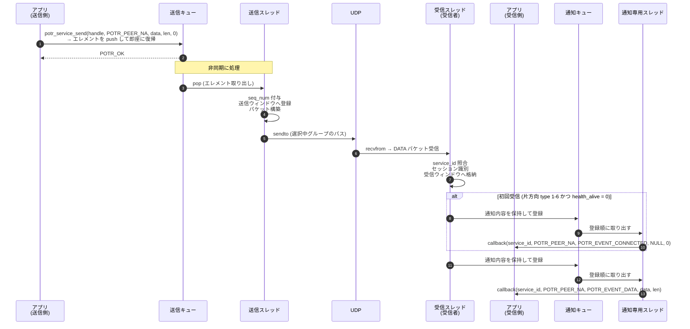

Figure: 正常送受信 (非ブロッキング)

## 正常送受信 (ブロッキング)

`POTR_SEND_BLOCKING` を指定して `potr_service_send()` を呼び出したときのデータフローです。  
送信完了まで `potr_service_send()` は復帰しません。

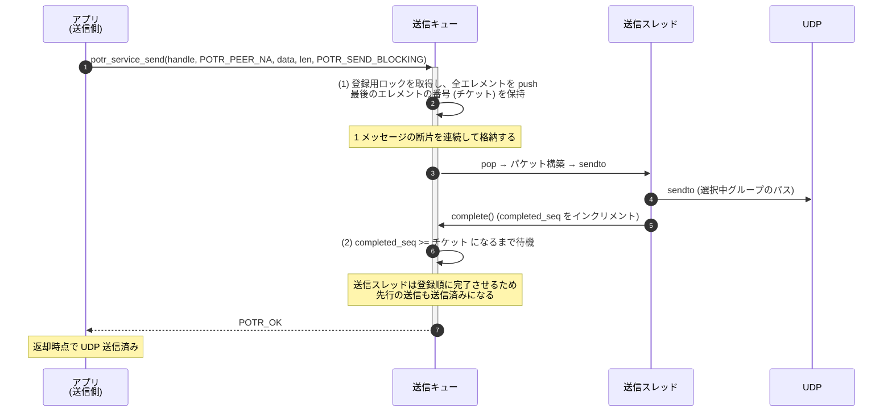

Figure: 正常送受信 (ブロッキング)

## フラグメント化と結合

送信データが `max_payload` を超える場合の分割・結合処理です。

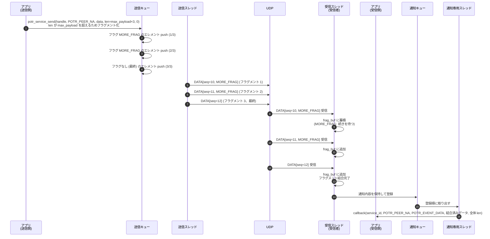

Figure: フラグメント化と結合 (3 フラグメントの例)

## NACK による再送

パケット ロスが発生した場合の再送シーケンスです。

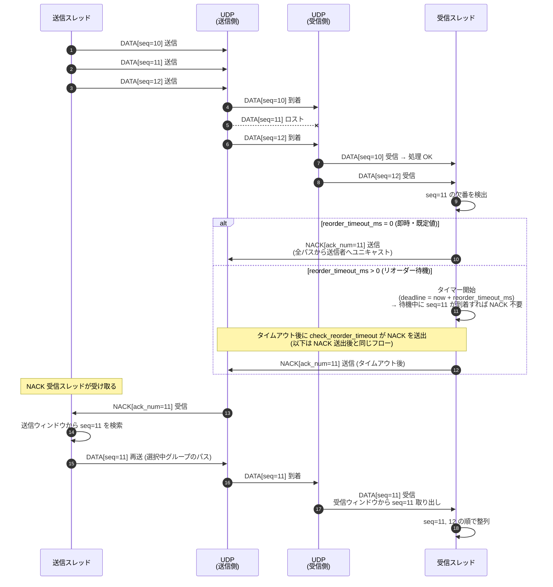

Figure: NACK による再送

## リオーダー バッファー (reorder_timeout_ms > 0) {#reorder-buffer}

`reorder_timeout_ms` を 0 より大きな値に設定すると、欠番検出後にただちに NACK や DISCONNECTED を発行せず、指定時間だけ待機します。待機中に欠落パケットが到着した場合は NACK/DISCONNECTED を発行せずに正常配信します。

### 通常モード: 待機中に到着した場合 (NACK なし)

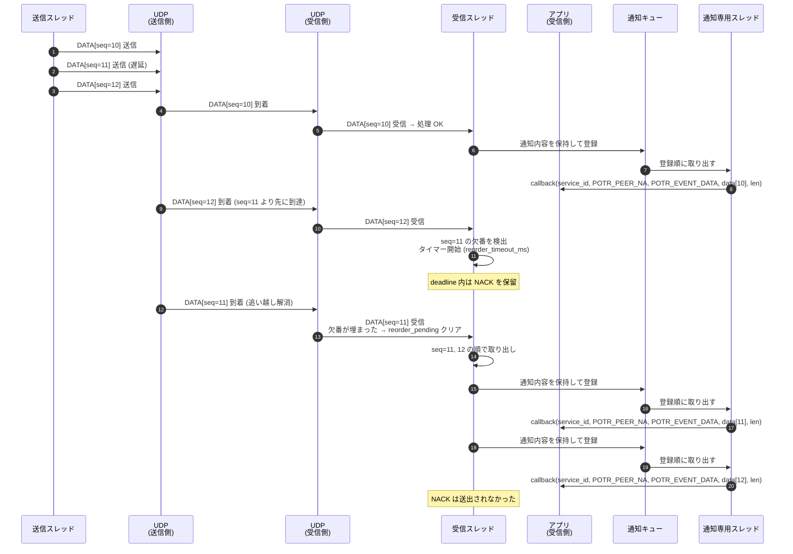

Figure: リオーダー - 通常モード: 待機中に到着した場合 (NACK なし)

### RAW モード: 待機中に到着した場合 (DISCONNECTED なし)

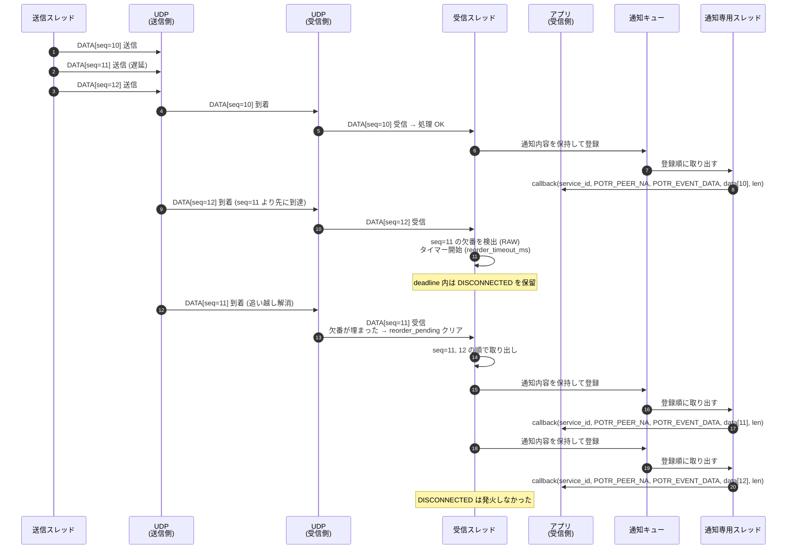

Figure: リオーダー - RAW モード: 待機中に届いた場合 (DISCONNECTED なし)

## REJECT による切断と復帰

送信ウィンドウから evict 済みのパケットを要求した場合のシーケンスです。

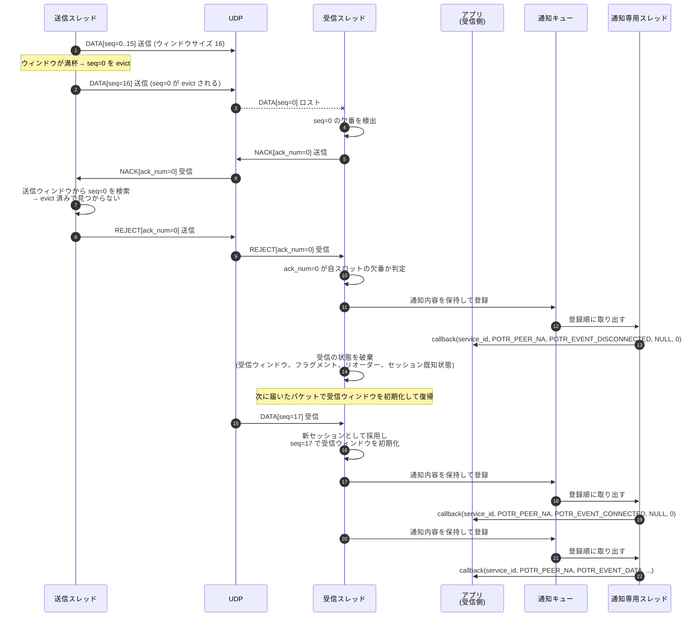

Figure: REJECT による切断と復帰

## RAW モード: ギャップ検出による切断と復帰 (DATA)

DATA パケットの追い越し (欠落) を検出した場合のシーケンスです。

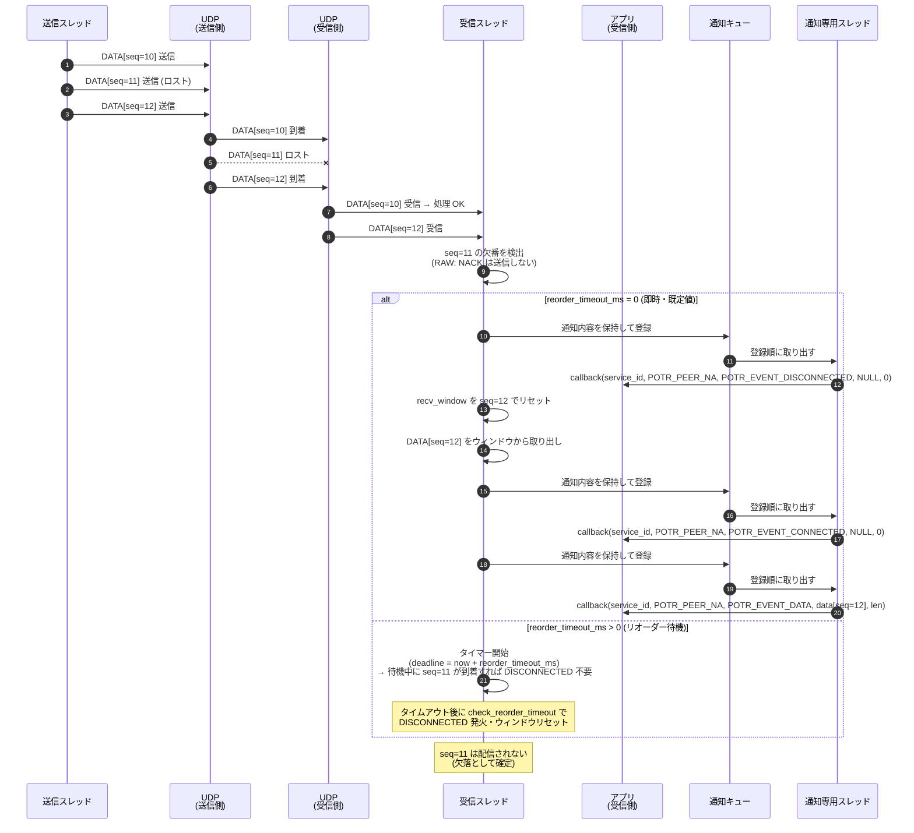

Figure: RAW モード - DATA ギャップ検出

## RAW モード: ギャップ検出による切断と復帰 (PING)

PING の `seq_num` から欠落パケットを検出した場合のシーケンスです。

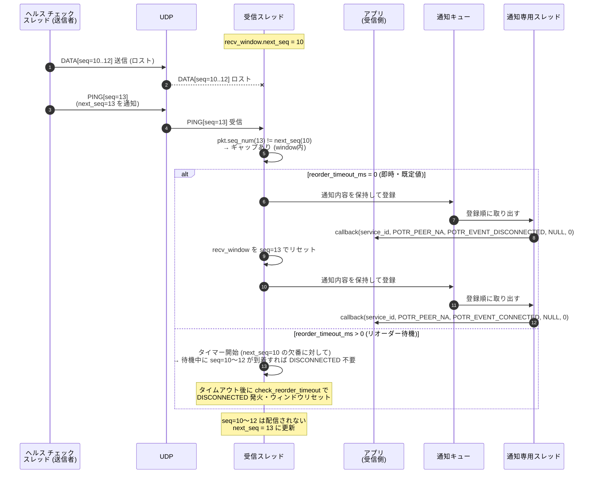

Figure: RAW モード - PING ギャップ検出

## フロー制御による抑制と解除

受信側の構成で `flow_control_capacity` を指定した場合の動作です。  
受信者は、すべてのフロー制御パケットに送出上限 (次に受信する通番 + 許可数) を載せ、送信者は送出上限に達したら自分で止まります。OS の受信バッファーに基づく送出上限を使う受信側では、許可数は、占有量による許可数と受信バッファーの幅の小さいほうです。  
`multicast` と `broadcast` の送信者は、「止める状態」(要求中、または送出上限に達している) の受信者の割合または台数が構成の条件を満たす場合に抑制します。`multicast` と `broadcast` で送出上限の最初の通知と更新を送るのは、監視対象の受信者だけです (後述の「multicast の監視対象の選択と入れ替わり」)。

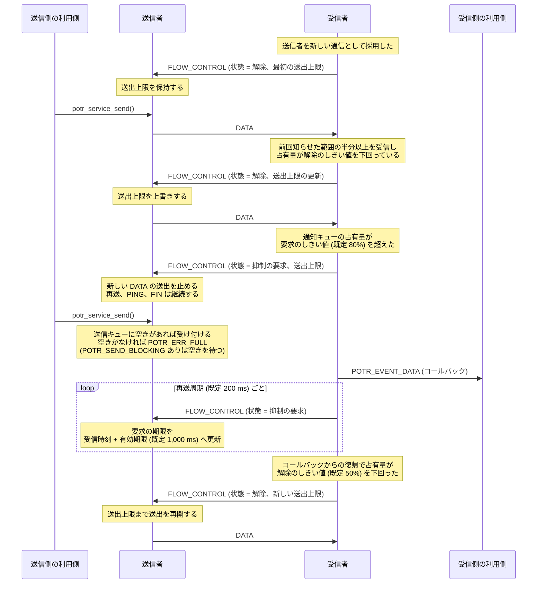

Figure: フロー制御による抑制と解除のシーケンス

解除が失われた場合と、抑制を要求した受信者が停止した場合は、要求の期限が過ぎた時点で送信者が送出を再開します。

送信者が送出上限まで送り終えたときの動作は、次のとおりです。

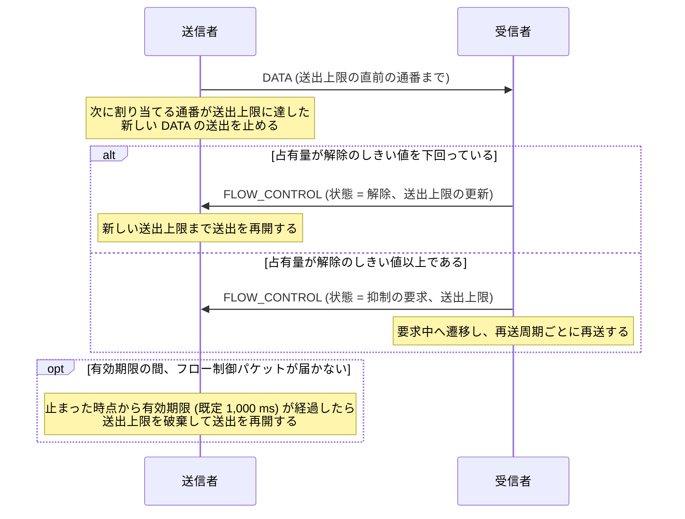

Figure: 送出上限まで送り終えたときのシーケンス

## 容量を設定していない受信側の送出上限の更新

受信側の構成で `flow_control_capacity` を指定していない場合も、`unicast`、`multicast`、`broadcast`、`unicast_bidir`、`unicast_bidir_n1` の受信側は、OS の受信バッファーに収まると見積もった DATA パケットの数 (受信バッファーの幅) を許可数として、送出上限を知らせます。  
受信側は抑制の要求を送らず、送出上限の最初の通知と更新だけを送ります。次の図は、OS の受信バッファーが既定の Linux (幅 42) の受信者の例です。

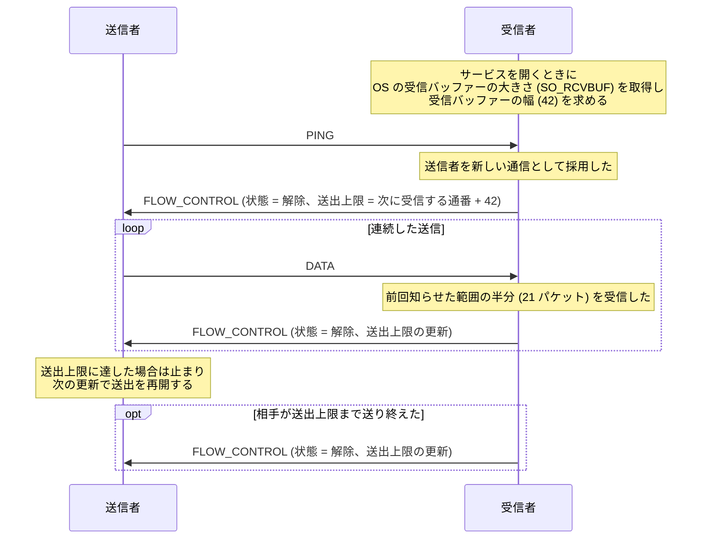

Figure: 容量を設定していない受信側が送出上限を更新するシーケンス

OS の受信バッファーの大きさを取得できなかった受信側と、`flow_control_receive_buffer_percent` に `-1` を指定した受信側は、容量を指定していなければフロー制御パケットを送出しません。

## multicast の監視対象の選択と入れ替わり

`multicast` と `broadcast` では、送出上限を知らせるのは、送信者が選んだ監視対象の受信者だけです。  
受信者は受信報告に自身の送出上限を載せ、送信者は受信者ごとの余裕 (送出上限 − 次に割り当てる通番) が小さいほうから監視対象を選びます。次の図は、1 対 N の台数の条件 (`flow_control_receiver_count`) が 1、監視する台数 (`flow_control_monitored_receiver_count`) が 1 の例です。

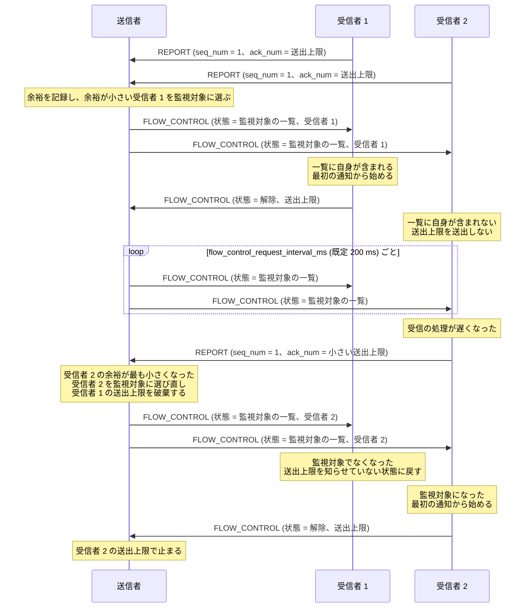

Figure: multicast で監視対象が選ばれ、入れ替わるシーケンス

- 監視対象でない受信者も、容量を設定していれば、占有量に基づく抑制の要求と解除を送ります。監視対象でない受信者から抑制の要求を受けた送信者は、その受信者の余裕を 0 として扱い、次の受信報告を待たずに監視対象の候補にします。
- 受信者は、一覧を `flow_control_request_lifetime_ms` (既定 1,000 ms) の間受け取らなかった場合、監視対象でなくなったものとして扱います。

## フロー制御の容量超過による切断と復帰

抑制の要求が送信者へ届くまでに届いた DATA によって、占有量が容量を超える場合の動作です。

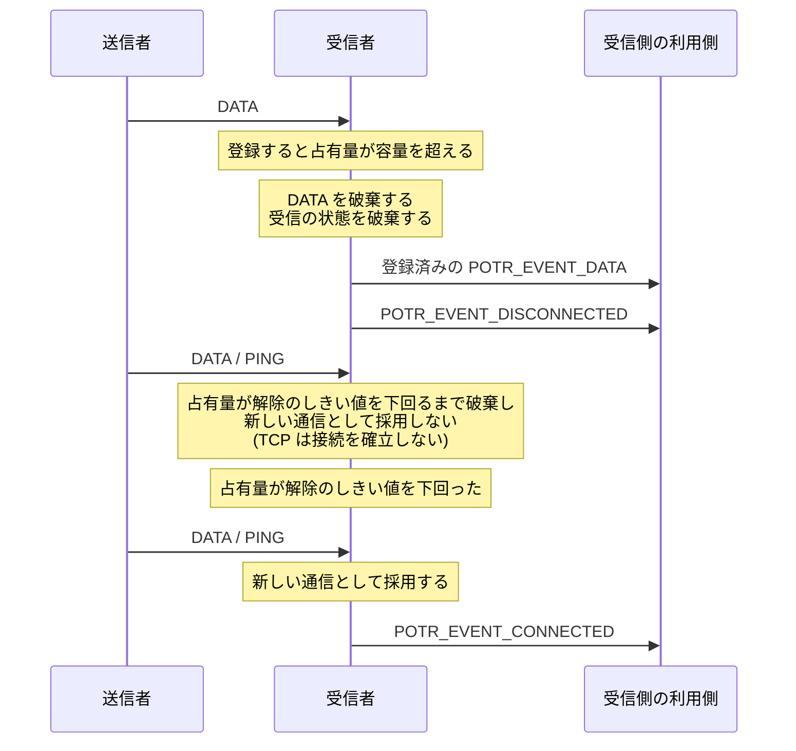

Figure: フロー制御の容量超過による切断と復帰のシーケンス

片方向 UDP の受信者は、採用しない間も抑制の要求の再送を続けます。

## close と登録済み通知

close は API の受付を停止して、受付済み操作と送信の完了を待ちます。  
通知の生成元が停止した後に通知キューを確定し、すべての登録済み通知を実行してから復帰します。  
close 中にコールバックが新たに送信を要求した場合は CANCELED で拒否します。

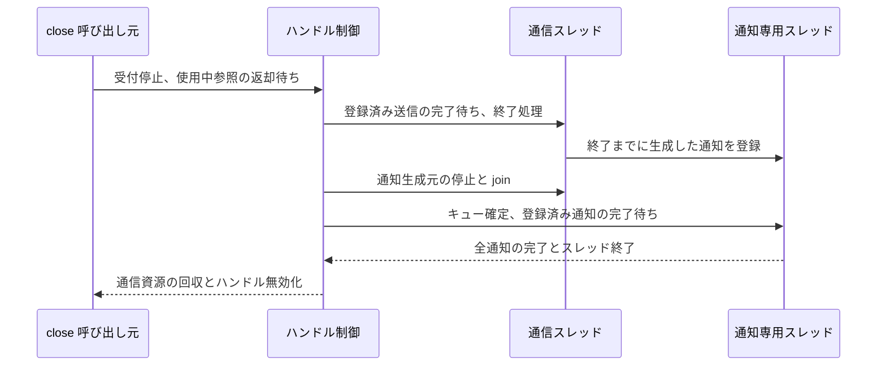

Figure: close 呼び出しと登録済み通知の処理シーケンス
