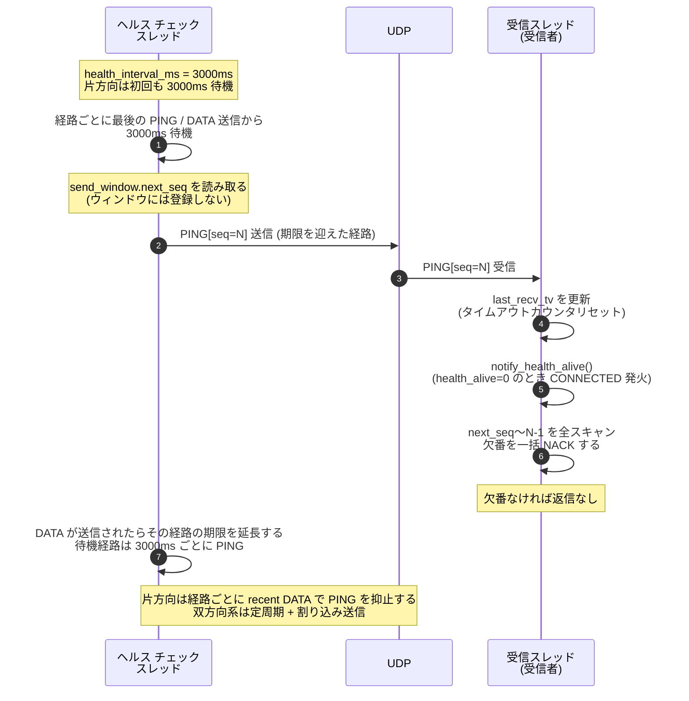
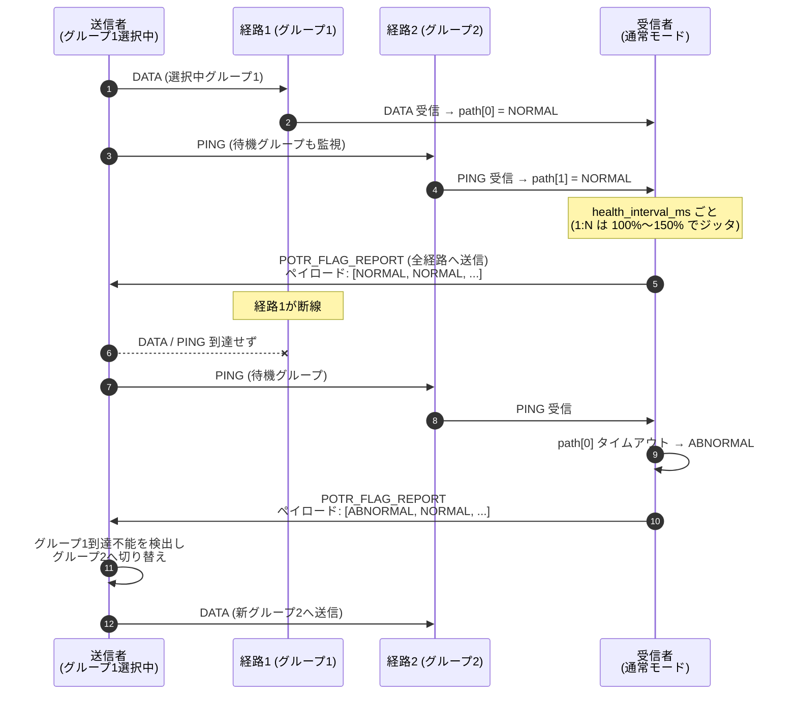
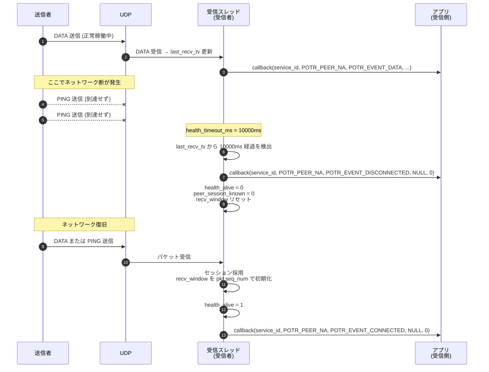

# UDP のヘルス チェックのシーケンス

[通信シーケンスの一覧](sequence.md) へ戻ります。

## 受信監視は既存の受信ループから呼ぶ

`thread_recv_health.c` は、UDP の受信タイムアウト監視と、TCP の受信状態変化に伴う PING 起床判断を担当します。  
`potr_recv_thread.c` の既存の受信ループから呼び、監視専用のスレッドは追加しません。  
N:1 では `peers_mutex` を保持してパス状態を同期し、期限に達したピアを切断・解放します。  
必要な health 起床は、ロックを解放した後に行います。  
1:1 ではパスとサービスの期限を確認し、サービス切断時にセッション、FIN と受信ウィンドウを初期化します。

TCP の受信状態が変化した場合は、定周期 health が稼働していれば全パスの health を起床し、それ以外は即時 PING を送信します。  
この判断も、状態を更新した受信スレッドから呼びます。

## ヘルス チェック (正常疎通)

ヘルス チェックが有効な場合の PING 送信です。片方向 type 1-6 は open 直後の即時 PING を行わず、経路ごとに「最後の `PING` または有効 `DATA` 送信」から `health_interval_ms` 経過したときに PING を送信します (待機グループの経路にも DATA が流れない間に PING が送出されます)。双方向 UDP では定周期 PING と、`path_ping_state[]` 変化時の割り込み PING を送出します。双方向 UDP はこの PING 往復で `CONNECTED` するため、実効 `health_interval_ms = 0` のままでは接続確立しません。

Figure: ヘルス チェック (正常疎通)

## 受信報告による片方向の経路把握

通常モードの片方向・一対多 (`unicast`、`multicast`、`broadcast`) では、受信者が全経路から送信者へ受信報告 (`POTR_FLAG_REPORT`) を送り、送信者が優先グループの到達判定を行います。

Figure: 受信報告による片方向の経路把握と切り替え

## ヘルス チェック タイムアウト

片方向 type 1-6 で、最後の有効な `PING` / `DATA` から一定時間パケットが到着しなくなった場合の切断検知と復帰です。

Figure: ヘルス チェック タイムアウト
