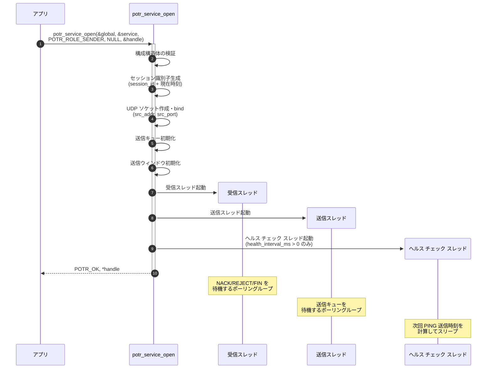
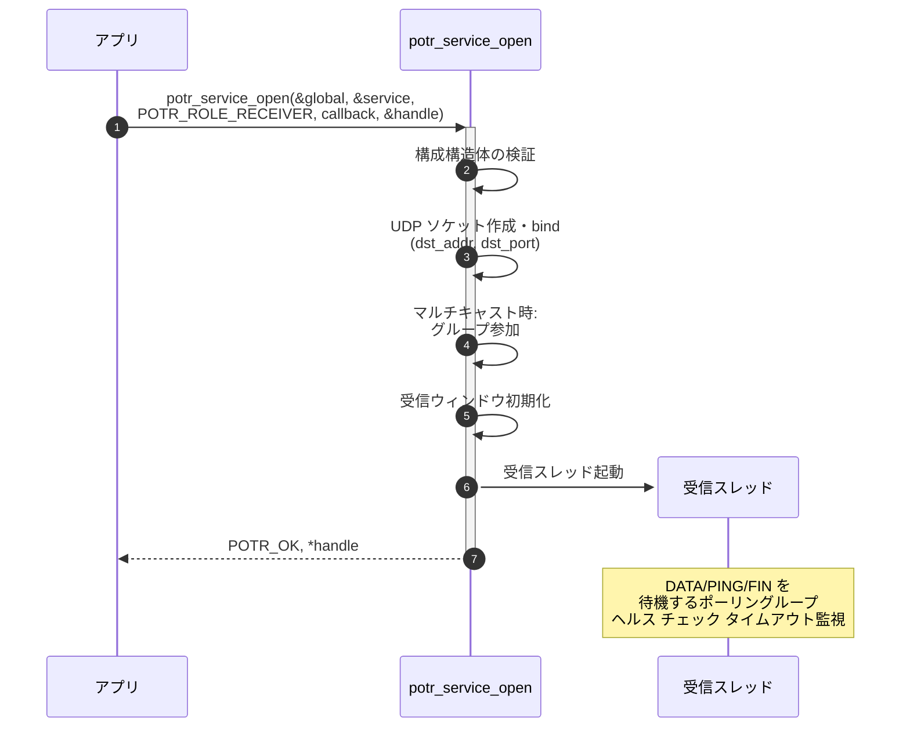
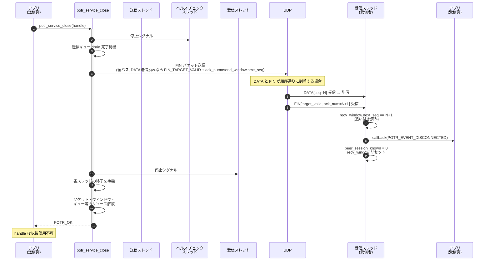
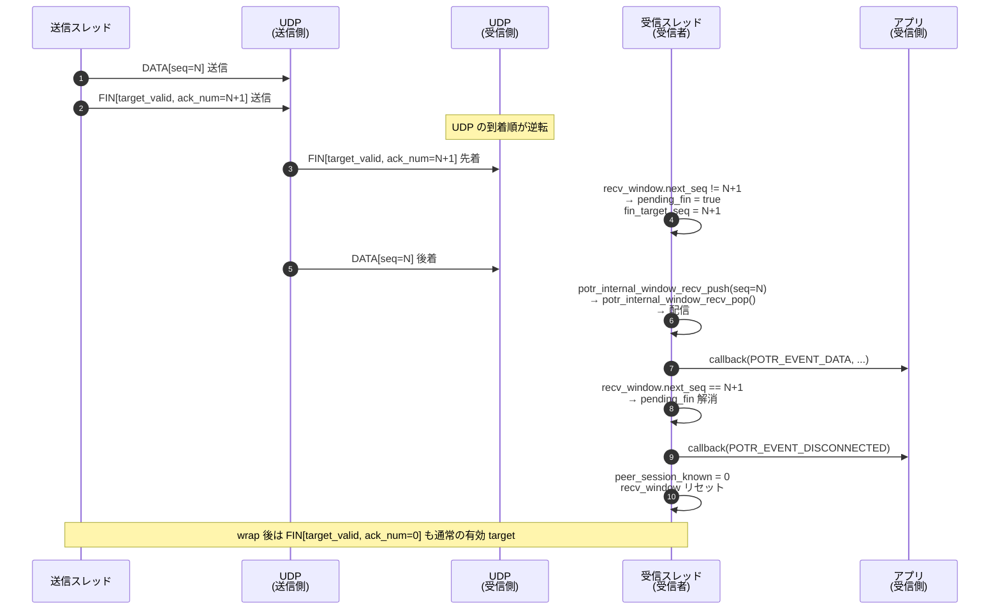
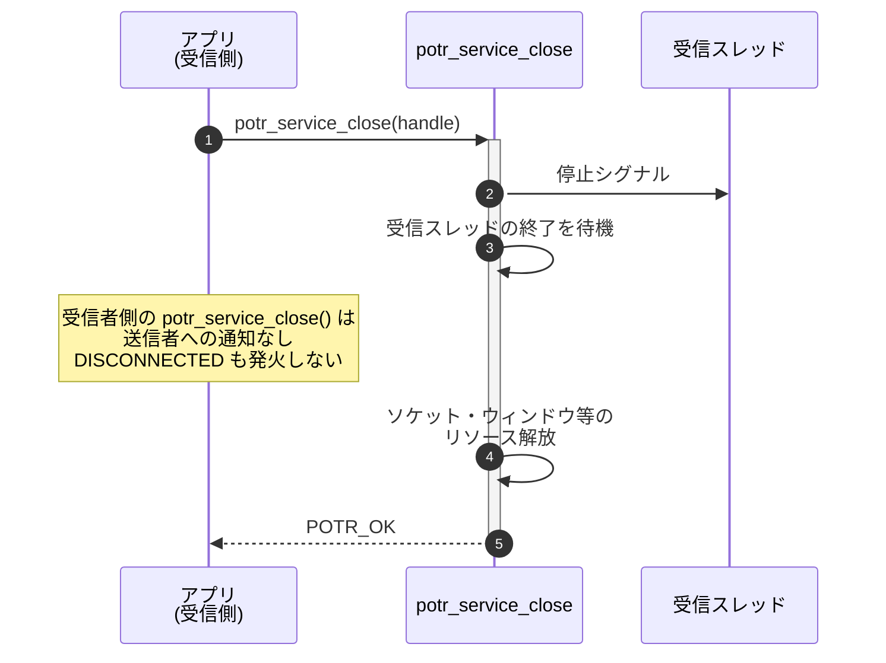
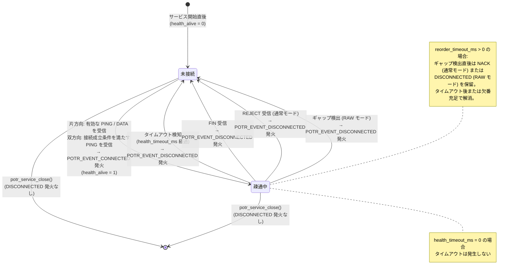

# サービスの開始と終了のシーケンス

[通信シーケンスの一覧](sequence.md) へ戻ります。

## サービス開始 (送信者)

`potr_service_open()` を SENDER として呼び出したときの内部処理です。

CodeBlock: サービス開始 (送信者)

## サービス開始 (受信者)

`potr_service_open()` を RECEIVER として呼び出したときの内部処理です。

CodeBlock: サービス開始 (受信者)

## サービス終了 (potr_service_close)

`potr_service_close()` による正常終了シーケンスです。

### 送信者側の終了 (DATA/FIN が順序通りに到着する場合)

CodeBlock: 正常終了 (送信者側)

### 送信者側の終了 (FIN が DATA より先に到着する場合)

UDP の到達順序は保証されないため、FIN が最後の DATA より先に受信側へ到着する場合があります。  
受信側は `FIN.ack_num` を参照して DATA の到着を待機します。

CodeBlock: 正常終了 (FIN が DATA より先に到着する場合)

### 受信者側の終了

CodeBlock: 正常終了 (受信者側)

## 補足: 接続状態の遷移

CodeBlock: 接続状態遷移 (受信者側 health_alive フラグ)

## 開始失敗の巻き戻しと停止後の共通解放

通常終了では、FIN 送信、FIN_ACK 待機、送信キュー排出と各スレッドの停止を通信方式ごとの手順で実施します。  
使用する全スレッドの終了待ちを完了してから、コンテキストの共通資源を解放します。  
共通解放処理は通信の終了手順を引き受けません。

開始失敗では FIN 送信や FIN_ACK 待機を行わず、生成に成功した資源だけを巻き戻します。  
各初期化処理は、失敗して戻る前に自身が生成済みの資源を回収します。  
起動済みスレッドがある場合は、そのスレッドの終了待ちを完了してから共有するキュー、同期資源とバッファーを解放します。

TCP の複数パス起動で途中のスレッド生成が失敗した場合は、起動成功分に停止を要求し、条件変数の起床とソケットの shutdown により待機を解除します。  
生成済みの接続管理スレッドと、それらが管理する受信・ヘルス監視・共有送信スレッドの終了待ち後に、受信者用の先読みバッファーとセッション確立ロックを回収します。  
最初のスレッド生成に失敗した場合やスレッド起動前の準備失敗でも、生成済みの受信者用準備資源を回収します。  
稼働フラグが 0 であることだけを理由に、生成済みハンドルの終了待ちや準備資源の回収を省略しません。
