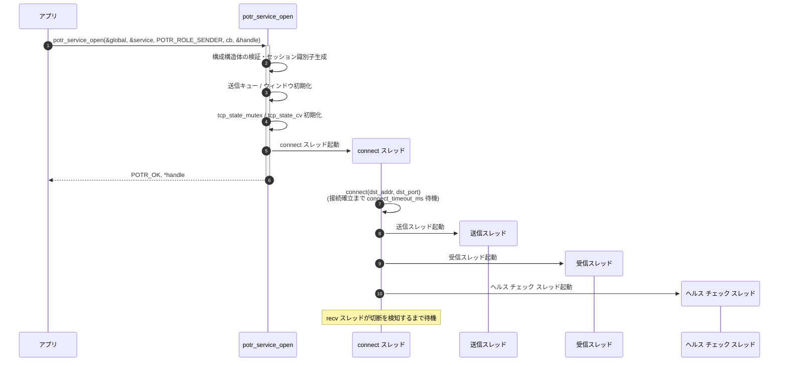
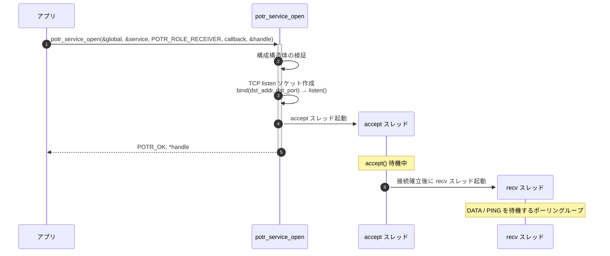
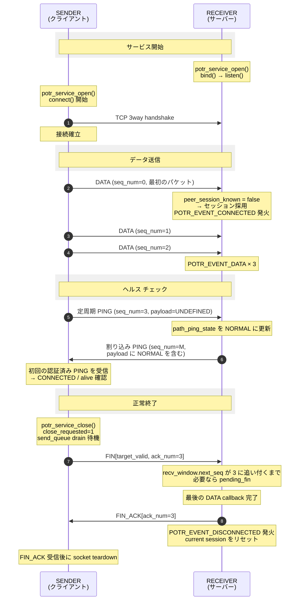
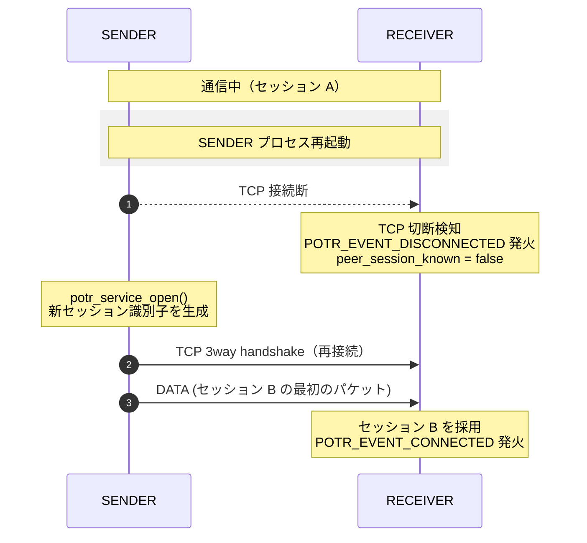
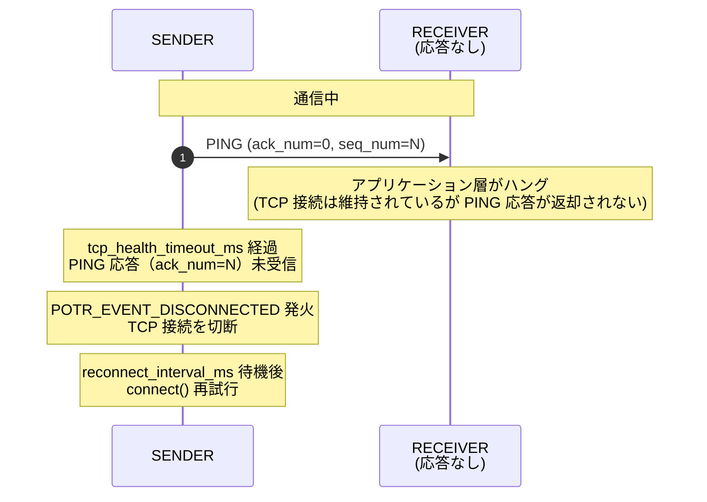
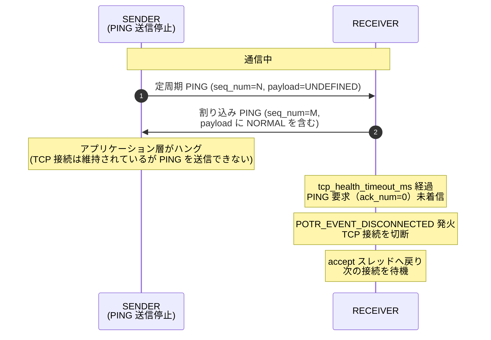
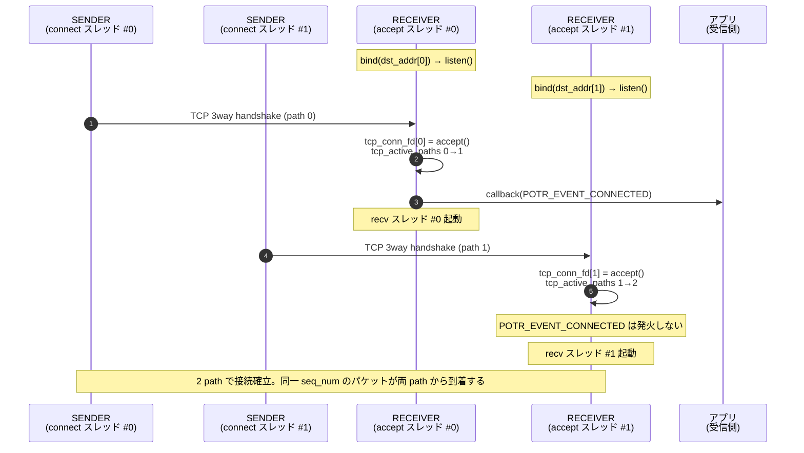
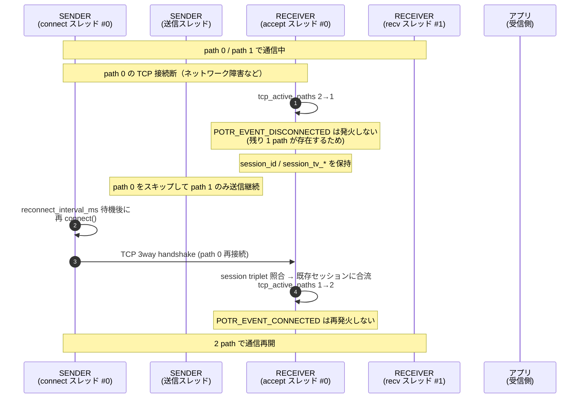
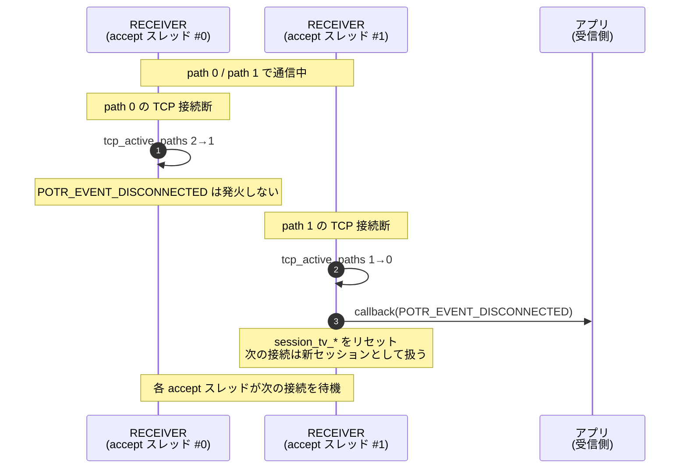

# TCP 通信のシーケンス

[通信シーケンスの一覧](sequence.md) へ戻ります。

## 接続管理と接続成立前処理の境界

`thread_connect_prepare.c` は、TCP の接続待機、最初のパケットの読み取り、接続元の照合とセッションの比較を担当します。  
受信側の管理ループは、先読みと既存のパケット解析の後に `session_establish_mutex`、`tcp_recv_mutex` の順でロックを取得します。  
サービス ID と認証を検査してからセッションを比較し、比較処理では共有状態を変更しません。

`potr_connect_thread.c` は、採用する接続ソケットを共有状態へ登録し、通知と接続後のスレッド管理を担当します。  
接続ヘルパーが生成した新規ソケットは、接続失敗時にはヘルパーが閉じ、成功時には呼び出し元へ所有権を渡します。  
accept 後にフィルター・先読み・解析・認証などで拒否した接続は、管理ループが閉じます。

## TCP サービス開始 (SENDER)

`potr_service_open()` を TCP SENDER として呼び出したときの内部処理です。  
`potr_service_open()` は即座に復帰し、接続確立は connect スレッドが非同期に行います。

Figure: TCP サービス開始 (SENDER)

## TCP サービス開始 (RECEIVER)

`potr_service_open()` を TCP RECEIVER として呼び出したときの内部処理です。

Figure: TCP サービス開始 (RECEIVER)

## TCP 正常接続・通信・切断

TCP SENDER / RECEIVER 間の正常な接続確立・データ送信・切断シーケンスです。

Figure: TCP 正常シーケンス

## TCP SENDER 再起動・自動再接続

SENDER プロセスが再起動した場合に自動再接続が行われるシーケンスです。

Figure: TCP SENDER 再起動・自動再接続

## TCP PING 応答タイムアウト

RECEIVER のアプリケーション層がハングした場合に SENDER が切断を検知するシーケンスです。  
TCP 接続は OS レベルで生存していてもアプリ層の PING 応答が途絶えることで検知します。

Figure: TCP PING 応答タイムアウト

## TCP RECEIVER 側 PING タイムアウト

SENDER のアプリケーション層がハングして PING 送信が停止した場合に RECEIVER が切断を検知するシーケンスです。  
TCP 接続は OS レベルで生存していても、PING 要求が到着しなくなることで RECEIVER が検知します。

Figure: TCP RECEIVER 側 PING タイムアウト

## TCP マルチパス

### TCP マルチパス接続確立

path 数 = 2 の例。RECEIVER が 2 つの listen ソケットを用意し、SENDER が各 path に接続します。  
最初の 1 本が接続した時点で `POTR_EVENT_CONNECTED` が発火します。

Figure: TCP マルチパス接続確立 (path 数 = 2)

### 部分切断時の継続

1 本の path が切断しても残りの path で通信を継続します。  
`POTR_EVENT_DISCONNECTED` は発火しません。

Figure: TCP 部分切断時の継続 (path 0 切断)

### 全 path 切断

全 path が切断した時点で `POTR_EVENT_DISCONNECTED` が発火します。

Figure: TCP 全 path 切断
